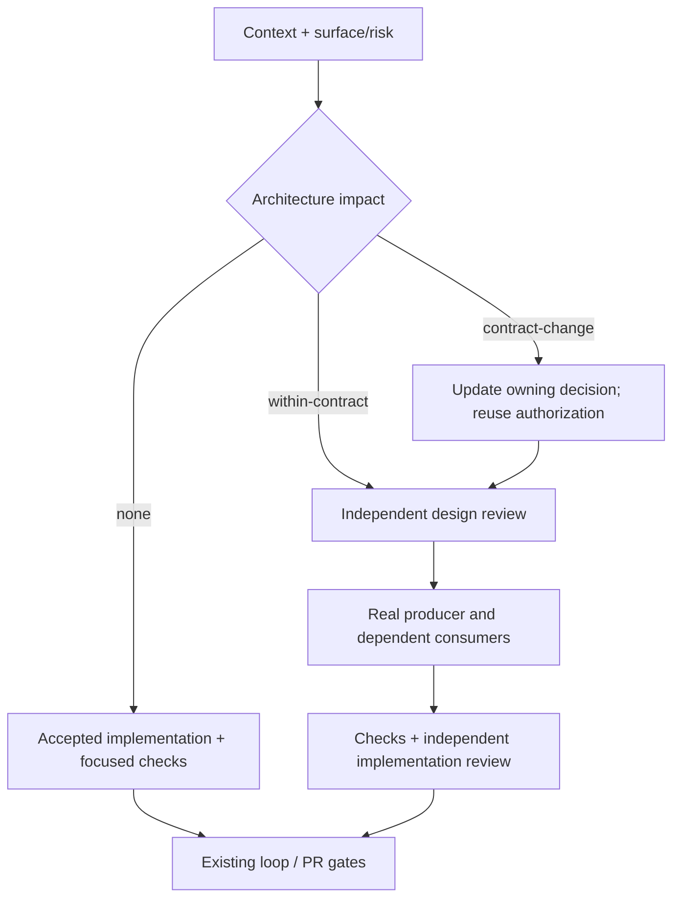

# Architecture Review

Change surface: shell. This policy owns architecture admission in the existing
delivery loop. It adds no registry, session, CI lane, external skill dependency,
or automatic CodeRabbit review.

The substantive acceptance baseline is the
[TA3000 Architecture Standard](docs/architecture/product-plane/architecture-standard.md):
accepted principles, module boundaries, constraints and criterion evidence.
This document owns the review procedure; the standard's linked owners retain
exact module/API/schema meaning and current implementation status.

## Classify before implementation

Record architectural impact alongside surface and semantic risk, using the
existing task/Issue/PR discussion:

| Impact | Meaning | Required review |
| --- | --- | --- |
| `none` | Reuses a suitable accepted decision; no new ownership, boundary, state writer, runtime choice, or material cost tradeoff | Short reason and focused checks; no new specification or independent architecture review |
| `within-contract` | Makes a new architectural choice inside accepted contracts | Independent design and implementation review |
| `contract-change` | Changes an accepted boundary, contract, ownership, lifecycle, or consequential runtime decision | Update the owning decision/specification; reuse existing authorization; independent design and implementation review |

Classify meaning, not diff size or directory. SQL, internal calls, schemas,
shared state and material performance choices can trigger review without a docs
change. Docs-only decisions can also trigger review. A bugfix reusing a suitable
decision still needs its regression proof, but not a new architecture spec.

Inspect the affected baseline: actual producer, schema authority, writers,
consumers, accepted explanation, reuse alternatives and ordinary operation cost.
Distinguish missing prose, demonstrated drift, unsuitable decisions and
unrelated debt. Correct applicable violations within authorized scope; revise
the owning decision when its accepted boundary must change. Do not expand the
task to unrelated debt. Two recurring failures require diagnosis, not a
presumption that duplicate ownership caused them.



## Sources and ownership

- Human explanations: current repository hot docs and owning architecture docs.
- Exact contracts: code/schema owners, versioned fixtures and contract tests.
- Work scope and authorization: the user's request and existing Issue/PR.
- Historical memory, graphs and DFDs: navigation; verify current claims at owners.
- Runtime claims: current scoped readback. Engineering storage inspection is
  allowed; it does not grant UI consumers direct storage access.

Start with context routing and bounded source inspection. Graphs and external
tools are optional expansions with a stated uncertainty and stopping point.
Keep product rules in product-plane owners. In dataflow reviews, select relevant
keys, timezone, versions, idempotency, writer ownership, compatibility and
lineage checks. Reuse existing DFDs and native runtime ownership. Do not invent
tenants, RBAC, queues, RAG, test quotas or telemetry requirements.

## Independent checkpoints

For triggered decisions, the author delegates review to an independent reviewer
or subagent, supplying scope, accepted sources, decision, implementation and
evidence without a requested verdict. Self-review is preparation, not independent
acceptance. No available reviewer means BLOCKED for dependent work only.

1. Design: review the decision before dependent implementation. PASS does not
   grant missing human authorization. Reuse authorization already given for the
   same scope. A producer artifact not yet built is planned proof at this phase.
2. Build the real producer example after design admission and before changing
   dependent consumers in parallel. Use one schema authority. Preserve schema,
   fixture and tests together where the product contract policy requires it.
3. Implementation: independently inspect actual changes, callers, state writers,
   removed routes and focused evidence. A contract change requires a real
   producer-to-consumer proof; handwritten fixtures alone are insufficient.
4. Reconcile the owning explanation. Re-review changed portions; reuse unaffected
   evidence. Keep staged scope explicit; architectural PASS proves neither
   deployment nor a separate product journey.

Every confirmed applicable violation blocks PASS until closure, irrespective of
severity. Record advice and unrelated debt separately. Intentional exceptions
need the decision owner's existing or explicit authorization, bounded scope and
expiry/removal conditions. Missing evidence is BLOCKED, not an invented defect.

## Review format

Use exactly one fenced `architecture-review` JSON block in the existing task/PR
body. Local `--architecture-review-source` is a temporary UTF-8 export of that
body, not a second status store. Alternatively set
`AI_SHELL_ARCHITECTURE_REVIEW_SOURCE` for nested/local gate invocations. Hosted
PR checks consume `GITHUB_EVENT_PATH` directly. Never execute body contents.

Ordinary implementation needs only:

````text
```architecture-review
{
  "impact": "none",
  "author": "author identity",
  "reason": "Named accepted decision reused; explain why no architectural choice changes",
  "scope_digest": "sha256 from the validator's --print-binding output"
}
```
````

Triggered reviews additionally require a `decision` object with nonempty
`owner`, `accepted_contract`, `change`, `reuse`, `cost`, `compatibility`, and
`validation` strings. Include alternatives, migration/removal/rollback and
affected state/consumers in those fields where relevant. The validator prints
its canonical `decision_digest`; the independent design record binds to it.

Triggered decisions also contain `decision.standard` with `path` equal to
`docs/architecture/product-plane/architecture-standard.md` and `digest` equal to
its current normalized UTF-8 content hash. `--print-binding` emits this pin and
the criterion IDs read from that same document; there is no separate registry.

Both `design` and `implementation` records contain:

- `reviewer`: actual independent reviewer identity, different from `author`;
- `verdict`: `PASS`, `CHANGES_REQUIRED`, or `BLOCKED`;
- `evidence`: nonempty list of scoped source/check/readback references;
- `findings`: list of objects with `id`, `status` (`open` or `closed`), and
  `evidence`; a closed finding names its closure evidence.
- `criteria`: assess every standard ID exactly once. Use `status: satisfied`
  with nonempty `evidence`, `status: not-applicable` with a concrete scope
  `reason`, or `status: gap`. Unknown/duplicate/missing IDs and gaps block PASS.

Design criterion evidence explains how the decision meets the invariant and
names planned proof. Implementation criterion evidence names actual scoped
artifacts/checks/readback. Do not demand a future producer artifact at design
admission, or relabel planned proof as completed implementation evidence.

Both `design.decision_digest` and `implementation.decision_digest` bind the
reviewed decision. The top-level `scope_digest` is the implementation reviewer's
attestation of the reviewed file scope, not merely author metadata. For `contract-change`, add
`implementation.producer_proof` with `kind: real`, `producer`, `consumer`, and
`evidence`. These name the actual run/output and consumer readback, not a claim
that a fixture exists.

The binding includes resolved base/head identity, complete selected file scope
and Git-normalized content/deletions. Immutable `--base-ref/--head-ref` checks
read the head tree; local checks read the working tree. Refresh implementation
review when any selected content, scope or head changes. Do not put the block
inside a selected source file: its own digest would be circular.
Resolve requested Git refs and fail closed on collection errors before treating
an empty file scope as exempt. An invalid ref is not an empty change.
The standard pin is validated even when the standard is outside selected scope.
Immutable checks read it from the reviewed PR head; local checks read working
content. A missing/empty/ambiguous standard or changed pin blocks triggered
reviews. Existing triggered receipts need refreshed standard assessments and
decision bindings; this reuses existing authorization for the same scope.
The ordinary `none` declaration needs no standard pin or criterion packet.

## Gate behavior

- Before dependent implementation, run the validator with `--phase design` and
  the existing decision body. It requires classification and design PASS for
  triggered work, but no implementation evidence.
- Loop gate validates a supplied design record. Without a source it reports
  classification pending and runs ordinary diagnostics; that is not design
  admission or architecture acceptance.
- PR gate requires classification for every nonempty scope, including docs-only
  changes. `none` stays a short route. Triggered work requires both PASS records,
  no open findings, fresh scope binding, and applicable real producer proof.
- Existing required `pr-lane` owns enforcement. PR body edits rerun the lane.
  No additional required GitHub status is introduced.
- Hosted nightly on `main` may reuse the same checks as post-merge hygiene
  without re-admitting a merged PR: `GITHUB_ACTIONS=true`, schedule/manual event, valid base/head,
  checked-out HEAD equal to head and clean checkout are all required. No public
  PR skip flag exists. Local/dirty/explicit-path nightly retains full admission.
  Hygiene output and summary explicitly disclaim architecture admission.

The machine validates structure, freshness and declared closure. It cannot
authenticate a self-reported reviewer, judge architectural meaning, or establish
that claimed evidence really ran; independent review and existing CI permissions
remain responsible for those facts. A dishonest `none` declaration is a review
violation, not something file-name routing can reliably infer.

Commands use the same explicit scope as the gates:

```text
python scripts/validate_architecture_review.py --changed-files <paths> --architecture-review-source <body-export> --phase design
python scripts/validate_architecture_review.py --changed-files <paths> --architecture-review-source <body-export> --print-binding
python scripts/run_pr_gate.py --changed-files <paths> --architecture-review-source <body-export> --snapshot-mode changed-files --profile none
```

## Pilot and acceptance

Pilot: existing shell flow `task/PR Markdown -> validator -> loop -> PR gate`.
Use this policy change's independently reviewed decision and actual scoped
files as producer input. Confirm consumer acceptance, then mutate the exported
body or scoped content to prove rejection. Temporary exports/outputs stay under
`.tmp/`; findings and final outcome belong in the owning chat/PR.

Required regression cases: ordinary `none` without full review; code-only
contract change; missing classification; changed decision; stale content/head;
self-review; open findings; synthetic producer proof; malformed body; explicit
scope and source propagation through nested gates. An isolated Git integration
test exercises real commits as producer input, rather than pretending that its
fixtures establish product-plane runtime readiness.
