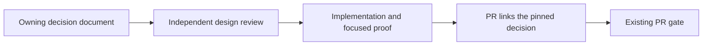

# ADR 0003: Durable architecture decisions

Date: 2026-10-25. Change surface: shell.
Decision status: accepted. Implementation status: implemented in this change;
release/deployment acceptance is separate.
Owner: Delivery Shell architecture admission.

## Context

The existing architecture review records a decision in the task/PR body and
binds independent reviews to that decision and the selected implementation.
The body can preserve the rationale while the repository contains only the
resulting API, schema or runbook. New work then has no reliable repository
reference for the choice, rejected alternatives and conditions for revisiting it.

## Decision

Before dependent implementation, save each new architectural choice in its
owning `docs/architecture/` document or in the existing ADR directory. Update
an existing decision when its boundary changes. No new registry or CI lane.
Architectural impact follows ownership, contracts, state, runtime and material
cost choices, rather than the number of changed lines.

Only `within-contract` and `contract-change` admissions require `decision.record` with the
repository-relative Markdown `path` and normalized UTF-8 SHA-256 `digest`.
For `none`, keep the short reason and focused checks, with no mandatory
document, pin, new ADR or independent architecture review.
For `within-contract` and `contract-change`, the record is the permanent
explanation of the reviewed choice. Its pin is part of `decision_digest`, so
changing the record invalidates both independent reviews.

Record durable ownership/source-of-truth, module/API boundaries, state writers,
publication/recovery lifecycle, compute/runtime ownership and material recurring
cost or reversibility choices. Ordinary fixes, timeout/path parameters,
mechanical refactors and implementation of an accepted choice belong in the
PR/tests/runbook. A payload field or a large change is not sufficient by itself;
classify its semantics. Existing owning prose is preferable to duplicate ADRs.

Validate the record even when it is outside the selected implementation scope.
Immutable PR admission reads the exact reviewed head tree, including the record;
local admission reads the worktree. Reject missing, empty, stale, non-Markdown,
external, traversing and symlink records. Normalize BOM and CRLF as for the
architecture standard. The gate checks existence and version; independent
review checks whether the text actually explains this choice.

`--print-binding --record-path <owning-document>` prints the record pin.
When a review body already names it, `--print-binding` resolves that path.
The body remains the review receipt; the repository document owns the durable
explanation. Never embed the admission receipt in its own pinned source.

## Alternatives

- PR body alone: preserves review evidence but leaves repository navigation and
  subsequent decisions dependent on reconstructing conversations.
- A new decision database or status registry: duplicates existing architecture
  ownership and contradicts the accepted lightweight delivery flow.
- One new ADR for every patch: adds noise to implementation of existing decisions.
- Infer architectural meaning from paths or diff size: misses consequential
  internal state/runtime choices and over-classifies mechanical edits.

## Consequences

New choices retain context, alternatives, rationale, consequences, migration and
rollback, decision status, implementation status and evidence links. Existing
owning documents can contain that explanation; a separate ADR is optional.
Decision acceptance, implementation evidence and deployment remain distinct.
The machine cannot determine truth or applicability from a content hash.

## Migration and rollback

Existing open triggered receipts add a current record pin and refresh their
decision digests and independent reviews. Ordinary `none` receipts remain valid.
Closed historical PRs
are not rewritten or re-admitted. Backfill recent admission/recovery decisions
from their original PRs, marking reconstruction date, sources and unknowns.
Do not infer deployment from a merged PR or fabricate missing rationale.

Rollback reverts this metadata requirement and its docs/tests through PR flow;
keep the recorded explanations. No product data or runtime migration is needed.

## Evidence

- User-approved scope: persist decisions, link implementations and enforce
  presence/version through the existing gate; backfill admission and recovery.
- Procedure: [Architecture Review](docs/agent/architecture-review.md).
- Consumer: `scripts/validate_architecture_review.py`, existing loop/PR gates.
- Proof locations: `tests/process/test_architecture_review.py` covers ordinary
  `none` without document reads, triggered missing/stale/outside-scope records,
  immutable-head readback, unsafe paths/Git symlinks/Windows junctions,
  BOM/CRLF normalization and actual Git producer to nested loop/PR gates.
- The PR body holds independent review and fresh test/gate receipts. This
  explanation does not assert product numerical or operational acceptance.
