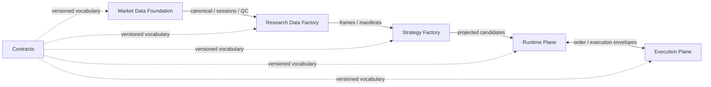

# Архитектурный стандарт TA3000

Change surface: mixed. Консолидация принятых владельцев main, 2026-10-22.
Процедуру приёмки задаёт [Architecture Review](docs/agent/architecture-review.md).
Стандарт не меняет продуктовые схемы, API или статус реализации.

## Источники и границы

| Вопрос | Авторитетный владелец |
| --- | --- |
| Продуктовая область и текущая готовность | [Current truth map](docs/project-map/current-truth-map-2026-05-05.md), [STATUS](docs/architecture/product-plane/STATUS.md) |
| Shell / product-plane | [Repository surfaces](docs/architecture/repository-surfaces.md), [AGENTS](AGENTS.md) |
| Владение решениями и публичные границы | [Module charters](docs/architecture/product-plane/product-plane-module-charters.md), [Public APIs](docs/architecture/product-plane/product-plane-module-apis.md) |
| Точные payload и совместимость | [Contract surfaces](docs/architecture/product-plane/CONTRACT_SURFACES.md), [Contract change policy](docs/architecture/product-plane/contract-change-policy.md) |
| Native вычисления и хранение | [Native runtime ownership](docs/architecture/product-plane/native-runtime-ownership.md) |
| Доставка и достаточность свидетельств | [Development workflow](docs/DEV_WORKFLOW.md), [Critical contours](docs/agent/critical-contours.md) |

Точные определения остаются у этих владельцев. Проверяют фактический producer,
схему, writer, consumer и scoped readback. Наблюдаемая реализация сама по себе не
узаконивает отклонение от принятого решения. При конфликте уточняют scope,
актуальность и полномочия; зависимую работу не продолжают до разрешения конфликта.

| Модуль | Владеет | Не присваивает |
| --- | --- | --- |
| Delivery shell | Процесс, маршрутизация, gates, проверка свидетельств | Торговую логику и продуктовые данные |
| Contracts | IDs, DTO, схемы, совместимость | Storage access, расчёт и runtime execution |
| Market Data Foundation | Источники, raw/canonical, сессии, roll truth, QC | Индикаторы, поиск стратегий, публикацию сигналов |
| Research Data Factory | Frames, continuous-front views, индикаторы, manifests | Raw/canonical truth, поиск стратегий, broker execution |
| Strategy Factory | Гипотезы, симуляцию, поиск, ranking, projected candidates | Материализацию рынка, runtime state, broker transport |
| Runtime Plane | Signal lifecycle, publication, durable state, operator API | Research internals и broker transport |
| Execution Plane | Order intents, transport, fills, reconciliation | Генерацию сигналов и research compute |
| Interfaces | Команды и представления через public APIs | Прямой доступ UI к private storage |

Это карта владения решениями, не распоряжение физически переименовать пакеты.
Стрелки обозначают обмен через публичные контракты, не private imports:

Текущие tolerated bridges остаются у owning migration decision и import inventory.
Новая работа не расширяет их молча. Report-only ограничение становится hard gate
после принятой миграции и соответствующего proof. Другие локальные предложения
и ещё не доставленные спецификации не становятся нормативными этим документом.

## Критерии решения

AS-* стабильны; заголовки ниже — единственный источник списка критериев для
валидатора. Применимость определяется фактической областью, а не размером diff.

### AS-01 — Продуктовая задача и разделение поверхностей

Объявить surface, пользователя/результат, владельца и non-goals. Соблюдать область
Current truth map и STATUS. Предметная логика остаётся в product-plane;
shell управляет доставкой. Не расширять продуктовый scope без авторизации.
Доказательство: owning decision, расположение кода/контрактов, сценарий результата.

### AS-02 — Глубокие модули и узкие публичные границы

Модуль скрывает собственные design decisions. Consumer зависит от контракта,
продукта данных, артефакта или команды; не от private storage/job/helper.
Нельзя сохранять старого writer и вводить конкурирующего владельца под фасадом.
Public API не требует обёртки вокруг каждой функции.
Доказательство: producer/callers/consumer, imports, writers и удалённые пути.

### AS-03 — Авторитетные данные и владение состоянием

Market/research/economics truth принадлежит Delta; durable runtime state —
своему PostgreSQL owner. Contracts не исполняет вычисления и не владеет storage.
Публикация выбирает принятый baseline; verification/staging не подменяют current.
Доказательство: схема/manifest, точные roots/versions, writers, publish semantics
и независимый scoped readback.

### AS-04 — Один исполняемый контракт и эволюция

Одна авторитетная схема границы; DTO, validators и adapters не переопределяют её
независимо. Payload change сопровождается schema + fixture + tests в одном patch
set по действующей compatibility policy. Не переиспользовать смысл старых полей.
Миграция, история и удаление прежних путей принадлежат owning decision.
Доказательство: version/compatibility, negative mutations и реальный producer
output, принятый consumer. Handwritten fixture не заменяет runtime roundtrip.

### AS-05 — Подходящий native owner

Spark владеет широкими transforms; Delta — durable analytical tables; Dagster —
повторяемыми jobs/assets/schedules; pandas-ta-classic — стандартными индикаторами;
vectorbt — симуляцией; Optuna — адаптивным поиском. DuckDB — локальным анализом.
Python координирует, адаптирует, валидирует и реализует обоснованные специфические
relationships. Fallback требует явного основания у Native Runtime Ownership.
Delta predicates/projection применяются до Python; row-list scans не становятся
активным research/backtest fallback.
Доказательство: native primitive, Python boundary, фактический run/readback.

### AS-06 — Причинность и воспроизводимость

Источники, время, версии, методики и quality status прослеживаются. Расчёт не
использует будущее; historical/batch не объявляются live inputs. Replay закрепляет
достаточные входы, включая историю/прогрев, где они нужны. Обновление storage не
переписывает старое свидетельство. Unknown/expired/unavailable сохраняют смысл.
Доказательство: lineage от результата к точным входам; версии/время; scoped replay.

### AS-07 — Lifecycle, идемпотентность и восстановление

Переходы и side effects принадлежат названному владельцу. Retry не создаёт
повторное действие/запись. Recurring data routes используют Dagster и согласованное
writer ownership. Ошибка, частичная запись, resume и rollback имеют явные условия.
Доказательство: реальные failure/retry cases, сохранение принятого состояния,
конфликт владельца и проверка повторного действия.

### AS-08 — Минимальная достаточность и стоимость

Сначала проверить подходящего существующего владельца и native primitive.
Новый сервис, реестр, writer, слой или материальный compute tradeoff требует
обоснования, альтернатив, совместимости и пути удаления/rollback. Не переносить
сложность потребителю под видом упрощения.
Доказательство: рассмотренные альтернативы и измерение значимого tradeoff.
При отсутствии принятого численного бюджета его не выдумывают.

### AS-09 — Доверие и разрешённые действия

UI использует public APIs. Внешний текст и модельный ответ — данные, не команды
и не авторизация. Advisory/paper/live сохраняют отдельные условия допуска;
historical/batch не заменяет подтверждённый broker live feed. Отсутствующие или
устаревшие обязательные live inputs блокируют live decision. Роли, tenancy и
security requirements берут из принятого контура, не из чужого шаблона.
Доказательство: actual caller/access path, rejected input и запрещённый side effect.

### AS-10 — Достаточный proof и честная готовность

Различать implemented, accepted target, staged, fallback и открытые вопросы.
Architecture PASS, fixture, healthcheck и green CI доказывают только свою область.
Merge и production promotion — отдельные действия; test и production staging
имеют отдельные roots. Квоты новых тестов нет; достаточно релевантного proof.
Доказательство: claim -> actual artifact/run/readback, ограничения и зависимости.
Target closure требует соответствующей contour-specific реальности.

## Привязка review

Для within-contract и contract-change поле decision.standard закрепляет этот path
и digest UTF-8 текста с CRLF -> LF. Оба независимых checkpoint оценивают каждый
AS-* ровно один раз: satisfied с evidence, not-applicable с конкретным scope
reason или gap. Gap, неизвестный/дублирующийся/пропущенный ID и пустая оценка
блокируют PASS. Отдельного реестра критериев нет.

Design evidence описывает соблюдение инварианта и достаточный planned proof;
будущий producer artifact до реализации не требуется. Implementation evidence
содержит фактические scoped artifacts/checks/readback. Staged scope не разрешает
нарушение применимого инварианта. Непройденная более широкая приёмка остаётся
явно за пределами заявленного результата.

При immutable base/head проверке стандарт читается из PR head tree, локально —
из working tree. Изменение стандарта требует обновлённого pin, критериев и decision
binding. Ordinary none сохраняет короткую декларацию принятого решения.
Машина проверяет структуру, полноту и freshness; смысл и достоверность evidence
проверяет независимый reviewer.
