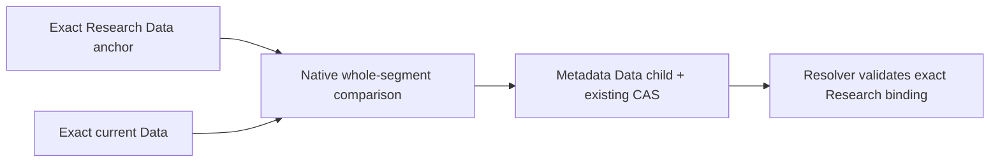

# Data scope recovery

Reconstructed: 2026-10-25. Owner: Data recovery publisher and Research scope resolver.

Change surface: product-plane. Decision status: accepted through
[PR #236](https://github.com/deusexrenovatio-arch/trading-advisor-3000/pull/236).
Implementation status: merged. This records the existing recovery authority;
it is not authorization to execute recovery or accept a production dataset.

## Context and reason

A successful new baseline may still contain an unproven native transition from
an earlier failed attempt. Its later narrow scope cannot certify the missing
history. Rewriting an old manifest would erase provenance; bypassing admission
or launching a full rebuild would exceed the known daily scope.
The chosen recovery proves the complete unknown segment explicitly, while
retaining the immutable history and existing Data/Research owners.

## Chosen proof

The Data owner audits the exact accepted Research Data anchor against exact
accepted current Data. Spark reads both pinned Delta versions and compares
complete changed physical partitions with symmetric `EXCEPT ALL`, preserving
duplicate multiplicity. Unpartitioned tables are compared in full.
Reader row counts must agree with native AddFile statistics.

The proof binds Data source/target and Research IDs/digests, native reference
hashes, table coverage, changed ranges and a retained historical prefix.
Old/new/deleted semantic effects determine time bounds; ingestion time cannot
substitute for effect time. Unknown features, changed table identity/schema,
unproven timestamps or incomplete coverage reject recovery.
An operator lower bound checks actual changes; it never truncates earlier ones.
Recovery without a retained prefix cannot silently become an all-domain rebuild.

The single `data_scope_recovery.v1` report is embedded in the existing Data
manifest downstream scope. Publication runs the native audit itself; an
externally supplied report cannot authorize the metadata change.

## Publication and concurrency

The bridge is a new immutable Data child whose tables equal the prior current
Data tables and whose parent is that Data snapshot. Existing manifests and
physical table contents are not rewritten by this operation.
The resolver may discharge only the proven segment to the exact Research anchor;
new normal scope-v2 children keep their ordinary producer proof requirements.

Publication uses the existing Data expected-current CAS, not a transaction
spanning both Data and Research registries. Research identity is checked before
and after Data CAS and again during admission. If Research changes concurrently,
an already-published bridge becomes unusable; it never grants a different scope.
The caller can therefore receive failure after Data advanced safely. Retry must
resolve the new accepted state rather than assume the old pointer survived.

This is metadata recovery, not a competing writer, registry or scheduler.
No fake baseline success, cursor rewind, blanket compatibility alias or implicit
full refresh is permitted. Current accepted Research remains protected by its
ordinary admission/publication checks.

## Consequences, alternatives and rollback

Comparing complete changed partitions costs native reads but avoids unreliable
file-name filtering and preserves Delta row semantics. This explicit audit is
not a new recurring full-table comparison on every daily run.
Unknown scope remains blocked when proof cannot be completed.

Rejected alternatives were trusting a later narrow child, rewriting old
manifests, bypassing guards and using a global rebuild as automatic repair.
Concrete engine compatibility transitions in the delivery are bounded migration
evidence, not general permission to change compute meaning.
Rollback retains immutable manifests and pins; code/release rollback does not
rewind physical tables or manufacture a valid bridge for changed accepted IDs.

### Catch up after a completed daily CF

An explicitly selected successful scheduled CF may be ahead of accepted Research.
In that case the four CF outputs start at the exact descriptors captured by that
producer. All other Research outputs still start at the accepted Research pins.
The Data owner checks the successful schedule and sensor ticks in the product
code location, both run IDs, CF step success, admission, numerical contract and QC.
Publication rechecks the checkpoint digest, accepted parents and native table pins.
A foreign write, replacement or unavailable pin stops the operation.

The owner compares both immutable Data anchors with the same current Data.
Both comparisons must produce the same nonempty dirty windows. The owner also
compares the old and checkpoint CF rows outside the admitted windows including
the seven-day halo. The November 17 consumer ignores the bar producer's
`created_at` and `input_row_count`. Other kernels compare every column.
Window-wide QC is renewed for admitted groups. Outside groups retain exact QC.
Ordinary subsequent baseline scopes apply to both stages. The bridge is metadata only.
The next publication uses the existing daily Dagster jobs, current Data, native
stage QC and Research CAS. The prior CF result is never relabeled.

## Sources, status and unknowns

- Contract: [recovery schema](src/trading_advisor_3000/product_plane/contracts/schemas/data_scope_recovery.v1.json).
- Owners: [Data recovery publisher](src/trading_advisor_3000/product_plane/data_plane/data_snapshots.py), [native comparison](src/trading_advisor_3000/spark_jobs/snapshot_diff_job.py), [bridge validator](src/trading_advisor_3000/product_plane/common/data_snapshots.py), [scope consumer](src/trading_advisor_3000/product_plane/research/refresh_scope.py).
- Proof locations: [contract tests](tests/product-plane/contracts/test_data_scope_recovery_contract.py), [native publication/resolver cases](tests/product-plane/integration/test_native_scope_recovery.py).
- Related decision: [Research admission](docs/architecture/product-plane/research-refresh-admission.md).
- Operational sequence and CLI: [snapshot publication runbook](docs/runbooks/app/data-research-snapshot-publication.md#explicit-scope-recovery).

Historical PR/native evidence and current code establish the implemented path.
They do not establish a fresh production recovery, worker-source binding,
physical tail/duplicate quality or successful next daily publication. Those
remain separate scoped evidence; no live readiness or speedup is asserted here.

## Restore a dropped renewed economics input

Decision selected 2026-11-01; implementation, deployment and operational acceptance
require their separate PR/native evidence. The Data owner restores only a missing
`prepared_raw_moex_contract_securities` reference after the known accepted
`PASS-NOOP` / `published_economics_covers_target` fallback. Future fallback reports
carry the native renewal's already validated prepared pin through normal publication.

Existing affected publications use explicit `restore-economics-inputs`, with exact
expected Data/Research IDs and the completed baseline report. Require the report's
Data ID/digest/run, accepted fallback and coverage binding, exact raw/prepared/OI
renewal references, and the prepared table's identity/path/schema/layout matching
the accepted Research Data anchor. Capture the producer's exact prepared version;
reject current native drift, another missing/added table, or changed accepted parents.
The operation defaults to read-only validation; `--publish` creates an immutable
metadata Data child with the original tables unchanged plus that one restored pin.
Retain original calculation provenance; record restoration evidence and current
runtime provenance separately. Existing expected-current CAS owns publication.

This child retains the unbounded downstream scope. It grants no daily compute
permission. Ordinary native `recover-scope` must then compare the complete restored
table set against the exact Research anchor before the usual metadata bridge and
SCOPED Dagster continuation. Research is checked before/after Data CAS; a race
leaves the published child blocked and requires reconciliation against accepted
current. Lost acknowledgement requires reading the child before another request.
Rollback keeps immutable manifests and pins; do not rewind pointers or tables.

Alternatives rejected: dropping the prepared dependency, weakening equal-table-set
or admission guards, rewriting the bad manifest, or rerunning baseline/full rebuild.
The additional metadata child and explicit full-segment audit are one-off recovery
costs; no new writer, registry, scheduler, numerical formula or table schema is added.

## Solution Intent

- Solution Class: target
- Critical Contour: data-integration-closure
- Forbidden Shortcuts: baseline rerun, full refresh, immutable manifest rewrite, guessed scope
- Closure Evidence: failing fallback regression; native restoration/CAS and full-segment recovery tests; production SCOPED CF, accepted Research and pinned readback
- Shortcut Waiver: none

Use the existing Data publisher and native audit. Restoration repairs the missing
input description; native comparison remains the sole authority for changed scope.

## Accepted inputs after an interrupted Data write

Decision status is admitted for isolated implementation review. The existing Data
recovery publisher owns this opt-in extension. The native daily CF and Research
owners retain execution and publication. Architecture impact is contract-change.

An explicit recover-scope audit may preserve accepted input versions while later
unaccepted native heads exist. Its optional input_read_consistency report section
binds each actually advanced input to the complete accepted descriptor hash and
the observed physical table ID and version. These observations fence concurrency.
The bridge retains the exact accepted target tables and parent. Native comparison
still audits the complete accepted segment, retained prefix, original QC and CF
checkpoint. The option is --accepted-input-pins and requires the owning native audit.

The verified reader families are canonical_session_intervals, raw_moex_history,
canonical_contract_parameters, raw_moex_contract_securities and
raw_moex_session_schedule. Active daily numerical reads in this set use the pinned
Spark or Delta/Arrow helpers. The inherited support inputs use pinned native audit.
Other inputs and every CF/Research output retain physical-head equality. Paths
must retain the declared family and cannot alias an output or a direct latest
CF source. Unsupported changed inputs reject the opt-in audit.

Every daily worker boundary derives the allowance from the exact current Data
bridge in its configured canonical registry and the bound accepted Research.
Resume, CF handoff, resolve=False validation and publication repeat this check.
An input must equal its accepted descriptor in full. The observed heads must
still have their original IDs and versions. A changed accepted parent, expired
pin, altered report or additional unregistered read stops execution. The guarded
branch uses the exact parent input list and capture_new_inputs=False. Rebuild and
later Data children obtain their own ordinary admission.

Research dataset provenance uses the selected source version and the historical
log fingerprint through that version. It reproduces the fingerprint taken before
an appended commit. This preserves the established hash recipe and numerical
contract while keeping the manifest consistent with its actual input rows.

The former unconditional head comparison rejects readable accepted versions after
an interrupted writer. Rewriting descriptors to current heads would discard the
selected accepted boundary. The opt-in receipt preserves that boundary and keeps
later writes outside it. It introduces no table writer, numerical fallback or
alternative scheduler. The additional cost is the existing one-off native audit
and small metadata validation at worker boundaries.

Promote the reviewed code to both drained workers before publishing a bridge
with this optional report. Older workers reject the new report field. A rollback
after bridge publication requires compatible forward repair or completion under
the admitted code. Immutable manifests, Delta versions and cursors retain their
original history.

Acceptance requires real isolated Delta versions with different session intervals
and one-minute raw bars, old rows with matching source metadata, repeated worker
validation, and rejection of foreign outputs, stale parents, missing pins and
tampered or unregistered inputs. The seven-component numerical digest must equal
the accepted Research digest. A published metadata bridge still requires explicit
dispatch through the existing daily Dagster job.
