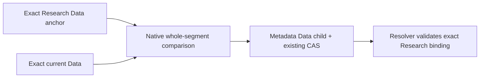

# Data scope recovery

Reconstructed: 2026-10-25. Owner: Data recovery publisher and Research scope resolver.

Change surface: product-plane. Decision status: accepted through
[PR #236](https://github.com/deusexrenovatio-arch/trading-advisor-3000/pull/236).
Implementation status: merged. This records the existing recovery authority;
it is not authorization to execute recovery or accept a production dataset.

## Context and reason

A successful new baseline may still contain an unproven native transition from
an earlier failed attempt. Its later narrow scope cannot certify the missing
history. Rewriting an old manifest would erase provenance; bypassing admission
or launching a full rebuild would exceed the known daily scope.
The chosen recovery proves the complete unknown segment explicitly, while
retaining the immutable history and existing Data/Research owners.

## Chosen proof

The Data owner audits the exact accepted Research Data anchor against exact
accepted current Data. Spark reads both pinned Delta versions and compares
complete changed physical partitions with symmetric `EXCEPT ALL`, preserving
duplicate multiplicity. Unpartitioned tables are compared in full.
Reader row counts must agree with native AddFile statistics.

The proof binds Data source/target and Research IDs/digests, native reference
hashes, table coverage, changed ranges and a retained historical prefix.
Old/new/deleted semantic effects determine time bounds; ingestion time cannot
substitute for effect time. Unknown features, changed table identity/schema,
unproven timestamps or incomplete coverage reject recovery.
An operator lower bound checks actual changes; it never truncates earlier ones.
Recovery without a retained prefix cannot silently become an all-domain rebuild.

The single `data_scope_recovery.v1` report is embedded in the existing Data
manifest downstream scope. Publication runs the native audit itself; an
externally supplied report cannot authorize the metadata change.

## Publication and concurrency

The bridge is a new immutable Data child whose tables equal the prior current
Data tables and whose parent is that Data snapshot. Existing manifests and
physical table contents are not rewritten by this operation.
The resolver may discharge only the proven segment to the exact Research anchor;
new normal scope-v2 children keep their ordinary producer proof requirements.

Publication uses the existing Data expected-current CAS, not a transaction
spanning both Data and Research registries. Research identity is checked before
and after Data CAS and again during admission. If Research changes concurrently,
an already-published bridge becomes unusable; it never grants a different scope.
The caller can therefore receive failure after Data advanced safely. Retry must
resolve the new accepted state rather than assume the old pointer survived.

This is metadata recovery, not a competing writer, registry or scheduler.
No fake baseline success, cursor rewind, blanket compatibility alias or implicit
full refresh is permitted. Current accepted Research remains protected by its
ordinary admission/publication checks.

## Consequences, alternatives and rollback

Comparing complete changed partitions costs native reads but avoids unreliable
file-name filtering and preserves Delta row semantics. This explicit audit is
not a new recurring full-table comparison on every daily run.
Unknown scope remains blocked when proof cannot be completed.

Rejected alternatives were trusting a later narrow child, rewriting old
manifests, bypassing guards and using a global rebuild as automatic repair.
Concrete engine compatibility transitions in the delivery are bounded migration
evidence, not general permission to change compute meaning.
Rollback retains immutable manifests and pins; code/release rollback does not
rewind physical tables or manufacture a valid bridge for changed accepted IDs.

## Sources, status and unknowns

- Contract: [recovery schema](src/trading_advisor_3000/product_plane/contracts/schemas/data_scope_recovery.v1.json).
- Owners: [Data recovery publisher](src/trading_advisor_3000/product_plane/data_plane/data_snapshots.py), [native comparison](src/trading_advisor_3000/spark_jobs/snapshot_diff_job.py), [bridge validator](src/trading_advisor_3000/product_plane/common/data_snapshots.py), [scope consumer](src/trading_advisor_3000/product_plane/research/refresh_scope.py).
- Proof locations: [contract tests](tests/product-plane/contracts/test_data_scope_recovery_contract.py), [native publication/resolver cases](tests/product-plane/integration/test_native_scope_recovery.py).
- Related decision: [Research admission](docs/architecture/product-plane/research-refresh-admission.md).
- Operational sequence and CLI: [snapshot publication runbook](docs/runbooks/app/data-research-snapshot-publication.md#explicit-scope-recovery).

Historical PR/native evidence and current code establish the implemented path.
They do not establish a fresh production recovery, worker-source binding,
physical tail/duplicate quality or successful next daily publication. Those
remain separate scoped evidence; no live readiness or speedup is asserted here.
