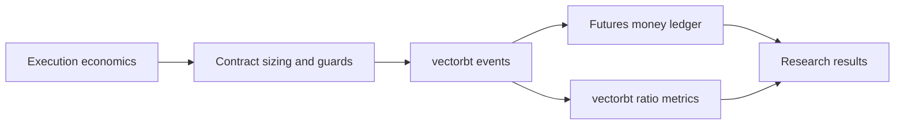

# Futures Backtest Money Authority

Date: 2026-10-25. Change surface: product-plane.
Owner: Research backtest engine and its versioned futures money adapter.

## Status and scope

This records the existing choice delivered by [PR #175](https://github.com/deusexrenovatio-arch/trading-advisor-3000/pull/175).
Implementation is present in main `78917b9efe5743332a94098c2906a8b9b7d995e2`.
This explanation establishes neither current worker/source binding nor fresh
numerical equivalence, production acceptance, paper trading or live readiness.

## Context and reason

A simulated price change does not by itself specify contract-denominated cash
PnL, margin or transaction costs. The Research execution input carries the
contract economics needed to interpret that change. PR #175 explicitly rejects
implicit fixed sizing, unsupported sizing modes, missing economics silently
filled with zero, and duplicate point-in-time keys reaching frame joins.

The implementation preserves vectorbt as the signal/order/trade event simulator
and adds a futures-specific sizing and money adapter around those events.

## Authority split

| Surface | Authority |
| --- | --- |
| Signal/order/trade event simulation | vectorbt `SignalFactory` and `Portfolio.from_signals` |
| Execution economics | `research_bar_views.execution_*` sourced from `canonical_contract_economics.delta` |
| Contract quantity and entry rejection | `prepare_money_surface`, stop distance and required money inputs |
| Gross/net cash PnL, commission and tick slippage | `futures_trade_ledger.v1` over vectorbt trade records |
| Return, profit factor, win rate, expectancy and drawdown aggregates | Futures ledger metrics selected by the backtest engine |
| Sharpe, Sortino and Calmar | Metrics retained from the vectorbt portfolio |

The result tables contain these different metric authorities. Their presence in
one table does not establish one shared equity basis for every metric.

## Current contracts and consequences

- Risk cash is `initial_cash * risk_per_trade_pct`; this is the implemented
  Research sizing basis, not a claim about changing live account equity.
- Quantity uses stop risk and the configured contract/margin caps. Required
  execution economics must be positive and finite; invalid money inputs reject
  the entry with a reason. Unsupported `sizing_mode` rejects configuration.
- Vectorbt receives the prepared contract amount with portfolio fees/slippage
  set to zero. Configured per-contract commission and tick slippage are applied
  by the money ledger when interpreting the resulting trade records.
- Ledger rows retain money-model/source versions, tick economics, quantity,
  costs, risk and margin evidence. `realized_trade_equity` is the code's named
  equity mode; its exact aggregation behavior remains owned by `money.py`.
- Signal price space and native execution price space retain distinct labels.
  Continuous-front analysis does not authorize substituting an adjusted signal
  quote for the contract execution economics.

## Compatibility and boundaries

The model identifier is `futures_trade_ledger.v1`; the source economics model
version is separate provenance. Changes to sizing, costs, equity semantics or
metric authority must be assessed as money-model/contract changes, preserving
their source and focused proof. Rollback follows the reviewed code and its
compatible persisted outputs; this document authorizes no data rewrite.

The general native-runtime rule still applies: custom code does not replace
vectorbt event simulation. This is its explicit futures-money adapter boundary.

## Open questions

The interpretation and ranking use of ledger aggregates together with retained
vectorbt ratios need an explicit common-basis validation. Their split alone is
not evidence of a numerical defect. Live equity, shared portfolio margin and
account-wide risk policy require their own accepted scope and evidence.

## Sources and verification locations

- [Money adapter](src/trading_advisor_3000/product_plane/research/backtests/money.py): economics, sizing, ledger and aggregate metrics.
- [Backtest engine](src/trading_advisor_3000/product_plane/research/backtests/engine.py): `prepare_money_surface`, `run_surface_portfolio`, ledger collection and retained portfolio ratios.
- [Input loader](src/trading_advisor_3000/product_plane/research/io/loaders.py): native projection and pre-join unique-key validation.
- [Money tests](tests/product-plane/unit/test_research_backtest_money.py): missing economics, risk/margin sizing and long/short pricing.
- [Engine semantics tests](tests/product-plane/unit/test_research_backtest_engine_semantics.py): `test_money_ledger_sizes_before_vectorbt_and_collects_ledger_pnl`.
- [Research platform](docs/architecture/product-plane/research-plane-platform.md) and [native ownership](docs/architecture/product-plane/native-runtime-ownership.md).

These are implementation and test locations, not a fresh test-run receipt.
