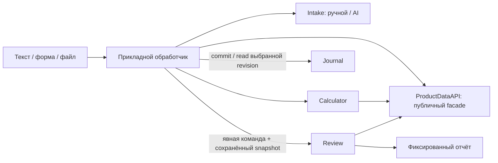

# Intake, Calculator, Journal и Review: границы и интерфейсы

Дата: 2026-09-30. Change surface: `product-plane`. Solution Intent: `target`.
Это полный архитектурный target; актуализация документа — 2026-11-04.
Часть manual Journal/Intake есть в отдельных локальных candidates; их наличие
не означает доставку в main, приёмку полного API или текущего runtime.
Source refs и ограничения закреплены в
[статусе реализации](docs/architecture/product-plane/trade-workspace/delivery-and-validation.md).
Имена операций, DTO и схем PostgreSQL ниже — предлагаемый контракт для реализации.

Этот документ — предметные charters в полном
[архитектурном пакете расширения](docs/architecture/product-plane/trade-workspace/README.md).
[Решение 2026-09-30](docs/architecture/product-plane/trade-workspace/decision.md)
фиксирует PostgreSQL, LM Studio за заменяемым LLM-адаптером и представление
происхождения «От числа к источнику». Детальные DTO/storage/frontend/AI contracts
и открытые решения находятся в специализированных документах пакета.

## Принятая структура

Три предметных модуля: Calculator, Journal, Review. Перед ними — общий входной
слой Intake. Один backend может размещать все компоненты. Прикладной обработчик
управляет последовательностью вызовов и статусом запроса; это не обязанность Journal.

Основной поток: Intake → Calculator → Journal. Review запускается по запросу
пользователя или внешнего workflow и работает с сохранённой версией сделки.
Заметки проходят Intake → Journal. Уже совершённые исполнения можно сохранить
при недоступном расчёте, явно указав его статус.

Стрелки показывают разрешённые вызовы прикладного обработчика. Он передаёт ввод
Intake в Calculator и затем пакет в Journal; заметки/факты проходят без расчёта.
Calculator не пишет в Journal; Journal не вызывает Review. Общий ProductDataAPI
скрывает публичные Market/Research readers и не становится владельцем их данных.

## Владение ответственностью

| Компонент | Владеет | Не владеет |
| --- | --- | --- |
| Intake | Исходный материал, распознавание намерения, нормализация, уточнения, происхождение извлечённых полей | Денежные расчёты, сохранение бизнес-фактов в обход Journal, выбор выгодного сценария |
| Calculator | Правила расчёта сценариев стопа, риска, количества и оценки ГО; сравнение вариантов | AI-интерпретация, ввод фактических исполнений, история Journal, подготовка базовых индикаторов |
| Journal | Сохранённые факты, гипотезы, планы, расчётные пакеты, ревизии и чтение истории | AI intake, финансовый калькулятор, чтение Delta, запуск других модулей |
| Review | Фиксированная методика технического разбора, пакет фактов, локальная AI-интерпретация, отчёты и их история | Перезапись сделки/плана, выбор сценария за пользователя, собственные альтернативные формулы риска и ГО |
| Прикладной обработчик | Порядок вызовов, запросы на расчёт/сохранение/ревью, статус всего процесса и повторы | Дублирование правил предметных модулей и прямые записи в их таблицы |

Journal не публикует TradeChanged; outbox, подписки и автоматический запуск
downstream-процессов исключены из первоначального объёма. Статус запроса
клиент читает через интерфейс приложения.

## Intake

| Операция | Вход | Выход |
| --- | --- | --- |
| submit | SourceSubmission: материал, источник, request_id, необязательный контекст карточки | IntakeResult: submission_id, status, нормализованный ввод либо уточнения |
| clarify | submission_id, ответы, версия заявки | Обновлённый IntakeResult |
| get_submission | submission_id | Состояние разбора, уточнения и результат |

Типичные намерения: план сделки, факт исполнения, наблюдение, изменение гипотезы,
исправление записи, выбор ранее рассчитанного сценария. Состояния разбора:
received, processing, needs_clarification, ready, failed.

NormalizedTradeInput содержит:
- submission_id, input_revision, назначение ввода: план либо фактическая запись;
- account_id и разрешённые instrument_id / contract_id / venue, когда они нужны;
- отдельную analysis_reference/series_ref, если нужен рыночный ряд для анализа;
- направление, параметры входа, количество либо риск-бюджет, сценарии расчёта;
- время события и время регистрации;
- целевую карточку и ожидаемую версию при её изменении;
- происхождение значений и ссылки на исходный материал.

Валидация зависит от намерения: заметка не требует цены, а неоднозначный контракт
не получает выдуманный ID. Intake может использовать публичный справочник
контрактов и read API Journal для разрешения контекста. Запись выполняется
только через команды Journal. Локальная модель используется для извлечения,
а не для вычисления финансовых значений.

## Calculator

| Операция | Вход | Выход |
| --- | --- | --- |
| calculate | CalculationRequest: NormalizedTradeInput, сценарии, режим расчёта, версия методики, время/ссылка рыночного контекста | CalculationBundle: исходные условия, использованный контекст, результаты и статус каждого сценария |

Для повторного расчёта существующей сделки обработчик собирает вход из
TradeSnapshot и новых явно заданных параметров. Calculator не читает внутренние
таблицы Journal и не меняет сохранённый план.

Сценарий содержит scenario_id, правило стопа, параметры факторов и таймфреймы,
отступ/коэффициенты и опорную цену. Например: EMA50, EMA100 или EMA50 с отступом
по ATR. Это конфигурации правил; точные определения должны быть согласованы отдельно.

Режим расчёта указан явно:
- fixed_quantity: задано количество, сравнивается риск до разных стопов;
- fixed_risk_budget: задан риск-бюджет, рассчитываются количество и оценка ГО.

CalculationBundle содержит calculation_id, input_revision/хеш условий,
method_version, DataContext с фактически использованными значениями, scenarios[].
В строке сценария: цена стопа, расстояние, количество, риск с единицами/валютой,
оценка ГО, допущения, status и причины недоступности. Расчётные значения никогда
не превращаются автоматически в фактические исполнения.

Состояния сценариев: calculated, unavailable_data, invalid_input. Возможен
частичный результат: отсутствие EMA100 не скрывает доступный результат EMA50.
Недоступный сценарий нельзя сохранять как рассчитанный выбранный план.

Calculator получает готовую экономику контракта и подготовленные факторы через
публичные data API. Он не материализует EMA/ATR самостоятельно и не подменяет
общую модель money math: версии economics model, buffer policy, комиссии и
проскальзывание фиксируются с происхождением. Отсутствующие входы не заменяются
нулевыми расходами или нулевым ГО. Различаются оценка ГО и данные брокера.

До commit результат принадлежит рабочей заявке приложения. После commit
неизменяемый расчётный пакет хранится в Journal; отдельного авторитетного
хранилища тех же расчётов у Calculator в первой версии не требуется.

## Journal

| Операция | Вход | Выход |
| --- | --- | --- |
| commit_trade | TradeWriteBundle: нормализованный ввод, исходное свидетельство, расчётный пакет либо явный статус его отсутствия; command_id | CommitReceipt: trade_id, trade_revision, ID созданных записей |
| apply_change | trade_id, expected_revision, типизированная операция, связанные артефакты, command_id | Новая версия и перечень изменений |
| get_trade | trade_id, конкретная revision либо запрос текущей | TradeSnapshot |
| list_trades | Фильтры, курсор, лимит | Страница карточек |
| get_timeline | trade_id, границы/курсор | Лента записей и правок |

Типизированные изменения: добавить исполнение/наблюдение, изменить гипотезу,
исправить запись, прикрепить расчёт, выбрать план, архивировать. Полный набор
команд и правила допустимости будут специфицированы после выбора единицы учёта.

TradeSnapshot содержит идентичность сделки, точную версию, гипотезу, применимые
исполнения и наблюдения, планы, связанные расчётные пакеты и происхождение.
Состав снапшота воспроизводим после последующих правок.

Journal проверяет структуру, ссылки, согласованность входа расчёта с сохраняемым
планом, ожидаемую версию и повтор команды. Данные, ревизии и результат команды
сохраняются атомарно в PostgreSQL. Он не пересчитывает полученный результат.
Попытка записать другой payload с тем же command_id отклоняется как конфликт.

Выбор сценария явный. Можно сохранить сравнение нескольких сценариев без выбора.
Смена выбранного плана и повторный расчёт создают новую версию, сохраняя прошлую.
Открытый объём и средняя цена — проекции фактических исполнений, отделённые от
планируемого количества. Исходное свидетельство сохраняется или получает
долговечную ссылку с гарантией retention, независимой от очистки рабочих заявок.

## Review

| Операция | Вход | Выход |
| --- | --- | --- |
| create_review | ReviewRequest: выбранный TradeSnapshot, report_profile_version, явный момент/контекст анализа, необязательная ссылка на предыдущий отчёт, request_id | ReviewReceipt: review_id, status |
| get_review | review_id | ReviewEnvelope: статус, отчёт, источники и версии либо причины недоступности |
| list_reviews | trade_id, фильтры/курсор | История отчётов |

ReviewRequest привязан к конкретной версии Journal. Review использует
сохранённые расчёты как свидетельство принятого плана, а требуемые методикой
рыночные факторы получает через data API. Новый расчёт стопов/объёма вызывается
отдельно через Calculator и сохраняется отдельной версией плана.

Профиль отчёта фиксирует состав и порядок факторов, параметры, правила
формальных состояний и поля интерпретации. Код формирует факты и проверяет
формат/ссылки; локальная модель заполняет разрешённые текстовые поля.
Новые факторы и параметры не добавляются моделью по собственной инициативе.

ReviewEnvelope содержит review_id, trade_id/revision, профиль, момент анализа,
факты, интерпретацию, качество данных, версии источников/модели/prompt и статус:
processing, completed, insufficient_data или failed. Недоступные факторы
остаются видимыми. Если текущий анализ и сохранённый расчёт относятся к разным
срезам, их времена и основания показываются раздельно.

Отчёты принадлежат Review, хранятся неизменяемо после завершения и отображаются
рядом с Journal через интерфейс приложения. Review не пишет в таблицы Journal.

## Общие интерфейсы data-plane

Единый ProductDataAPI — facade существующих публичных Market / Research Data API,
общий для каталога, Intake, Calculator, Review, chart и рыночной части lineage.
Подробные операции определяет
[план интеграции](docs/architecture/product-plane/trade-workspace/journal-integration-plan.md).
Минимальные группы контрактов:

| Операция | Вход | Выход |
| --- | --- | --- |
| resolve_contract | Пользовательское обозначение, площадка, дата/контекст | Разрешённая идентичность либо кандидаты/причина неопределённости |
| get_contract_context | Выбранный execution contract, as_of, pinned snapshot ref | ContractEconomicsContext: identity, экономика, units, availability и evidence |
| get_analysis_context | Явный series_ref, as_of, факторы с параметрами/таймфреймами, pinned snapshot ref | DataContext: значения, качество, price-space и происхождение каждого входа |

DataContext фиксирует context_id, отдельные analysis/execution identities, время среза, фактическую доступность,
единицы/валюты и список источников: логическая таблица, идентичность набора,
Delta version, окно/ключи и методика подготовки. Несколько Delta-таблиц могут
иметь разные номера версий; нужен согласованный манифест.

SeriesReference задаёт dataset/contour/series, timeframe и price-space. Связь с
execution contract явная; spot или continuous-front ряд не становится native
контрактом по совпадению символа/времени. Первый fixed-quantity slice считает по
введённым native уровням и pinned economics без обязательного analysis context.
Методика указывает, какие контексты обязательны; mapping требуется при переводе
между разными price spaces.

ProductDataAPI скрывает физические пути, выбор опубликованных таблиц, нативное чтение
и проекцию колонок. Оно объединяет общие зависимости сценариев без полного
копирования market history в PostgreSQL. Missing/stale/unavailable передаются
явно. Подготовка отсутствующего фактора — отдельный data/research-workflow.

Intake использует справочник; Calculator — экономику и факторы; Review —
факторы фиксированной методики. Journal хранит contract IDs и сохранённые
свидетельства, не обращаясь напрямую к Delta. Общей транзакции PostgreSQL/Delta
нет. Выгрузка Journal в Delta для статистики — возможный будущий производный набор.

Это target-расширение публичных API, а не доказательство их готовности.
Авторитетный справочник и наличие опубликованных данных предстоит проверить.

## Хранилища и runtime

| Владелец | Предлагаемое размещение |
| --- | --- |
| Intake / прикладной обработчик | PostgreSQL intake: заявки, уточнения, рабочие результаты, статус исполнения запроса |
| Journal | PostgreSQL journal: карточки, ревизии гипотез/исполнений/заметок, планы, расчётные пакеты, история применения команд |
| Review | PostgreSQL review: запросы, закреплённые факты, отчёты и их provenance |
| Calculator | Детерминированное вычисление; авторитетный сохранённый результат находится в Journal |
| Файлы | Управляемое хранилище с метаданными в PostgreSQL; ссылки и retention учитывают всех владельцев |
| Data-plane | Delta: рыночные таблицы, экономика контрактов, research-наборы |

JSONB подходит для версионированных пакетов по фиксированной схеме; идентичность,
связи, время, числа и статусы имеют типизированные колонки. Цены и денежные суммы
используют точные числовые типы. DDL, размеры пакетов и политика retention открыты.

FastAPI обслуживает публичный интерфейс. Python адаптирует контракты и выполняет
ограниченную детерминированную логику сценариев на подготовленных входах.
Spark/Delta/Dagster сохраняют владение dataflow, pandas-ta-classic — стандартными
индикаторами. Портфельная симуляция остаётся за vectorbt; Calculator не является
новым backtest-движком. Фоновые governed workflow и их повторы должны использовать
существующую модель владения Dagster; конкретное размещение интерактивных
обработчиков и latency проверяются отдельно. Journal не получает обязанности scheduler.

## Сбои, повторы и совместимость

- Request ID идентифицирует запрос, command ID — сохраняемую операцию.
  Одинаковый текст не является достаточным ключом дедупликации.
- Приложение сохраняет ход обработки. Сбой после commit до обновления статуса
  заявки устраняется повторным получением того же CommitReceipt по command ID.
- Долгие вызовы модели и data API выполняются вне транзакции записи Journal.
  Изменившийся expected_revision возвращает conflict вместо молчаливой перезаписи.
- Нет транзакции на весь pipeline. Атомарен commit бизнес-пакета в Journal;
  остальные шаги восстанавливаются по долговечным состояниям и идентификаторам.
- При недоступных данных сохраняется исходный ввод. Фактические исполнения и
  заметки доступны для записи без успешного расчёта; результат помечается явно.
- Смена DTO требует версии и проверки совместимости. method_version,
  report_profile_version и версии модели/prompt имеют отдельные назначения.
- Вложения резервируются и восстанавливаются вместе со ссылками БД.
  Срок жизни свидетельств принятого плана не зависит от временного кэша.
- Сохранение рассчитанного плана не отправляет брокерский приказ и не создаёт
  вымышленный факт исполнения.

## Что решить и проверить до реализации

| Решение | Проверочный сценарий |
| --- | --- |
| Развитие v1 single-episode/contract/account модели до идеи с несколькими эпизодами | Добор, выход, повторный вход и смена контракта; версия и миграция до изменения текущего ограничения |
| Обязательные поля, время, точность, source identity | Неизвестная комиссия, поздняя запись, неоднозначный тикер |
| Определения стопов и правила риска/ГО | EMA50, EMA100 и ATR; фиксированный объём против фиксированного бюджета; отсутствующая экономика |
| Политика применения многосоставного ввода | Исполнение и заметка в одном сообщении; фактическое исполнение при недоступном расчёте |
| Версии, исправления, повторный расчёт, выбор сценария | Старый снимок воспроизводится после исправления; новые данные не переписывают старый расчёт |
| Повторы, конфликты и восстановление | Повтор после commit, две одновременные правки, перезапуск обработки |
| Профиль Review и оценка качества | Каждый фактор на месте; причины пропусков видимы; выводы имеют основания |
| Владение файлами и retention | Очистка intake-кэша не удаляет свидетельства сохранённой сделки |
| Контракты data API и реальные источники | Delta недоступна; опубликованный срез отличается от кандидата; источники имеют разные версии |
| Общий пользовательский путь | Intake → Calculator → Journal → Review, без прямых записей в чужие таблицы |

Расширенная grain-модель остаётся открытой. Проверенный отдельный Journal v1
сохраняет один эпизод/контракт/контекст счёта; повторный вход — новая связанная
карточка. Предлагаемые DTO расширения требуют спецификации полей, fixture-примеров
и контрактных проверок; существующий v1 не переопределяется этим target-документом.
Этот документ не подтверждает актуальность или полноту физических Delta-данных.

## Связанные источники

- [Статус product-plane](docs/architecture/product-plane/STATUS.md)
- [Границы модулей](docs/architecture/product-plane/product-plane-module-charters.md)
- [Публичные API модулей](docs/architecture/product-plane/product-plane-module-apis.md)
- [Контракты](docs/architecture/product-plane/CONTRACT_SURFACES.md)
- [Владение runtime](docs/architecture/product-plane/native-runtime-ownership.md)
- [Экономика контрактов](docs/runbooks/app/moex-money-math-runbook.md)
