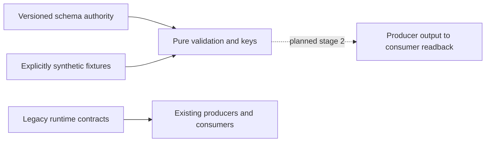

# Asset and instrument identity contract

Change surface: product-plane. Architecture impact: contract-change.
Owner: Contracts; Market Data owns future producers and namespace facts.
Decision: proposed stage 1; independent design admission required before code.
Implementation: staged contracts only. Runtime adoption and migration not accepted.

## Context and decision

Existing `market.CanonicalBar` and `canonical_bar.v1/v2` carry `contract_id`
and `instrument_id`; the latter also groups futures chains in CF producers.
`continuous_front_bars.v1/v2` bind active contracts to that grouping. MOEX
`foundation.MappingRecord` records activation, not full bitemporal applicability.
Those meanings and runtime owners remain unchanged.

Add `canonical_bar.v3` and `continuous_front_bars.v3`, both referring to one
`market_identity.v3` schema authority. Add `instrument_namespace.v1` as supplied in-memory asset/instrument facts,
not a runtime storage registry. All shapes and relational field bindings live
in the shared schema. Add `temporal_mapping.v1` (there is no
previous generic temporal mapping schema). The versioned pure validator executes
that schema's shapes, conditions, key projection and relational annotations.
No independently typed DTO restates the meaning. Existing limited v1/v2 schema
validator is not changed. The new evaluator supports only the documented schema
subset, rejects unsupported assertions and resolves local schema references only.
No new package dependency, storage owner, registry service or runtime import.

Alternatives rejected: repurpose existing IDs (breaks old consumers); opaque
series/family/product IDs or scope hashes (hide definition); migrate writers now
(outside authorization); a parallel DTO validator (competing semantic authority).
Revisit the finite evaluator if general JSON Schema becomes a declared dependency;
retain identical schema tests and semantics when replacing its implementation.

## Identity and applicability

`asset_id`: economic underlying. `instrument_id`: concrete listed instrument in
an explicit existing namespace. Equity and reference index are native instruments;
neither requires a fictitious futures contract. Base/derivative role is independent
of native/continuous_front series type and adjustment. Reference index is
nontradable with execution eligibility false and economics not_applicable.
Tradable metadata is a necessary description, never an execution authorization.

Native requires instrument_id and matching supplied namespace descriptor. CF has
instrument_id null and explicit scope C plus roll R. Role is derivative; CF itself
is not an executable instrument. `size_variant` is a fact envelope: known value
standard/mini/micro, unknown null, or not_applicable null. Contract size and
multiplier are separate numerical facts; labels do not establish size equality.
Grade/location/deliverable have the same explicit unknown/N/A distinction.

Optional active_instrument_id references the supplied namespace at an explicit
as_of timestamp and half-open [valid_from, valid_to). It is row observation/lineage,
never a permanent CF key. Every CF component has its own instrument FK and
half-open contribution interval inside the bar. Several contracts may contribute;
the active observation need not identify the only component. References must
agree with the CF scope's asset, venue/market/board eligibility and known specs.
Unknown specs cannot establish scope or FK equivalence; key admission fails closed.

## Logical keys

These are expanded tuples, not persisted opaque identifiers:

```text
Native: (Q, native, instrument_id, A, timeframe, ts_open)
CF:     (Q, continuous_front, C, R, A, timeframe, ts_open)
Research: (dataset, contour, set_versions, profile_versions, market_key)
```

Q contains source, namespace, venue, market, board, price basis/currency/unit,
quantity unit, aggregation, session, bounds, availability and quality recipes.
C contains asset, a set of exact eligible (venue, market, board) tuples, derivative subtype, exact
deliverable/benchmark, settlement and currencies, quantity unit, multiplier,
actual contract size, size variant, grade/location and expiry eligibility.
R contains roll method/version, decision timeframe, confirmation, reference and
switch rules. A contains adjustment method, direction, anchor and knowledge
policy, each with explicit version. Arrays representing eligibility sets are
order independent; duplicate entries rejected. Independent venue/market/board
sets cannot replace eligible tuples: equal projections do not prove equal combinations.
Unknown structural facts may be
preserved in a definition but cannot produce a comparable CF key.

Research set/profile versions extend the key; snapshot IDs, Delta table/version,
run IDs and retrieval timestamps are materialization lineage, not market identity.
Change any roll/adjustment/structural term: different definition. Change only the
active observation or component lineage: same CF definition and same row key.

## Temporal mappings and membership

Mapping includes namespace, source symbol and context (provider/venue/market/board),
target kind (asset, instrument, continuous_front), relation, valid time, recorded/
known time, source reference/hash and revision. Both time axes are half-open;
recorded_from is when knowledge first became available, never retrieval time.
Resolution requires valid_at and known_at, matches the full source context and
rejects zero or multiple applicable records, even if targets happen to agree.
Overlapping revisions require explicit recorded_to closure; never pick latest.
Retrieval timestamp is optional evidence and cannot make a mapping applicable.
`FUT_*` rolling source symbols cannot alias a dated instrument; they may map only
to a disclosed CF definition. Source hashes identify evidence, not economic IDs.
Membership has a component asset FK and an index instrument FK. It preserves
the component's own asset and requires a reference-index target; it is not aliasing.

## Old fields to new meaning

| Existing field | New contract meaning / migration requirement |
| --- | --- |
| native contract_id | concrete instrument_id, only after contextual temporal mapping |
| legacy instrument_id / internal_id | inspect owner: may mean underlying/grouping; no automatic rename |
| CF instrument_id | null; disclose C and R, asset_id names economic underlying |
| active_contract_id | optional active_instrument_id FK plus exact applicability |
| previous/candidate_contract_id | component/roll lineage, never permanent CF key |
| series_id or synthetic concatenation | absent; use expanded logical key |
| ts | explicit UTC ts_open and ts_close with half-open bar bounds |
| adjustment_mode / price_space | separate versioned A axis |
| dataset_version | Research dataset/contour/version dimensions or materialization lineage; inspect owner |
| mapping_version / activated_at | mapping revision plus independent valid and recorded intervals |
| snapshot/Delta/run identifiers | materialization lineage, outside logical market key |

## Compatibility, migration and rollback

Strict new major, opt-in only. Keep all old schema/fixture bytes and old exports.
New payloads reject undeclared fields including series_id/family_id/product_id.
No implicit upcast/downcast or runtime dispatch change. Stage 2 must implement
explicit producer/adaptation routes with temporal source evidence, fail closed
on ambiguous legacy values, and prove output at the actual consumer before any
activation. Rolling back stage 1 removes unused new files; old runtime is intact.
No Delta, mappings storage, manifests, pointers, configuration, jobs or services
are changed by this decision.



## Validation and next proof

Contract tests use synthetic SBER, IMOEX, SRZ6 and CF examples. All namespace IDs,
prices, sizes, dates, policies and membership intervals are illustrative, not
confirmed exchange facts. No live source lookup is needed or claimed. Mutations
cover native missing instrument, index execution denial, active-contract invariant,
structural/policy/venue/size separation, unknown non-equivalence, temporal boundaries,
alias ambiguity, namespace FKs and old compatibility. Assertions use specified
metamorphic invariants and independently selected time boundaries.

Next-stage real proof: owning MOEX producer emits a v3 native equity/index/futures
sample and a multi-component CF using sourced, bitemporal namespace facts; actual
consumer validates and reads back the expanded keys/lineage at pinned valid and
known times. Negative replay must reject ambiguity, unknown scope and future
knowledge. Plan separately authorized isolated resources before running it.

Current fixtures establish contract behavior only. The contract-change PR gate
requires real producer proof; it must remain BLOCKED without that artifact. Do not
invent a producer or relabel tests as runtime acceptance to make the gate pass.
