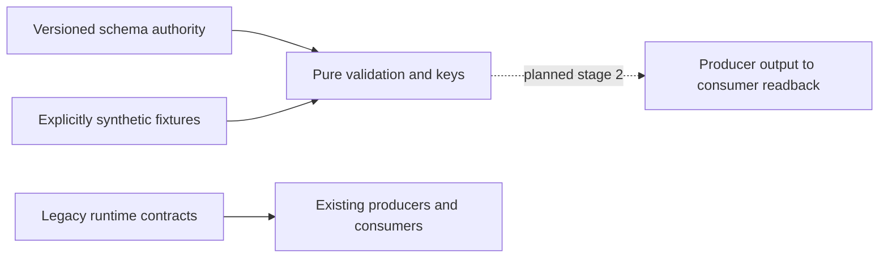

# Asset and instrument identity contract

Change surface: product-plane. Architecture impact: contract-change.
Owner: Contracts; Market Data owns future producers and namespace facts.
Decision: staged foundation; independent admission is scoped to the real native
namespace/evaluator boundary described below.
Implementation: staged contracts only. Runtime adoption and migration not accepted.

## Context and decision

Existing `market.CanonicalBar` and `canonical_bar.v1/v2` carry `contract_id`
and `instrument_id`; the latter also groups futures chains in CF producers.
`continuous_front_bars.v1/v2` bind active contracts to that grouping. MOEX
`foundation.MappingRecord` records activation, not full bitemporal applicability.
Those meanings and runtime owners remain unchanged.

Add `canonical_bar.v3` and `continuous_front_bars.v3`, both referring to one
`market_identity.v3` schema authority. Add `instrument_namespace.v1` as supplied in-memory asset/instrument facts,
not a runtime storage registry. All shapes and relational field bindings live
in the shared schema. Add `temporal_mapping.v1` (there is no
previous generic temporal mapping schema). The versioned pure validator executes
that schema's shapes, conditions, key projection and relational annotations.
No independently typed DTO restates the meaning. Existing limited v1/v2 schema
validator is not changed. The new evaluator supports only the documented schema
subset, rejects unsupported assertions and resolves local schema references only.
No new package dependency, storage owner, registry service or runtime import.

Alternatives rejected: repurpose existing IDs (breaks old consumers); opaque
series/family/product IDs or scope hashes (hide definition); migrate writers now
(outside authorization); a parallel DTO validator (competing semantic authority).
Revisit the finite evaluator if general JSON Schema becomes a declared dependency;
retain identical schema tests and semantics when replacing its implementation.

## Identity and applicability

`asset_id`: economic underlying. `instrument_id`: concrete listed instrument in
an explicit existing namespace. Equity and reference index are native instruments;
neither requires a fictitious futures contract. Base/derivative role is independent
of native/continuous_front series type and adjustment. Reference index is
nontradable with execution eligibility false and economics not_applicable.
Tradable metadata is a necessary description, never an execution authorization.

Native requires instrument_id and matching supplied namespace descriptor. CF has
instrument_id null and explicit scope C plus roll R. Role is derivative; CF itself
is not an executable instrument. `size_variant` is a fact envelope: known value
standard/mini/micro, unknown null, or not_applicable null. Contract size and
multiplier are separate numerical facts; labels do not establish size equality.
Grade/location/deliverable have the same explicit unknown/N/A distinction.

Optional active_instrument_id references the supplied namespace at an explicit
as_of timestamp and half-open [valid_from, valid_to). It is row observation/lineage,
never a permanent CF key. Every CF component has its own instrument FK and
half-open contribution interval inside the bar. Several contracts may contribute;
the active observation need not identify the only component. References must
agree with the CF scope's asset, venue/market/board eligibility and known specs.
Unknown specs cannot establish scope or FK equivalence; key admission fails closed.

## Logical keys

These are expanded tuples, not persisted opaque identifiers:

```text
Native: (Q, native, instrument_id, A, timeframe, ts_open)
CF:     (Q, continuous_front, C, R, A, timeframe, ts_open)
Research: (dataset, contour, set_versions, profile_versions, market_key)
```

Q contains source, namespace, venue, market, board, price basis/currency/unit,
quantity unit, aggregation, session, bounds, availability and quality recipes.
C contains asset, a set of exact eligible (venue, market, board) tuples, derivative subtype, exact
deliverable/benchmark, settlement and currencies, quantity unit, multiplier,
actual contract size, size variant, grade/location and expiry eligibility.
R contains roll method/version, decision timeframe, confirmation, reference and
switch rules. A contains adjustment method, direction, anchor and knowledge
policy, each with explicit version. Arrays representing eligibility sets are
order independent; duplicate entries rejected. Independent venue/market/board
sets cannot replace eligible tuples: equal projections do not prove equal combinations.
Unknown structural facts may be
preserved in a definition but cannot produce a comparable CF key.

Research set/profile versions extend the key; snapshot IDs, Delta table/version,
run IDs and retrieval timestamps are materialization lineage, not market identity.
Change any roll/adjustment/structural term: different definition. Change only the
active observation or component lineage: same CF definition and same row key.

## Temporal mappings and membership

Mapping includes namespace, source symbol and context (provider/venue/market/board),
target kind (asset, instrument, continuous_front), relation, valid time, recorded/
known time, source reference/hash and revision. Both time axes are half-open;
recorded_from is when knowledge first became available, never retrieval time.
Resolution requires valid_at and known_at, matches the full source context and
rejects zero or multiple applicable records, even if targets happen to agree.
Overlapping revisions require explicit recorded_to closure; never pick latest.
Retrieval timestamp is optional evidence and cannot make a mapping applicable.
`FUT_*` rolling source symbols cannot alias a dated instrument; they may map only
to a disclosed CF definition. Source hashes identify evidence, not economic IDs.
Membership has a component asset FK and an index instrument FK. It preserves
the component's own asset and requires a reference-index target; it is not aliasing.

## Old fields to new meaning

| Existing field | New contract meaning / migration requirement |
| --- | --- |
| native contract_id | concrete instrument_id, only after contextual temporal mapping |
| legacy instrument_id / internal_id | inspect owner: may mean underlying/grouping; no automatic rename |
| CF instrument_id | null; disclose C and R, asset_id names economic underlying |
| active_contract_id | optional active_instrument_id FK plus exact applicability |
| previous/candidate_contract_id | component/roll lineage, never permanent CF key |
| series_id or synthetic concatenation | absent; use expanded logical key |
| ts | explicit UTC ts_open and ts_close with half-open bar bounds |
| adjustment_mode / price_space | separate versioned A axis |
| dataset_version | Research dataset/contour/version dimensions or materialization lineage; inspect owner |
| mapping_version / activated_at | mapping revision plus independent valid and recorded intervals |
| snapshot/Delta/run identifiers | materialization lineage, outside logical market key |

## Compatibility, migration and rollback

Strict new major, opt-in only. Keep all old schema/fixture bytes and old exports.
New payloads reject undeclared fields including series_id/family_id/product_id.
No implicit upcast/downcast or runtime dispatch change. Stage 2 must implement
explicit producer/adaptation routes with temporal source evidence, fail closed
on ambiguous legacy values, and prove output at the actual consumer before any
activation. Rolling back stage 1 removes unused new files; old runtime is intact.
No Delta, mappings storage, manifests, pointers, configuration, jobs or services
are changed by this decision.



## Validation and next proof

Contract tests use synthetic SBER, IMOEX, SRZ6 and CF examples. All namespace IDs,
prices, sizes, dates, policies and membership intervals are illustrative, not
confirmed exchange facts. No live source lookup is needed or claimed. Mutations
cover native missing instrument, index execution denial, active-contract invariant,
structural/policy/venue/size separation, unknown non-equivalence, temporal boundaries,
alias ambiguity, namespace FKs and old compatibility. Assertions use specified
metamorphic invariants and independently selected time boundaries.

Future canonical/PIT admission requires the owning MOEX producer to emit a v3 native equity/index/futures
sample and a multi-component CF using sourced, bitemporal namespace facts; actual
consumer validates and reads back the expanded keys/lineage at pinned valid and
known times. Negative replay must reject ambiguity, unknown scope and future
knowledge. Plan separately authorized isolated resources before running it.

Current fixtures establish contract behavior only. Foundation admission uses a
separate real namespace proof: the pinned source-backed producer at `5277abbf`
replays existing original MOEX metadata/report/assignments, emits its namespace,
and the current public namespace evaluator consumes the unchanged SBER/IMOEX
records and required assets. Readback is exact and repeatable; contradictory
asset FKs and index execution reject. At foundation head `fe8d0e06`, the full emitted namespace rejected because
unknown future expiry/specification was not yet admitted; the separate snapshot
amendment below admits those unknown native facts without establishing CF scope.
The producer source, original input hashes and current consumer/schema hashes
are pinned in `integration-20261109/pr1-real-namespace.py` and `.json` under the
task evidence root `D:/CodexHome/visualizations/2026/10/31/01a19403-e9da-7011-bc5b-51fbe3ea3be9`.

This admits only the staged native namespace/evaluator boundary. Real producers
for `canonical_bar.v3`, continuous front, full Q and bitemporal applicability
remain BLOCKED/unadmitted until the separate proof above exists. No such payload
is fabricated for foundation acceptance. This is real producer/consumer evidence
for the limited boundary, not an exception to the contract-change gate.

## Native snapshot identity admission

Decision status: independently reviewed design. Implementation status: staged
metadata route; [scoped proof and limits](docs/runbooks/app/identity-snapshot-admission.md).

Decision amendment: explicit opt-in snapshot-bound metadata admission, verification
only. Contracts owns the shared schema; Market Data owns the source-backed
constructor and public resolver. This does not accept full row adapters, historical
mapping/PIT, execution, publication or production. Native adoption is bounded to
one supplied snapshot and exact source context; no runtime mapping is changed.

`temporal_mapping.v1` and `resolve_temporal_mapping` retain both known/valid axes.
They never dispatch snapshot bindings. New thin selector/binding schemas refer to
`market_identity.v3` definitions; no parallel DTO meaning or mutable registry.
A closed selector requires snapshot_bound applicability, namespace, concrete
instrument_id, source context, engine, price basis and complete pins. Temporal
parameters and CF selectors are invalid. Pins bind source manifest, report,
configuration, assignment file/version, namespace, dataset context and the
report's original table path plus physical table UUID/exact Delta version.
The closed binding adds asset_id, source_symbol, a closed legacy source descriptor,
source reference/hash, observed_at and historical_mapping_verified=false.
Schema constraints bind its SECID/context/engine/price basis and namespace FK.
Legacy source IDs occur only as explicitly named compatibility evidence.

The Market Data source-backed constructor verifies original input bytes against
explicit expected hashes, manifest descriptor/envelope hashes, inner raw payload
hashes and the selected concrete assignment. It checks complete descriptor and
raw-board engine/market/board association, source type/SECID and source IDs.
It verifies the pinned invocation receipt's logical-to-host root binding,
report/config/source/registry coherence, and the report's exact Delta version and
expected physical UUID. Original manifests/references are retained, never rewritten.
Configuration SHA256 hashes exact original source context_json UTF-8 bytes with
no newline/reserialization; its dataset_context_id must match the report.
Namespace SHA256 uses sorted compact UTF-8 JSON with no NaN. Source file hashes
cover original bytes. Raw payload verification reuses the acquisition byte rule:
sorted JSON, ensure_ascii=False, default separators, allow_nan=False, newline.
The pure public resolver consumes trusted admitted inputs, schema-validates and
matches every selector pin; zero or multiple candidates fail closed. Pure pin
equality alone is not source verification. Returned metadata is a defensive copy.

For native futures, null expiry means unknown UTC instant and null specification
means an unconfirmed complete canonical specification. Observed lifetime dates,
lot size and delivery facts remain source evidence; no midnight expiry or missing
CF terms are invented. CF active/component references require known complete
specification and expiry for each referenced instrument; otherwise controlled
contract rejection. Unrelated unknown futures do not invalidate valid CF refs.
Old merged v1/v2 schemas and fixtures retain their original bytes and meanings.

Initial sourced example adopts only SBER TQBR, IMOEX SNDX and SRZ6 RFUD/forts from
the explicitly supplied r7 pilot assignments, namespace
`ta3000:pilot:identity-v2-r7-20261031`. Those IDs are pilot assignments, not official
exchange IDs. SBER and SRZ6 share the confirmed ordinary-share underlying; index
remains reference-only. Execution eligibility is false. Unknown economics,
complete future specification/expiry and historical applicability remain unknown.
No source-native Q/recipe or CF equivalence is inferred by identity admission.

Validation: pre-change unknown native-future expiry/spec rejection; focused
schema/resolver/constructor regressions for altered pins, descriptor association,
ambiguous/absent mapping, PIT rejection and CF unknown-reference boundaries.
Actual proof uses existing original source metadata, assignments, report/config,
receipt and Delta metadata -> constructor -> public resolver -> schema validation
and repeatability. No market/research output is written. Tests using synthetic
fixtures do not establish exchange facts or replace this real metadata proof.
Full stage-2 bar/L0/L1/L2 adapters still require sourced Q/recipes and independent
value/type/NULL/grain roundtrip; this metadata decision does not admit them.

Alternatives rejected: invented time intervals, lifetime/retrieval as historical
knowledge, midnight expiry, whole old CF-registry reuse, bypassing namespace
validation or introducing a parallel registry/schema owner. Cost is bounded
metadata validation and Delta metadata reads, with no analytical compute.
Rollback removes the unused admission route; old readers/data need no recovery.
Removal/revisit: replace this explicit snapshot mode only after sourced temporal
facts are accepted; never silently upgrade existing bindings into PIT claims.

## Bounded native snapshot read projection

Change surface: product-plane. Architecture impact: contract-change.
Decision status: independently reviewed bounded extension.
Implementation status: staged opt-in read slice, locally verified against existing
outputs; full PR write-proof matrix unexecuted. Owners: Contracts (executable carrier), Market
Data (identity/pins and bars), Research (L0/L1/L2), Interfaces (opt-in inspector).

Read existing accepted verification outputs through snapshot-only admission.
Thin `snapshot_read_request.v1` and `snapshot_read_projection.v1` schemas refer
to this same shared authority, namespace and native binding rules. This carrier
is an explicit read projection, not `canonical_bar.v3` or a complete canonical
market key: unconfirmed Q/calendar/publication lag remains unverified. Never
invent lag_seconds=0, official calendars, temporal intervals or CF definitions.
Old JSON contracts, writers and physical schemas retain their existing meaning.

Request is closed: schema_version=1, identity (snapshot selector), layer
bars/L0/L1/L2, series_type=native, timeframe, UTC start/end, ordered unique
projection, row_limit (1..500, existing inspector bound), positive byte_limit,
research (null for bars; explicit dataset/contour/set/profile version fields for
Research, irrelevant versions null). CF/PIT/rolling aliases fail closed.

Carrier is a closed metadata envelope plus Arrow IPC. Envelope fields:
schema_version=1, contract_version=snapshot_read_projection.v1, status
ok/empty/unavailable, request, identity (native binding), source, projection,
payload, fingerprint, unavailable_reason. Source, when present, contains the
unchanged original table reference, explicit table UUID/version/Arrow-schema
hash, exact original config JSON/hash/context ID, sourced recipe-version pairs,
and source report/manifest/namespace/mapping pins. Those pins must agree with
the supplied native binding; Research context is distinct from source context.
Projection contains timestamp_column, source_key_timestamp semantics, grain,
ordered columns, canonical_Q_verified=false, historical_PIT_verified=false and
unverified Q terms. Payload is null only for unavailable; otherwise row count,
base64 Arrow schema bytes (including field/schema metadata) and IPC content SHA.
Fingerprint covers stable envelope metadata and the data IPC hash, without its
own field. Retrieval time never enters applicability or reproducible identity.

The shared schema declares executable Arrow rules: mandatory identity columns,
forbidden legacy/grouping columns, constant bindings, native timestamp/grain,
wire metadata key and payload paths. Its validator executes those rules against
actual Arrow buffers, schema/metadata, ordered projection, count, budgets,
constants and uniqueness. Numeric values never pass through JSON/Pandas/list
conversion. Arrow IPC preserves source types and NULL/NaN masks; source hashes
remain lineage. New projection fingerprint is not an economic or series ID.

Market Data owns a public immutable pinned snapshot context. Construction uses
the verified source-backed admission constructor and explicit read-side table
pins captured from these existing report outputs, without changing the report.
Every read/cache hit rechecks original input bytes, report/config/receipt scope,
requested native mapping, original ref, UUID/exact version and source schema.
The pinned report/receipt supplies path mapping; no arbitrary path or latest
fallback. Research calls this public identity/pin boundary for its owned tables.
Explicit frozen selection versions come from the existing selected outputs;
they must agree with the matching report context/profile, never pick latest.

Predicates before scanner: exact legacy descriptor and native contract (null for
equity/index), native discriminator, null CF scope, timeframe, half-open period,
correct layer context and explicit dataset/contour/set/profile versions. Bars
also bind security_id. Source/feed/board/price basis come from the pinned
descriptor plus corresponding context, even where physically absent in frames.
Bars use original bar_start_ts; Research uses original ts. Do not rename them
to an unproven close/open axis or reconstruct TF/bounds. Timestamp strings are
parsed only inside Arrow predicates/grain checks; returned buffers keep types.

Only requested columns, source grain/filter checks and mandatory identity/time
columns reach the bounded scanner. Unknown/forbidden projection fields reject.
Read at most row_limit+1; overflow or wire-byte overflow rejects rather than
returning an undeclared truncation. Native IDs are metadata-projected from the
admitted contract/descriptor, never active_contract_id. No row join/dedup,
resampling, indicator computation or fallback materialization. Sort by normalized
source timestamp/native grain before fingerprint; duplicate canonical projection
grain rejects. Missing accepted output is unavailable; valid empty slice is empty.

A new memory-only byte-bounded LRU stores immutable IPC bytes under the explicit
snapshot_read_projection.v1 namespace. Key covers contract, every source/table/
schema/mapping/config/recipe pin, selector, Research selection, layer, period/TF,
ordered projection and budgets. Pins/projection/applicability validate before
cache lookup; decoded hits validate again. Legacy caches/spill readers are unused.

Existing DataInspector gets one opt-in POST Arrow route using public Market and
Research readers. No new service/UI or automatic production-root binding. Its
existing legacy reader remains unchanged. Actual proof: original accepted
producer output -> adapters -> inspector consumer -> schema/Arrow validation;
independent direct bounded pinned Arrow predicates are the oracle for every
value, type, NULL/NaN mask, grain, index execution NULL, repeat and old readback.
Fixtures stay in memory; source proof reads existing Delta only. Required broad
write-proof matrix remains explicitly unexecuted under the user's prohibition.

Alternatives rejected: JSON-number conversion, pretending complete Q, duplicating
identity DTO meaning, futures backtest loader for other assets, spill-file cache,
latest reads, Python broad row scans, silent dedup/truncation and writer changes.
Runtime choice: Delta/Arrow predicates/projection/IPC; Python bounded contract
adaptation and metadata validation, no compute fallback. Cost: bounded rows/bytes
and configured cache bytes; no performance/SLA claim. Rollback: opt out of the
inspector route/use old reader; no data restore. Revisit full canonical-key/PIT
admission only when independently sourced Q and temporal facts exist.

Exact carrier names: request.research has dataset_version, contour_id,
indicator_set_version, derived_indicator_set_version, profile_version and
source_indicator_profile_version; every field is present, irrelevant fields null.
Projection mandatory order is asset_id, instrument_id, series_type, timeframe,
then the unchanged source timestamp column, followed by ordered requested fields.
Its grain is those mandatory columns. Timestamp comparisons/grain normalization
use native Arrow UTC timestamps without altering returned source buffers.
Source fields are original_reference, read_pin (table_id, delta_version,
arrow_schema_sha256, source_schema_ipc_base64, reference_sha256), configuration (dataset_context_id,
sha256, original_json), recipes (name/version pairs), report_sha256,
manifest_sha256, mapping_version, namespace_sha256 and pin_bundle_sha256.
Read-side pin bundles retain public common.data_snapshots capture_table references;
open_pinned_table verifies them before scanner/cache, including original report
path/version correspondence. This metadata-only capture publishes no snapshot.
Payload fields are row_count, schema_ipc_base64 and ipc_sha256. Data hash is SHA256
of uncompressed Arrow IPC stream after deterministic native-grain sorting and
combine_chunks, preserving original Arrow metadata. Envelope fingerprint is
SHA256 of sorted compact UTF-8 JSON without fingerprint (no NaN values in JSON).
Wire IPC adds the JSON envelope under its schema metadata key; decoding restores
the exact payload schema metadata and verifies schema/hash/count/column constants/
grain/window/order/budgets. Wire byte budget includes that envelope. Cache stores
only immutable wire bytes; unavailable returns an explicit reason without data.
The embedded original source schema must hash to arrow_schema_sha256. Every raw
projected field and schema metadata must match that source schema exactly;
only the four admitted identity/grain metadata columns are replaced. This makes
type/field-metadata preservation executable, independent of payload self-description.

Operational request, read-pin capture, actual readback evidence and rollback:
[snapshot read projection runbook](docs/runbooks/app/snapshot-read-projection.md).
