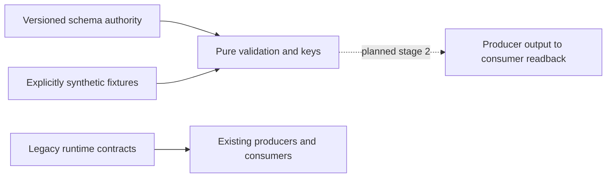

# Asset and instrument identity contract

Change surface: product-plane. Architecture impact: contract-change.
Owner: Contracts; Market Data owns future producers and namespace facts.
Decision: staged foundation; independent admission is scoped to the real native
namespace/evaluator boundary described below.
Implementation: staged contracts only. Runtime adoption and migration not accepted.

## Context and decision

Existing `market.CanonicalBar` and `canonical_bar.v1/v2` carry `contract_id`
and `instrument_id`; the latter also groups futures chains in CF producers.
`continuous_front_bars.v1/v2` bind active contracts to that grouping. MOEX
`foundation.MappingRecord` records activation, not full bitemporal applicability.
Those meanings and runtime owners remain unchanged.

Add `canonical_bar.v3` and `continuous_front_bars.v3`, both referring to one
`market_identity.v3` schema authority. Add `instrument_namespace.v1` as supplied in-memory asset/instrument facts,
not a runtime storage registry. All shapes and relational field bindings live
in the shared schema. Add `temporal_mapping.v1` (there is no
previous generic temporal mapping schema). The versioned pure validator executes
that schema's shapes, conditions, key projection and relational annotations.
No independently typed DTO restates the meaning. Existing limited v1/v2 schema
validator is not changed. The new evaluator supports only the documented schema
subset, rejects unsupported assertions and resolves local schema references only.
No new package dependency, storage owner, registry service or runtime import.

Alternatives rejected: repurpose existing IDs (breaks old consumers); opaque
series/family/product IDs or scope hashes (hide definition); migrate writers now
(outside authorization); a parallel DTO validator (competing semantic authority).
Revisit the finite evaluator if general JSON Schema becomes a declared dependency;
retain identical schema tests and semantics when replacing its implementation.

## Identity and applicability

`asset_id`: economic underlying. `instrument_id`: concrete listed instrument in
an explicit existing namespace. Equity and reference index are native instruments;
neither requires a fictitious futures contract. Base/derivative role is independent
of native/continuous_front series type and adjustment. Reference index is
nontradable with execution eligibility false and economics not_applicable.
Tradable metadata is a necessary description, never an execution authorization.

Native requires instrument_id and matching supplied namespace descriptor. CF has
instrument_id null and explicit scope C plus roll R. Role is derivative; CF itself
is not an executable instrument. `size_variant` is a fact envelope: known value
standard/mini/micro, unknown null, or not_applicable null. Contract size and
multiplier are separate numerical facts; labels do not establish size equality.
Grade/location/deliverable have the same explicit unknown/N/A distinction.

Optional active_instrument_id references the supplied namespace at an explicit
as_of timestamp and half-open [valid_from, valid_to). It is row observation/lineage,
never a permanent CF key. Every CF component has its own instrument FK and
half-open contribution interval inside the bar. Several contracts may contribute;
the active observation need not identify the only component. References must
agree with the CF scope's asset, venue/market/board eligibility and known specs.
Unknown specs cannot establish scope or FK equivalence; key admission fails closed.

## Logical keys

These are expanded tuples, not persisted opaque identifiers:

```text
Native: (Q, native, instrument_id, A, timeframe, ts_open)
CF:     (Q, continuous_front, C, R, A, timeframe, ts_open)
Research: (dataset, contour, set_versions, profile_versions, market_key)
```

Q contains source, namespace, venue, market, board, price basis/currency/unit,
quantity unit, aggregation, session, bounds, availability and quality recipes.
C contains asset, a set of exact eligible (venue, market, board) tuples, derivative subtype, exact
deliverable/benchmark, settlement and currencies, quantity unit, multiplier,
actual contract size, size variant, grade/location and expiry eligibility.
R contains roll method/version, decision timeframe, confirmation, reference and
switch rules. A contains adjustment method, direction, anchor and knowledge
policy, each with explicit version. Arrays representing eligibility sets are
order independent; duplicate entries rejected. Independent venue/market/board
sets cannot replace eligible tuples: equal projections do not prove equal combinations.
Unknown structural facts may be
preserved in a definition but cannot produce a comparable CF key.

Research set/profile versions extend the key; snapshot IDs, Delta table/version,
run IDs and retrieval timestamps are materialization lineage, not market identity.
Change any roll/adjustment/structural term: different definition. Change only the
active observation or component lineage: same CF definition and same row key.

## Temporal mappings and membership

Mapping includes namespace, source symbol and context (provider/venue/market/board),
target kind (asset, instrument, continuous_front), relation, valid time, recorded/
known time, source reference/hash and revision. Both time axes are half-open;
recorded_from is when knowledge first became available, never retrieval time.
Resolution requires valid_at and known_at, matches the full source context and
rejects zero or multiple applicable records, even if targets happen to agree.
Overlapping revisions require explicit recorded_to closure; never pick latest.
Retrieval timestamp is optional evidence and cannot make a mapping applicable.
`FUT_*` rolling source symbols cannot alias a dated instrument; they may map only
to a disclosed CF definition. Source hashes identify evidence, not economic IDs.
Membership has a component asset FK and an index instrument FK. It preserves
the component's own asset and requires a reference-index target; it is not aliasing.

## Old fields to new meaning

| Existing field | New contract meaning / migration requirement |
| --- | --- |
| native contract_id | concrete instrument_id, only after contextual temporal mapping |
| legacy instrument_id / internal_id | inspect owner: may mean underlying/grouping; no automatic rename |
| CF instrument_id | null; disclose C and R, asset_id names economic underlying |
| active_contract_id | optional active_instrument_id FK plus exact applicability |
| previous/candidate_contract_id | component/roll lineage, never permanent CF key |
| series_id or synthetic concatenation | absent; use expanded logical key |
| ts | explicit UTC ts_open and ts_close with half-open bar bounds |
| adjustment_mode / price_space | separate versioned A axis |
| dataset_version | Research dataset/contour/version dimensions or materialization lineage; inspect owner |
| mapping_version / activated_at | mapping revision plus independent valid and recorded intervals |
| snapshot/Delta/run identifiers | materialization lineage, outside logical market key |

## Compatibility, migration and rollback

Strict new major, opt-in only. Keep all old schema/fixture bytes and old exports.
New payloads reject undeclared fields including series_id/family_id/product_id.
No implicit upcast/downcast or runtime dispatch change. Stage 2 must implement
explicit producer/adaptation routes with temporal source evidence, fail closed
on ambiguous legacy values, and prove output at the actual consumer before any
activation. Rolling back stage 1 removes unused new files; old runtime is intact.
No Delta, mappings storage, manifests, pointers, configuration, jobs or services
are changed by this decision.



## Validation and next proof

Contract tests use synthetic SBER, IMOEX, SRZ6 and CF examples. All namespace IDs,
prices, sizes, dates, policies and membership intervals are illustrative, not
confirmed exchange facts. No live source lookup is needed or claimed. Mutations
cover native missing instrument, index execution denial, active-contract invariant,
structural/policy/venue/size separation, unknown non-equivalence, temporal boundaries,
alias ambiguity, namespace FKs and old compatibility. Assertions use specified
metamorphic invariants and independently selected time boundaries.

Future canonical/PIT admission requires the owning MOEX producer to emit a v3 native equity/index/futures
sample and a multi-component CF using sourced, bitemporal namespace facts; actual
consumer validates and reads back the expanded keys/lineage at pinned valid and
known times. Negative replay must reject ambiguity, unknown scope and future
knowledge. Plan separately authorized isolated resources before running it.

Current fixtures establish contract behavior only. Foundation admission uses a
separate real namespace proof: the pinned source-backed producer at `5277abbf`
replays existing original MOEX metadata/report/assignments, emits its namespace,
and the current public namespace evaluator consumes the unchanged SBER/IMOEX
records and required assets. Readback is exact and repeatable; contradictory
asset FKs and index execution reject. At foundation head `fe8d0e06`, the full emitted namespace rejected because
unknown future expiry/specification was not yet admitted; the separate snapshot
amendment below admits those unknown native facts without establishing CF scope.
The producer source, original input hashes and current consumer/schema hashes
are pinned in `integration-20261109/pr1-real-namespace.py` and `.json` under the
task evidence root `D:/CodexHome/visualizations/2026/10/31/01a19403-e9da-7011-bc5b-51fbe3ea3be9`.

This admits only the staged native namespace/evaluator boundary. Real producers
for `canonical_bar.v3`, continuous front, full Q and bitemporal applicability
remain BLOCKED/unadmitted until the separate proof above exists. No such payload
is fabricated for foundation acceptance. This is real producer/consumer evidence
for the limited boundary, not an exception to the contract-change gate.

## Native snapshot identity admission

Decision status: independently reviewed design. Implementation status: staged
metadata route; [scoped proof and limits](docs/runbooks/app/identity-snapshot-admission.md).

Decision amendment: explicit opt-in snapshot-bound metadata admission, verification
only. Contracts owns the shared schema; Market Data owns the source-backed
constructor and public resolver. This does not accept full row adapters, historical
mapping/PIT, execution, publication or production. Native adoption is bounded to
one supplied snapshot and exact source context; no runtime mapping is changed.

`temporal_mapping.v1` and `resolve_temporal_mapping` retain both known/valid axes.
They never dispatch snapshot bindings. New thin selector/binding schemas refer to
`market_identity.v3` definitions; no parallel DTO meaning or mutable registry.
A closed selector requires snapshot_bound applicability, namespace, concrete
instrument_id, source context, engine, price basis and complete pins. Temporal
parameters and CF selectors are invalid. Pins bind source manifest, report,
configuration, assignment file/version, namespace, dataset context and the
report's original table path plus physical table UUID/exact Delta version.
The closed binding adds asset_id, source_symbol, a closed legacy source descriptor,
source reference/hash, observed_at and historical_mapping_verified=false.
Schema constraints bind its SECID/context/engine/price basis and namespace FK.
Legacy source IDs occur only as explicitly named compatibility evidence.

The Market Data source-backed constructor verifies original input bytes against
explicit expected hashes, manifest descriptor/envelope hashes, inner raw payload
hashes and the selected concrete assignment. It checks complete descriptor and
raw-board engine/market/board association, source type/SECID and source IDs.
It verifies the pinned invocation receipt's logical-to-host root binding,
report/config/source/registry coherence, and the report's exact Delta version and
expected physical UUID. Original manifests/references are retained, never rewritten.
Configuration SHA256 hashes exact original source context_json UTF-8 bytes with
no newline/reserialization; its dataset_context_id must match the report.
Namespace SHA256 uses sorted compact UTF-8 JSON with no NaN. Source file hashes
cover original bytes. Raw payload verification reuses the acquisition byte rule:
sorted JSON, ensure_ascii=False, default separators, allow_nan=False, newline.
The pure public resolver consumes trusted admitted inputs, schema-validates and
matches every selector pin; zero or multiple candidates fail closed. Pure pin
equality alone is not source verification. Returned metadata is a defensive copy.

For native futures, null expiry means unknown UTC instant and null specification
means an unconfirmed complete canonical specification. Observed lifetime dates,
lot size and delivery facts remain source evidence; no midnight expiry or missing
CF terms are invented. CF active/component references require known complete
specification and expiry for each referenced instrument; otherwise controlled
contract rejection. Unrelated unknown futures do not invalidate valid CF refs.
Old merged v1/v2 schemas and fixtures retain their original bytes and meanings.

Initial sourced example adopts only SBER TQBR, IMOEX SNDX and SRZ6 RFUD/forts from
the explicitly supplied r7 pilot assignments, namespace
`ta3000:pilot:identity-v2-r7-20261031`. Those IDs are pilot assignments, not official
exchange IDs. SBER and SRZ6 share the confirmed ordinary-share underlying; index
remains reference-only. Execution eligibility is false. Unknown economics,
complete future specification/expiry and historical applicability remain unknown.
No source-native Q/recipe or CF equivalence is inferred by identity admission.

Validation: pre-change unknown native-future expiry/spec rejection; focused
schema/resolver/constructor regressions for altered pins, descriptor association,
ambiguous/absent mapping, PIT rejection and CF unknown-reference boundaries.
Actual proof uses existing original source metadata, assignments, report/config,
receipt and Delta metadata -> constructor -> public resolver -> schema validation
and repeatability. No market/research output is written. Tests using synthetic
fixtures do not establish exchange facts or replace this real metadata proof.
Full stage-2 bar/L0/L1/L2 adapters still require sourced Q/recipes and independent
value/type/NULL/grain roundtrip; this metadata decision does not admit them.

Alternatives rejected: invented time intervals, lifetime/retrieval as historical
knowledge, midnight expiry, whole old CF-registry reuse, bypassing namespace
validation or introducing a parallel registry/schema owner. Cost is bounded
metadata validation and Delta metadata reads, with no analytical compute.
Rollback removes the unused admission route; old readers/data need no recovery.
Removal/revisit: replace this explicit snapshot mode only after sourced temporal
facts are accepted; never silently upgrade existing bindings into PIT claims.

## Bounded native snapshot read projection

Change surface: product-plane. Architecture impact: contract-change.
Decision status: independently reviewed bounded extension.
Implementation status: staged opt-in read slice, locally verified against existing
outputs; integration gates are tracked per delivery head. Owners: Contracts (executable carrier), Market
Data (identity/pins and bars), Research (L0/L1/L2), Interfaces (opt-in inspector).

Read existing accepted verification outputs through snapshot-only admission.
Thin `snapshot_read_request.v1` and `snapshot_read_projection.v1` schemas refer
to this same shared authority, namespace and native binding rules. This carrier
is an explicit read projection, not `canonical_bar.v3` or a complete canonical
market key: unconfirmed Q/calendar/publication lag remains unverified. Never
invent lag_seconds=0, official calendars, temporal intervals or CF definitions.
Old JSON contracts, writers and physical schemas retain their existing meaning.

Request is closed: schema_version=1, identity (snapshot selector), layer
bars/L0/L1/L2, series_type=native, timeframe, UTC start/end, ordered unique
projection, row_limit (1..500, existing inspector bound), positive byte_limit,
research (null for bars; explicit dataset/contour/set/profile version fields for
Research, irrelevant versions null). CF/PIT/rolling aliases fail closed.

Carrier is a closed metadata envelope plus Arrow IPC. Envelope fields:
schema_version=1, contract_version=snapshot_read_projection.v1, status
ok/empty/unavailable, request, identity (native binding), source, projection,
payload, fingerprint, unavailable_reason. Source, when present, contains the
unchanged original table reference, explicit table UUID/version/Arrow-schema
hash, exact original config JSON/hash/context ID, sourced recipe-version pairs,
and source report/manifest/namespace/mapping pins. Those pins must agree with
the supplied native binding; Research context is distinct from source context.
Projection contains timestamp_column, source_key_timestamp semantics, grain,
ordered columns, canonical_Q_verified=false, historical_PIT_verified=false and
unverified Q terms. Payload is null only for unavailable; otherwise row count,
base64 Arrow schema bytes (including field/schema metadata) and IPC content SHA.
Fingerprint covers stable envelope metadata and the data IPC hash, without its
own field. Retrieval time never enters applicability or reproducible identity.

The shared schema declares executable Arrow rules: mandatory identity columns,
forbidden legacy/grouping columns, constant bindings, native timestamp/grain,
wire metadata key and payload paths. Its validator executes those rules against
actual Arrow buffers, schema/metadata, ordered projection, count, budgets,
constants and uniqueness. Numeric values never pass through JSON/Pandas/list
conversion. Arrow IPC preserves source types and NULL/NaN masks; source hashes
remain lineage. New projection fingerprint is not an economic or series ID.

Market Data owns a public immutable pinned snapshot context. Construction uses
the verified source-backed admission constructor and explicit read-side table
pins captured from these existing report outputs, without changing the report.
Every read/cache hit rechecks original input bytes, report/config/receipt scope,
requested native mapping, original ref, UUID/exact version and source schema.
The pinned report/receipt supplies path mapping; no arbitrary path or latest
fallback. Research calls this public identity/pin boundary for its owned tables.
Explicit frozen selection versions come from the existing selected outputs;
they must agree with the matching report context/profile, never pick latest.

Predicates before scanner: exact legacy descriptor and native contract (null for
equity/index), native discriminator, null CF scope, timeframe, half-open period,
correct layer context and explicit dataset/contour/set/profile versions. Bars
also bind security_id. Source/feed/board/price basis come from the pinned
descriptor plus corresponding context, even where physically absent in frames.
Bars use original bar_start_ts; Research uses original ts. Do not rename them
to an unproven close/open axis or reconstruct TF/bounds. Timestamp strings are
parsed only inside Arrow predicates/grain checks; returned buffers keep types.

Only requested columns, source grain/filter checks and mandatory identity/time
columns reach the bounded scanner. Unknown/forbidden projection fields reject.
Read at most row_limit+1; overflow or wire-byte overflow rejects rather than
returning an undeclared truncation. Native IDs are metadata-projected from the
admitted contract/descriptor, never active_contract_id. No row join/dedup,
resampling, indicator computation or fallback materialization. Sort by normalized
source timestamp/native grain before fingerprint; duplicate canonical projection
grain rejects. Missing accepted output is unavailable; valid empty slice is empty.

A new memory-only byte-bounded LRU stores immutable IPC bytes under the explicit
snapshot_read_projection.v1 namespace. Key covers contract, every source/table/
schema/mapping/config/recipe pin, selector, Research selection, layer, period/TF,
ordered projection and budgets. Pins/projection/applicability validate before
cache lookup; decoded hits validate again. Legacy caches/spill readers are unused.

Existing DataInspector gets one opt-in POST Arrow route using public Market and
Research readers. No new service/UI or automatic production-root binding. Its
existing legacy reader remains unchanged. Actual proof: original accepted
producer output -> adapters -> inspector consumer -> schema/Arrow validation;
independent direct bounded pinned Arrow predicates are the oracle for every
value, type, NULL/NaN mask, grain, index execution NULL, repeat and old readback.
Fixtures stay in memory; source proof reads existing Delta only. The original
read-only proof excluded the broad write matrix. The November 9 integration
authorizes isolated fixture/CI writes, tracked separately for each delivery head;
real market/research outputs, publications and deployment remain outside scope.

Alternatives rejected: JSON-number conversion, pretending complete Q, duplicating
identity DTO meaning, futures backtest loader for other assets, spill-file cache,
latest reads, Python broad row scans, silent dedup/truncation and writer changes.
Runtime choice: Delta/Arrow predicates/projection/IPC; Python bounded contract
adaptation and metadata validation, no compute fallback. Cost: bounded rows/bytes
and configured cache bytes; no performance/SLA claim. Rollback: opt out of the
inspector route/use old reader; no data restore. Revisit full canonical-key/PIT
admission only when independently sourced Q and temporal facts exist.

Exact carrier names: request.research has dataset_version, contour_id,
indicator_set_version, derived_indicator_set_version, profile_version and
source_indicator_profile_version; every field is present, irrelevant fields null.
Projection mandatory order is asset_id, instrument_id, series_type, timeframe,
then the unchanged source timestamp column, followed by ordered requested fields.
Its grain is those mandatory columns. Timestamp comparisons/grain normalization
use native Arrow UTC timestamps without altering returned source buffers.
Source fields are original_reference, read_pin (table_id, delta_version,
arrow_schema_sha256, source_schema_ipc_base64, reference_sha256), configuration (dataset_context_id,
sha256, original_json), recipes (name/version pairs), report_sha256,
manifest_sha256, mapping_version, namespace_sha256 and pin_bundle_sha256.
Read-side pin bundles retain public common.data_snapshots capture_table references;
open_pinned_table verifies them before scanner/cache, including original report
path/version correspondence. This metadata-only capture publishes no snapshot.
Payload fields are row_count, schema_ipc_base64 and ipc_sha256. Data hash is SHA256
of uncompressed Arrow IPC stream after deterministic native-grain sorting and
combine_chunks, preserving original Arrow metadata. Envelope fingerprint is
SHA256 of sorted compact UTF-8 JSON without fingerprint (no NaN values in JSON).
Wire IPC adds the JSON envelope under its schema metadata key; decoding restores
the exact payload schema metadata and verifies schema/hash/count/column constants/
grain/window/order/budgets. Wire byte budget includes that envelope. Cache stores
only immutable wire bytes; unavailable returns an explicit reason without data.
The embedded original source schema must hash to arrow_schema_sha256. Every raw
projected field and schema metadata must match that source schema exactly;
only the four admitted identity/grain metadata columns are replaced. This makes
type/field-metadata preservation executable, independent of payload self-description.

Operational request, read-pin capture, actual readback evidence and rollback:
[snapshot read projection runbook](docs/runbooks/app/snapshot-read-projection.md).

## Unpublished native observation trial

Decision status: accepted for isolated verification after independent design
review. Each implementation change requires independent review and the native
proof below. Production deployment: not admitted. Change surface:
product-plane; architecture impact: contract-change. Owner: Market Data, with
Contracts owning the shared schema. Authorization: stage 3.1 trial, resumed
2026-11-10; production and publications explicitly excluded.

Solution Class: staged. Critical Contour: data-integration-closure. Forbidden
Shortcuts: invented Q/PIT, fake r7 receipts, Python analytical table scans,
synthetic source evidence, publication, and a second HTTP/storage owner. Closure
Evidence: fresh original HTTP bytes -> Spark/Delta -> independent source oracle
and public pinned read, plus replay/correction/failure/recovery and containment.
Shortcut Waiver: none. Full canonical/PIT admission remains a separate decision.

Existing `canonical_bar.v3` requires Q/session/availability/UTC closure facts
not established by retrieval or lifetime dates. Preserve it and the existing
UTC/r7-bound read mode unchanged. Add an explicit `native_observations.v1` mode,
with `native_observation_snapshot.v1`, request and read-metadata wrappers whose
definitions live in `market_identity.v3`. These closed metadata contracts do
not pass prices through JSON numbers. Snapshot metadata carries the namespace,
source-manifest and explicit-assignment hashes, recipe/version and exact
`storage_layout` constants (field name, Spark SQL type, nullability and grain).
Spark and Arrow adapters derive physical schemas from those constants; they
must check actual types/nullability rather than restating a competing schema.

The source manifest binds exact body/receipt hashes, URL/status/headers/time,
source block/column layout, page offset/count, requested context and window.
Capture must finish before decode; sink failure aborts, independently of the
best-effort diagnostic hook. Pagination advances by the original page row
count even if a row quarantines. Request/page/row/response-byte budgets are
explicit trial inputs. Source discovery confirms TYPE, complete board route,
ordinary-share underlying and lifetime. Reuse only individually extracted
existing pilot asset/instrument assignments, revalidated against new evidence;
never copy its CF registry or infer identity from ticker prefixes.

Four Delta tables have exact layouts in the shared metadata schema:

- `raw_observations`: native/context/timeframe keys, original source begin/end,
  decimal lexemes as nullable strings, lossless decimal-string source-values
  JSON, body/receipt hashes, block/page/row ordinal, intake rejection reason.
  Original body bytes remain the authoritative RAW, never re-encoded JSON.
- `native_bars`: native asset/instrument/context keys, unchanged source begin/end,
  OHLC and volume/OI as decimal(38,10), quantity states/reasons, source unit/currency
  facts, exact row lineage, recipe and value-origin/simulation discriminator.
- `observed_day_qc`: context/instrument/timeframe/source-day grain, observed count,
  first/last source keys, volume sum and simulated-row count. This describes only
  acquired rows; it is not a resampled daily bar or a complete-session claim.
- `quarantine`: exact source-row lineage plus rejection reason. Source rows equal
  admitted plus quarantined rows; no silent filtering, deduplication or truncation.

Native grain is namespace, provider/venue/engine/market/board, concrete
instrument_id, timeframe and source_begin. Source end is retained, not silently
treated as an exclusive UTC close. Decimal intake rejects nonfinite values,
overflow or nonzero digits beyond scale 10; it never rounds. Numeric intake is
bounded source parsing, not an analytical fallback. Spark owns casts, validation,
projection, uniqueness and observed-day aggregation. Index source volume zero
remains in RAW; native index volume/OI are NULL/not_applicable. Missing futures
OI is NULL/unavailable. No zero filling. Namespace expiry/specification stay
unknown when exact source evidence is absent; execution_eligible remains false.

Limitations are executable constants: snapshot_bound=true, canonical_Q_verified,
historical_PIT_verified, timezone_verified, utc_closure_verified and
session_complete_verified=false. The source-time request is closed: input_mode,
namespace, concrete instrument_id, timeframe, source_begin_from/to (strict naive
source-key strings, half-open key selection), ordered columns, row_limit and
byte_limit. It has no CF/valid_at/known_at/UTC interval parameters. The Arrow
read returns original strings and Decimal buffers, with mandatory native grain
and source_end columns plus requested columns. It sorts by that grain and rejects
duplicates, row_limit+1 or actual wire-byte overflow. Read metadata binds request,
completion/common-manifest/source/metadata hashes, row count/schema/IPC hashes
and the limitation constants. No cache or implicit legacy-mode dispatcher is added.

Native Runtime Choice: existing MoexISSClient HTTP intake and strict capture;
Spark SQL/DataFrames; Delta ACID tables; ephemeral bounded Dagster job/instance.
Python owns source/metadata parsing, contracts, orchestration and evidence only.
Use the existing Spark bootstrap and common.data_snapshots capture/create/save/
load/open_pinned_table. Do not call publish_snapshot or create current/accepted/
latest pointers, including inside verification. A dedicated one-shot container
has code/evidence RO and only one validated unique verification child RW; no
production code/data or Dagster instance mounts. Runtime scratch is inside it.

The graph is acyclic: immutable source manifest/assignments/metadata -> tables ->
common snapshot (parameters pin metadata) -> terminal completion receipt. Metadata
does not contain the common snapshot's future hash. The receipt is written last,
after namespace, RAW/bars/QC/quarantine, exact physical pins and independent
source/physical checks validate. A saved common snapshot alone is not a completed
candidate. Public `NativeObservationSnapshot` requires an explicitly hash-pinned
completion receipt, verifies the complete graph and source/namespace associations
before every read, then uses open_pinned_table and bounded Arrow predicates.
It never manufactures old pilot reports or enters PinnedNativeSnapshot's r7 path.

Command key scope is this unique trial root. Immutable intent binds original
command identity and canonical input hash over source/assignment/recipe/code,
selection, explicit immutable parent and optional named overlay. Same key with
changed input conflicts. An OS-owned advisory lock serializes this Linux native
trial writer and releases on process death; no stale-lease takeover. Each attempt
gets an exclusive unique child and write-once table paths. Completed replay
verifies and returns its original receipt with no HTTP or Delta writes. A crash
after saving a complete graph but before acknowledgement is reconciled by
validating that graph and issuing the same command's terminal receipt. An
incomplete graph is retained; retry creates a fresh attempt without overwriting
its files. No mutable head exists: a parent is an explicit pinned dependency,
multiple named children are allowed and old replay cannot switch anything back.

Correction is an explicitly named simulated overlay on exact native keys, pinned
to an explicit parent and overlay hash. Changed rows carry
value_origin=simulated_correction and simulation identity; they are never labeled
as new exchange observations. Original RAW stays immutable. A descendant changes
only selected logical bars and their affected observed-day aggregates; untouched
logical values and source lineage remain exact. Preceding candidates stay readable.

Proof A-F: independent Decimal parser of original source bytes compares every
value/type/NULL/key/bound and page/quarantine count with physical Delta; no-op
replay checks unchanged versions/files and no acquisition; named correction
checks exact affected keys/groups; injected inter-table and post-save/pre-receipt
failures test rejection/recovery; public source-time read and the old frozen
reader both work; roots/mounts and absent publication pointers prove containment.
Fixture tests do not replace this real producer/consumer proof. No Research,
full Q, CF/PIT, execution, shared publication or production readiness is claimed.

Alternatives rejected: weakening canonical Q, invented UTC dates, duplicate
HTTP/storage/publisher owners, fake r7 input, mutable candidate heads and float
price DTOs. Rollback: stop the opt-in job and read the explicitly pinned previous
unpublished candidate; no production or old-data restore. Revisit this observation
mode when independently sourced Q/time/temporal facts support a separate admission.

Exact completion and wire refinements: `native_observation_intent.v1` and
`native_observation_completion.v1` are closed shared definitions. A file pin is
exactly path/sha256; paths resolve inside this unique root without symlink escape.
Intent contains schema_version/input_mode, command_id/operation, source_manifest,
assignments, metadata, code_sha256, exact source-time read selections, parent and
overlay pins (baseline requires both null; simulation requires both). Canonical
JSON is sorted compact UTF-8, ensure_ascii=false, allow_nan=false, without a
trailing newline for input_sha256. File hashes cover actual file bytes including
their newline. Completion contains command_id/input_sha256/attempt_id,
status=complete_unpublished, snapshot path/hash/id, metadata/source/assignment/
intent pins, parent/overlay pins and UTC creation lineage. It never changes a head.
Recovery under the command lock validates its saved same-input attempt manifests:
zero complete graphs -> fresh attempt; one -> reuse that graph without writes;
multiple -> explicit ambiguity error. Partial graphs are retained and rejected.

Shared metadata policies declare quantity states, known/nonnegative/non-null and
NULL-reason rules; index quantity N/A and equity OI N/A; exchange_observation
versus simulated_correction crosslinks; units schema and exact assignment binding.
Units are a closed price_currency/price_unit/quantity_unit object of shared
text_fact values. Unknown values remain null, with no unit conversion/inference.
RAW/quarantine grain is receipt_sha256/source_block/row_ordinal, not body content.
Request namespace/context FK/engine, calendar-valid source times and strict
from<to are checked before I/O; extra projection fields come from the shared
layout enum. Mandatory Arrow order is native grain, asset_id/source_symbol/
source_end, then requested additional columns. Serialize combined chunks as an
uncompressed Arrow IPC stream; schema bytes and content hash describe the payload
before attaching canonical JSON read metadata under
ta3000.native_observation_read.v1. Validate by removing only that metadata key,
restoring the exact payload schema, and recomputing IPC/hash/count/grain/types.
The byte budget counts the entire final IPC stream including envelope metadata.


## Bounded native Research consumers and observation-key MTF

Decision status: independently admitted design; bounded native implementation verified.
PR integration is tracked separately; production not admitted.
Change surface: product-plane.
Architecture impact: contract-change. Authorization: isolated native Research consumer
route, following the completed Data/L0 and feature slices; no production cutover.
Owner: Research Data Factory for frames/reads, Market Data for source and temporal
facts, Contracts for the shared schema; Interfaces consumes the public Research API.
Solution Class: staged. This decision adds a bounded opt-in consumer boundary, not
canonical Q, historical PIT, backtest/execution or complete temporal MTF admission.

Choice: `research/native_reads.py` is the public owner of closed native L0/L1/L2
Arrow reads and configured observation-key alignment. It composes the existing
NativeObservationSnapshot, NativeResearchSnapshot and NativeFeatureSnapshot public
verification boundary and common pinned Delta readers. No wrapper-only export,
equity/index-through-futures loader, parallel analytical writer or storage owner.
Existing strict UTC/r7 PinnedNativeSnapshot/snapshot_read_projection readers and
DataInspector routes retain their contracts. Original source limitations stay false
for timezone/UTC closure/session completeness/historical PIT; the new consumer does
not rewrite them or silently dispatch source-local data into the strict UTC route.

The single shared schema authority is market_identity.v3. Versioned read request,
IPC envelope and shadow descriptor definitions have thin wrappers, matching fixtures
and contract tests. Frame request is closed: exact immutable graph/completion pin,
L0/L1/L2, concrete namespace/instrument/context/engine, timeframe 1m/1d, half-open
source_begin_from/to, ordered unique projection, row_limit and full IPC byte_limit.
No latest, valid_at, known_at, UTC-period, CF selector or active-future substitution.
Caps reuse the observation boundary: 5000 rows and 16 MiB full wire. Requested metric
columns derive from the actual selected layer layout/policy; unknown columns reject.
Read-side L2 metadata does not broaden the unchanged L0/L1 compute-parent admission.

Verify immutable source/receipt/context/intent associations and physical table pins
before any cache lookup, then apply concrete context/instrument/timeframe/source-key
predicates and requested-column projection through Delta/Arrow before materializing
the requested data. Preserve native grain, asset/instrument, source symbol and original
source_begin/end; exact Arrow types/field metadata, Decimal, float64 metrics, NULL/NaN
masks and row lineage survive. Sort deterministically; reject duplicate grain, foreign
context, truncation and row/full-wire overflow. An absent valid period is typed empty.
Envelope binds both request and exact graph/completion/context/intent/common-snapshot
pins, table UUID/version/schema, policy/runtime provenance and payload schema/IPC hash.
Index remains reference/tradable=false; all observation outputs retain execution
ineligibility. No fabricated contract_id, money/physical-unit meaning or availability.

Cache: reuse SnapshotReadCache unchanged, immutable IPC bytes and bounded memory only,
with separate native_research_read.v1 and SOURCE_KEY wire namespaces. Key includes the
complete request/projection/window, all exact graph/source/table/context/policy/runtime
pins and contract identity. Revalidate the source graph before every hit, decode IPC
through the same contract and match its provenance to the freshly verified request.
Do not share ResearchFrameCache, old snapshot-projection entries or disk spill.
Physical trust stays the accepted open_pinned_table contract: active paths/sizes,
Delta UUID/version/schema and separately hash-pinned metadata/source bytes. This adds
no claim against adversarial same-size finite-value Parquet edits.

Shadow graph is one canonical content-addressed immutable descriptor over the existing
Data/L0/L1/L2 completion pins, parent common snapshots and exact table/context/policy
references. Reject mixed generations: L1 names this L0, L2 this L1, all resolve to this
Data completion. Exclude new UUID/creation time from descriptor identity. Save under
its canonical content digest with existing atomic_json(immutable=True) in the unique
authorized verification child, then reopen by explicit path/hash. Same input returns
the same artifact; different content at that expected digest conflicts. Do not
regenerate create_snapshot UUID/time on retry or add another receipt/recovery protocol.
Partial save returns no accepted descriptor and leaves prior snapshots readable.
No publish_snapshot, latest/current/accepted pointers or source/Delta table writes.

DataInspector gains an explicitly supplied opt-in Research reader and a native Research
read endpoint returning Arrow IPC; it calls this public Research owner. Nothing binds
it to production or discovers a latest graph automatically. Missing configuration,
invalid request and unavailable pins fail closed through existing API conventions.

SOURCE_KEY MTF is configured retrospective observation-key alignment, independent of
any temporal-mode admission. Its closed inputs name both exact lower/higher selectors,
completion/table/context pins, projections, explicit windows and higher lookback. Match
namespace, concrete instrument/asset and provider/venue/engine/market/board exactly;
bounded target=1m, higher=1d. Each SBER/IMOEX/SRU6/SRZ6 aligns only within its own source
context. Reference/execution flags stay unchanged. Never substitute another instrument,
expand an unpinned higher window, or materialize persistent mtf_* analytical tables.

Parse validated source-key strings as naive calendar datetimes for comparison only;
preserve their original strings. Reuse Contracts' existing strict source-key validation,
without timezone attachment or UTC conversion. Configured join_key is the reported
higher.source_end label plus 20 minutes; select the greatest key strictly before the
lower.source_begin label. The lag reuses selected stability-lag configuration as a
retrospective policy, not measured publication latency or an exchange fact. Do not assume
source_end inclusive/exclusive, close/finality or availability, or silently add a second.
Use pandas.merge_asof backward with allow_exact_matches=false after bounded native reads,
not a per-bar loop. Reject duplicate high matching keys/grain rather than deduplicating.
Carry both input selectors/pins/windows, matched higher source_begin/end, configured
join_key and policy in lineage and cache identity. Matched NULL remains matched NULL;
never search for an earlier finite value. Unmatched target has NULL value and no matched
higher-row lineage. Preserve lower grain, row order and all unchanged parent fields.

Result declares configured_retrospective_observation_key_alignment; its false source
limitations remain false. This proves a useful source-label relationship, not true
market availability, exchange-time causality, historical PIT or live suitability.
Capability evidence separates positive SOURCE_KEY from missing-facts temporal MTF.
A temporal-mode request rejects with temporal_mode_unverified rather than falling back.
The old backtest _reindex_strictly_before assumes UTC and silently deduplicates; retain
its callers and do not reuse it for source-local alignment.

A later temporal adapter reuses existing owners, not a separate package or parser:
foundation._parse_moex_datetime (Moscow to UTC), its configured stable cutoff, and
session_schedule.normalize_raw_session_schedule_rows with exact source_id/document hash
and dated policy. The March catalog rule moex-forts-unified-weekday-2026-03-23 is stale
for September session classification. [The later official announcement](https://www.moex.com/n103379)
has precedence from 14 September 2026: stock/futures morning 06:50-09:00 (06:50-07:00
auction), main 09:00-19:00, evening 19:00-23:50; index calculation/publication starts
09:00. [Annual calendar](https://www.moex.com/n94172) uses later specific amendments;
[weekend calendar](https://www.moex.com/n95564) excludes 12-13 September. Instrument/board
applicability and specific exceptions require their own scoped checks; equity/index do
not inherit futures-only rules. Scheduled hours do not prove ISS candle-end semantics,
finality or historical availability. Retained original source bytes/receipts are in
native-temporal-sources-20261111T014302Z-21b5347a/output under the November 11 consumer
evidence root; n103379 SHA256 79cb5b5620bdc320535665df614d4e81e22ed6890707d6f0678a4385c811fc34.
September SBRF specification last-trade cutoff 19:00 MSK remains distinct from expiry
instant and ISS availability; unknown exact expiry does not block SOURCE_KEY ordering.

Native Runtime Choice: Delta/Arrow predicates/projection, unchanged bounded IPC cache,
existing immutable JSON over common snapshot references, pandas native as-of primitive
for this configured relationship. Python assembles contracts, validates pins, adapts
naive source keys and reports proof. No dependency/service/recurring job/recompute.
Alternatives rejected: weakening UTC/Q contracts, fake future identity for equity/index,
unpinned ResearchFrameCache, mutable publication heads, regenerating snapshot identity
on metadata retry, assuming observed end is availability, and hand-written join loops.
Cost is bounded verification, selected reads and IPC; no unproved performance claim.

Planned proof before implementation acceptance: real completed native producer -> cold
public loader -> IPC decoder -> cache hit -> HTTP for all four instruments and both TFs;
independent values/types/NULL/masks/lineage and exact empty/budget cases. Corrupt hash-
pinned metadata/source or detectable physical-pin changes reject before cache hit;
different snapshot/profile/projection cannot collide. Cross-generation graph rejects;
immutable shadow reopen/same-input retry/conflict preserves prior artifacts and no
mutable pointer appears. Existing strict snapshot/old-reader parity remains. Independent
SOURCE_KEY before/equal/after boundaries, matched-NULL/unmatched and future-key mutation
plus actual day14/day15 1d-to-1m roundtrip prove only the configured label relationship.
Temporal-mode request rejection is separate. Fixture/design PASS/CI alone do not prove
the native producer-to-consumer path or production readiness.

Implementation order: contracts/policy with fixtures and tests, public loader/cache/
endpoint/shadow descriptor and SOURCE_KEY alignment, bound native proof, independent
implementation review, required PR integration. Rollback: omit the opt-in reader/endpoint,
discard cache and select the prior explicit shadow descriptor. Existing snapshots stay
readable; no data migration, restore, source rewrite or production promotion.


### Bounded consumer implementation evidence, 11 November 2026

The paired implementation passed actual completed native L0/L1/L2 -> public loader ->
IPC decoder -> memory cache hit -> loopback HTTP/FastAPI for all four instruments and
both 1m/1d timeframes:24 cases, all persisted columns, exact values/Arrow types/NULL
masks/parent lineage. The HTTP test used the standard-library loopback transport into
the actual ASGI application; no package or numerical-runtime change or deployed-server
admission. The same pinned Java17 image ran with2CPU/3GiB/networknone; original Data,
Research and code were read-only. Only owned negative metadata copies and the unique
shadow-descriptor child were writable. Original metadata/Delta-log hashes stayed exact.

Four actual1d-to-1m SOURCE_KEY results match the independent source-row label oracle;
matched open-interest NULLs and their source states/reasons remain distinct from no
match. Daily true_range is finite and was compared unchanged, never assumed missing.
Temporal requests still reject. The25 negatives include actual correctly hash-pinned
non-object completion/parent headers returning unavailable/HTTP409 before cache;
context/source/physical table UUID and foreign-root rejection; row/full-wire budgets;
valid mixed-generation parents; failed descriptor save preserving the previous reader;
and immutable retry/conflict. Typed empty retains the complete selected Arrow schema.

Request-local reuse of the same full verifier removes repeated work without retaining
an admission between requests. On the same2018-row/199-column L2 slice, profiled cold/hot
reads changed146.15/144.15s ->10.98/9.25s. Source-bundle verification88->1 and pinned-table
opens453->20; full source/receipt/context/intent/table/parent checks still precede each
cache hit. The unchanged wire SHA256 is6dd1483ea0642092998172574a7601abe3736977f8b21e52cc987d1f26f8e672.
These are bounded Windows-bind observations, not SLA, throughput or live suitability.

Full24-case consumer read-code identity a8695a8a232af829d9ed109fada29faf9b44bbf1693130ee04c9c96d57127033
covers package Python, contract YAML and identity schemas; it is distinct from producer
code provenance. Full consumer receipt SHA2564578c3512fa270b18b2e67ba622f736aac77134b40b79683cf44174c14c88bd6
is under the November11 consumer evidence root native-consumers-proof/native-20261111T034911Z-26ed92dd/full-retry2.
The unchanged original-byte/library oracle also reopens the old first7 physical L1/L2
snapshots with the new reader code:6728 rows/eight sequences each, unchanged values,
Decimal/NULL/lineage. Contracts and runtime are separate reviewable PR patch sets;
this evidence does not admit production, canonicalQ, actual availability, UTC or PIT.


A final import-ownership cleanup uses common.immutable_files.canonical_bytes directly
instead of its market-data re-export. The exact function object and all non-import AST
remain unchanged. Final read-code2d87b89565d523c7429b2c345aef69d8eb545b0e350c8c2b3acdc80f90271f97
has fresh native L2 cold/hot/loopbackHTTP and all four SOURCE_KEY wires byte-equal to the
saved full-run oracle; receipt SHA2565e379193314b1d903a6bf056cde2065060d2b1ddbb30da283c7f81a50f87dd68.
The24-case/25-negative, old physical and profiled evidence retains its actual a869
identity; it is not relabeled as a full rerun on the import-only final version.
