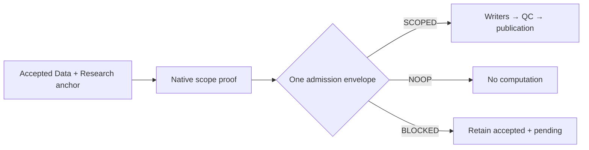

# Research refresh admission

Reconstructed: 2026-10-25. Owner: Research admission and Data/Research publishers.

Change surface: product-plane. Decision status: accepted through
[PR #234](https://github.com/deusexrenovatio-arch/trading-advisor-3000/pull/234) and
[PR #235](https://github.com/deusexrenovatio-arch/trading-advisor-3000/pull/235).
Implementation status: merged. This explanation records the existing decision;
it does not grant deployment, rebuild or production-data acceptance.

## Context and reason

An uncertain refresh scope previously requested a full rebuild. A raw NOOP after
failed Research could also conceal unfinished downstream work. Windows alone
could not prove which native changes a producer actually owned.
These behaviours coupled missing evidence to expensive, wider mutations and
could bless a later narrow update despite an unproven earlier transition.

## Chosen boundary

Existing Dagster jobs carry one `research_refresh_admission.v1` envelope through
Data → CF → L0 → L1 → L2 → sidecars/QC → Research publication.
The envelope binds exact Data/Research parents, native input identities/versions,
stable dataset domain, original/effective windows, reason and content digest.
It is immutable for an admitted attempt; consumers revalidate its bindings.

| Outcome | Permission |
| --- | --- |
| `NOOP` | Proven unchanged inputs; no compute or publication |
| `SCOPED` | Compute only admitted instrument/timeframe pairs and output scopes |
| `BLOCKED` | Missing, legacy, incompatible or drifting evidence; preserve accepted Research and pending work |

Daily execution cannot turn `None`, empty windows, a cache miss or an unknown
ancestry segment into permission for global computation. Full rebuild is a
separate explicitly selected operation with its own declared roots and domain.
It is not an automatic repair for failed daily admission.

## Producer proof and ancestry

Native downstream scope v2 must explain the complete reference chain from the
accepted Research Data anchor to the producer output. RAW and canonical owners
bind actual pre/post versions, table identities/paths and their owned commits.
Unexpected commits, legacy v1 transitions and ambiguous identities block daily
scope. A later narrow child cannot hide an unknown segment in immutable ancestry.

OI old/new keys are saved before mutation and retained through the existing
pending-work handoff. Old/new/deleted effects remain part of scope; upstream
NOOP and failed downstream attempts do not erase unfinished Research work.
The previous scope-v1 automatic full fallback from
[PR #220](https://github.com/deusexrenovatio-arch/trading-advisor-3000/pull/220)
is superseded for daily admission; its ancestry/pending-work purpose remains.

## Consequences and alternatives

Sensor-only checks were insufficient because direct/native writers could bypass
them. Writers and terminal publication therefore validate the same admission.
Publication additionally checks current parents, exact config, native successful
step owners and mandatory QC before the existing expected-current CAS.
Failed/partial physical writes cannot authorize an accepted Research snapshot;
retry transfers only verified successful work under the same admitted bindings.

Implicit full repair and guessed change windows were rejected as permissions
without proof. No new scheduler, registry, table writer or numerical formula
owner is introduced. Dagster, Spark/Delta and existing materializers retain roles.

`SCOPED` is a correctness boundary, not a tail-compute or performance promise.
An admitted affected series may still require its full numerical history.
Fewer written rows do not prove less formula work, bounded memory or a faster
whole nightly run. Unknown ancestry may use the separate
[Data scope recovery](docs/architecture/product-plane/data-scope-recovery.md)
decision; unsuccessful recovery leaves admission blocked.

## Sources, status and unknowns

- Contract: [admission schema](src/trading_advisor_3000/product_plane/contracts/schemas/research_refresh_admission.v1.json).
- Owners: [resolver](src/trading_advisor_3000/product_plane/research/refresh_scope.py), [admission](src/trading_advisor_3000/product_plane/research/admission.py), [Data publisher](src/trading_advisor_3000/product_plane/data_plane/data_snapshots.py), [Research publisher](src/trading_advisor_3000/product_plane/research/data_snapshots.py).
- Proof locations: [contract tests](tests/product-plane/contracts/test_research_refresh_admission_contract.py), [admission regressions](tests/product-plane/unit/test_research_admission.py), [native daily producer/consumer](tests/product-plane/integration/test_native_daily_admission.py).
- Operations: [indicator refresh](docs/runbooks/app/indicator-refresh.md), [snapshot publication](docs/runbooks/app/data-research-snapshot-publication.md).

Code/test presence and historical PR evidence establish the implemented contract.
Current worker binding, actual scheduled acceptance, source freshness and pinned
business-row readback require separate scoped operational evidence. This document
does not establish them or a production speedup. Rollback is an explicit release
decision retaining immutable manifests; it does not reinterpret unknown daily
history as permission to rebuild.
