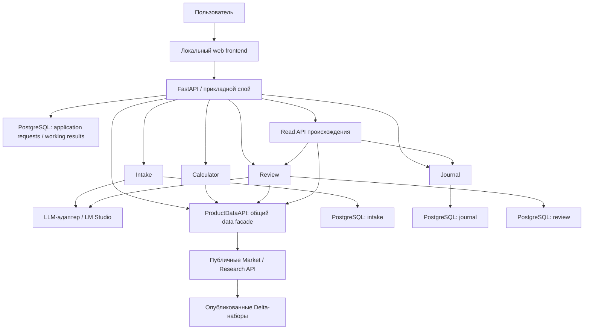
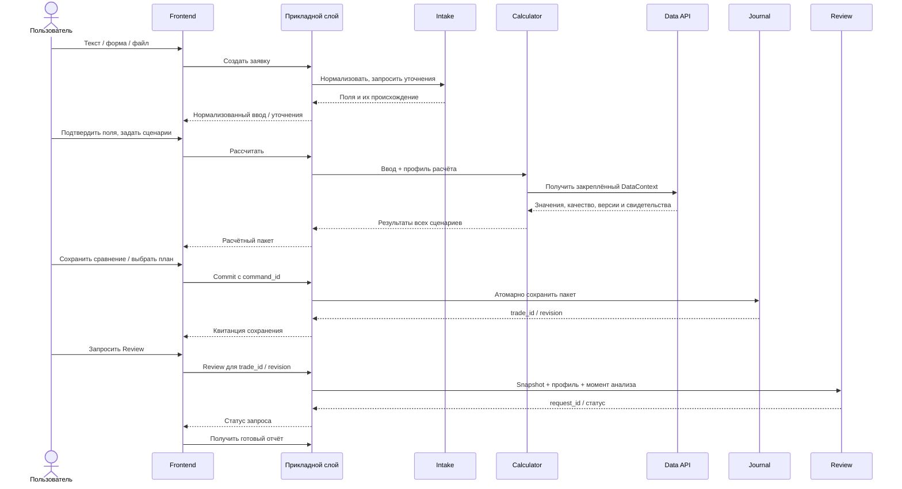

# Локальное рабочее место сделок: архитектура расширения TA3000

Дата: 2026-09-30. Change surface: `product-plane`. Solution Intent: `target`.
Статус полного target: `planned`; принятые границы сохранены при доставке 2026-11-04.
Main baseline `92160367` не содержит реализации Workspace. Отдельные локальные
Journal/Intake candidates существуют; их source refs, границы и условия доставки —
в [статусе реализации](docs/architecture/product-plane/trade-workspace/delivery-and-validation.md).
Принятие архитектуры, наличие кода, admission и deployment — отдельные утверждения.
Этот docs patch не подтверждает готовность API, PostgreSQL, модели или Delta-данных.

## Назначение

Расширение решает три задачи:
1. Вести личные планы, факты сделок, логику входа и последующие наблюдения.
2. Сравнивать сценарии риска/стопов/ГО и получать технический разбор по фиксированной
   методике с локальной AI-интерпретацией.
3. Демонстрировать проверяемый путь от MOEX и пользовательского ввода до конкретного
   значения расчёта или фактора отчёта.

Восстановление основного data pipeline — отдельная зависимость. Расширение читает
его опубликованные продукты и не запускает скрытую загрузку или перестройку данных.
Это локальное дополнение к Research Factory, а не замена Strategy, Runtime или
Execution Plane. Сохранение плана не является брокерским приказом.
Исторические/пакетные данные остаются аналитическим контекстом согласно
[STATUS.md](docs/architecture/product-plane/STATUS.md), а не live-feed для intraday execution.

## Как читать пакет

| Документ | Ответственность |
| --- | --- |
| [decision.md](docs/architecture/product-plane/trade-workspace/decision.md) | Принятые архитектурные решения, границы утверждения и альтернативы |
| [journal-module-design.md](docs/architecture/product-plane/journal-module-design.md) | Charters Intake, Calculator, Journal, Review и их предметные операции |
| [contracts.md](docs/architecture/product-plane/trade-workspace/contracts.md) | DTO, HTTP-команды, статусы, ошибки, повторы и версии |
| [storage-and-data.md](docs/architecture/product-plane/trade-workspace/storage-and-data.md) | Логическая схема PostgreSQL, таблицы Delta, время, снимки, retention |
| [review-and-local-ai.md](docs/architecture/product-plane/trade-workspace/review-and-local-ai.md) | Фиксированный отчёт, извлечение ввода, локальная модель и контроль качества |
| [frontend-and-lineage.md](docs/architecture/product-plane/trade-workspace/frontend-and-lineage.md) | Экран → read API → источники; «От числа к источнику» |
| [delivery-and-validation.md](docs/architecture/product-plane/trade-workspace/delivery-and-validation.md) | Этапы реализации, открытые решения, проверки, эксплуатация и критерии приёмки |
| [journal-integration-plan.md](docs/architecture/product-plane/trade-workspace/journal-integration-plan.md) | Исторические наблюдения 2026-10-14, актуальные границы интеграции и этапы подключения Journal |

Приоритет внутри пакета: decision — принятые границы; module design — владение;
специализированные документы — подробные проектные контракты. Имена полей,
маршрутов и таблиц ниже — целевая спецификация до реализации schema/fixtures/tests.
Текущую готовность определяет STATUS, а существующие versioned contracts —
[CONTRACT_SURFACES.md](docs/architecture/product-plane/CONTRACT_SURFACES.md).

## Состав

Три новых предметных модуля: **Calculator, Journal, Review**. **Intake** — общий
входной слой. Прикладной слой координирует их вызовы и долговечное состояние заявки.
Фронтенд и представление происхождения используют публичные интерфейсы модулей.
Отдельные микросервисы, брокер сообщений и graph database для первой версии не нужны.

Стрелки здесь обозначают разрешённые обращения. Прикладной слой выполняет
`Intake → Calculator → Journal`; модули не вызывают следующий этап самостоятельно.
Наблюдение проходит `Intake → Journal`. Факт исполнения можно сохранить при
недоступном расчёте. Review запускается явно для сохранённой версии Journal.

Общая ветвь расширения показана в
[канонической схеме TA3000](docs/architecture/trading-advisor-3000.md).
ProductDataAPI — один facade над public Market/Research products, общий для
каталога/Intake, Calculator, Review, chart и market evidence; каталог передаёт
прикладной слой. Он не владеет сценарием, отчётом или новой копией рыночных данных.
Lineage reader соединяет сохранённые Journal/Review roots с market evidence;
PostgreSQL-блоки обозначают логических владельцев в одном deployment.

Первый data slice: семейство → dated контракт → pinned economics → ручные native
уровни / fixed quantity → сохранённый расчёт → источник. Analysis series и
execution contract различаются; spot-карточки не превращаются в MOEX-контракты.
Подробности — [план интеграции](docs/architecture/product-plane/trade-workspace/journal-integration-plan.md).
Независимая оценка дизайна, проверенного Journal baseline и условий его доставки —
[реализация и приёмка](docs/architecture/product-plane/trade-workspace/delivery-and-validation.md).

## Основной сценарий

Длительные операции выполняются вне транзакции Journal. Состояние обработки
переживает закрытие браузера; фронтенд получает статус по ID. Повтор команды
возвращает прежний результат, а не создаёт вторую сделку.

## Техническое размещение

| Задача | Решение / статус |
| --- | --- |
| Backend | Python + существующий FastAPI/Uvicorn; один модульный backend |
| Состояние приложения | PostgreSQL; psycopg и версионированные SQL-миграции в установленном стиле репозитория |
| Внутренние контракты | Типизированные Python DTO; внешние/persisted envelopes — versioned JSON Schema |
| Деньги | Decimal в коде, NUMERIC в БД, десятичные строки с валютой/единицами в JSON |
| Frontend | Предлагаемый baseline: React + TypeScript + Vite; точные версии фиксируются при frontend bootstrap |
| Local AI | Принятый runtime: LM Studio через заменяемый backend-адаптер; модель ещё не выбрана |
| Табличная аналитика | Delta-native/Arrow чтение с predicates и column projection; Spark для широкой материализации |
| Индикаторы | Существующий research pipeline и pandas-ta-classic |
| Длительные/повторяемые workflow | Dagster; приложение хранит заявку и связь с engine run; interactive placement проверяется отдельно |
| Вложения | Управляемые локальные файлы + метаданные и ссылки PostgreSQL |
| Локальный запуск | Существующий подход Docker Compose + доступный backend endpoint LM Studio; topology проверяется при deployment |

Native Runtime Choice: PostgreSQL владеет транзакционными записями пользователя;
Delta — аналитическими наборами; Spark/Dagster/pandas-ta-classic сохраняют
dataflow/compute ownership. Python выполняет ограниченную логику сценария,
валидацию и адаптацию. Calculator не является симулятором портфеля; vectorbt
остаётся владельцем backtest. Эти границы уточняют, к каким данным относится
общее правило Delta storage truth, и не переносят Journal в research-хранилище.

## Граница первой версии

Входит: ввод и уточнение, несколько сценариев, история Journal, фиксированный
Review, LM Studio, карты экранных данных, обратная навигация «От числа к источнику»,
восстановление запросов и экспорт демонстрационных свидетельств без секретов.

Отложено: broker order entry, автоматические сигналы из Journal, портфельный
оптимизатор, универсальный редактор пайплайнов, облачный AI, обязательный voice/OCR,
универсальная шина событий и автоматическая загрузка отсутствующих факторов.

Гранулярность карточки, определения сценариев и состав факторов должны быть
закрыты по [реестру решений](docs/architecture/product-plane/trade-workspace/delivery-and-validation.md)
до соответствующей реализации. Архитектура этих решений не подменяет.
