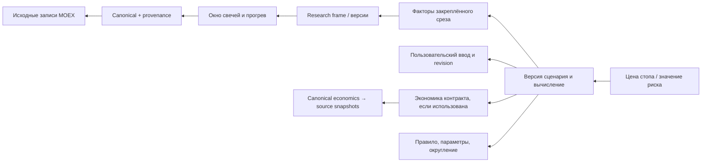

# Frontend data interfaces и «От числа к источнику»

Дата: 2026-09-30. Change surface: `product-plane`. Solution Intent: `target`.
Основное представление происхождения принято пользователем: **«От числа к источнику»**.
Этот документ задаёт архитектурный интерфейс данных, а не утверждённый графический макет.

## Граница frontend

Frontend получает экранные read models через FastAPI и отправляет типизированные
команды. Он не читает PostgreSQL/Delta, не знает физических roots, не выполняет
money math и не вызывает LM Studio. API композиции — часть прикладного слоя,
а не новый предметный модуль или второй владелец сделок.

Browser state: несохранённые правки, выбранная вкладка/узел/фильтр.
Server state: принятая заявка, revision, расчёт, отчёт, запросы и их статусы.
После reload клиента процесс восстанавливается по ID. Черновик текста до отправки
не считается серверной записью; UI показывает различие.

## Экран → ответ API → источник

| Экран / блок | Проектный read model | Источники через владельцев |
| --- | --- | --- |
| Главная | WorkspaceOverview: последние карточки/заявки/review и ссылки | Journal list, Intake requests, Review list; без загрузки истории свечей |
| Рабочая заявка | SubmissionView: original, fields, provenance, clarifications, input_revision, request state | Intake; предварительные результаты Calculator принадлежат заявке |
| Сценарии | CalculationBundleView: inputs, все сценарии, statuses, выбранный вариант либо null | Рабочий пакет или immutable пакет Journal |
| Карточка | TradeDetailView: конкретная revision, факты, план, связанные отчёты | Journal snapshot + Review metadata; переходы через публичные APIs |
| История | TradeTimelinePage | Journal entries/revisions/receipts; cursor pagination |
| Review | ReviewEnvelope | Review reports/attempt metadata; без повторной генерации при чтении |
| График | ChartContext: bars, overlays, source context refs, quality | Market/Research API; уровни сохранённого плана — Journal |
| Путь данных | LineageGraphPage + EvidenceDetail | Evidence refs Journal/Review + Market/Research manifests/provenance |
| Система | WorkspaceSystemStatus | Публикации/QC, Dagster state, health backend/model; не выводить актуальность из зелёного процесса |

Физическая карта таблиц определена в
[storage-and-data.md](docs/architecture/product-plane/trade-workspace/storage-and-data.md).
Список контрактов получает отдельный public catalogue API; его источник ещё
требует проверки. Настройки методик и report profiles версионируются, а не
переопределяются произвольными параметрами browser storage.

## Экранные границы

Основные пути: Журнал → карточка; новая запись → уточнение → расчёт → сохранение;
карточка → Review; значение расчёта/фактор отчёта → его происхождение.
Рабочая заявка может записать фактическое исполнение/заметку без доступного расчёта.
Calculator и Review доступны в контексте сделки, а не требуют отдельных независимых приложений.

Карточка группирует Обзор, Расчёты, Review, Историю. Планируемое количество
отличается от фактического; устаревший расчёт после редактирования входа помечается
явно. Report на прошлой revision виден как исторический. Новый рыночный контекст
не подменяет цены/индикаторы, использованные в старом плане.

## Принятый вид происхождения

Начальная точка — value_path конкретного расчёта или factor_id отчёта.
Пользователь движется от результата к использованным inputs и источникам.
Обязательны ветви рыночных данных, пользовательского ввода и методики/параметров.

Это направление навигации. В данных графа edge направлен от результата/операции
к его зависимости и имеет явный relation, чтобы UI не смешивал dataflow и browsing.
Если выбранный результат не использовал экономику, соответствующей ветви нет.
Рисовать такую связь по общей архитектурной схеме без run-specific evidence нельзя.

## Контракт LineageGraphPage

| Объект | Поля / смысл |
| --- | --- |
| Root | owner, result_id, result_revision, value_path/factor_id, graph_version |
| Node | node_id, kind, label, value/unit либо summary, immutable_ref, quality, evidence_state |
| kind | result, calculation, factor, dataset_slice, source_record_set, user_input, rule, quality_check, model_interpretation |
| Edge | from_node, to_node, relation, input_role; relation: depends_on, computed_by, selected_by, evidenced_by |
| Dataset ref | Logical table ID + table identity + version + keys/range/columns + manifest hash |
| Run ref | Owning module, pipeline/run ID, method/code/profile versions; при наличии — execution evidence |
| Completeness | complete/partial/evidence_expired/unavailable, missing_refs[], limitations[] |
| Pagination | cursor, remaining branches, depth; truncated graph не выдаётся за complete graph |

`value_path` выбирается из зарегистрированных roots результата. Это не произвольный
JSONPath для доступа к БД и не разрешение выполнить клиентский SQL.
Node IDs стабильны в рамках неизменяемых refs; одинаковое имя таблицы с другой
версией — другой источник. Input hash обеспечивает связь, но не заменяет источник.

`EvidenceDetail` возвращает ограниченный фрагмент данных, определение/версию
преобразования, реестр проверок и ссылки на следующий уровень. Большой input window
показывается агрегированно с точными границами, а строки доступны постранично.
EMA lineage включает окно/прогрев и правило инициализации, а не одну свечу.

## Владение и материализация свидетельств

- Market Data владеет raw/canonical identity, provenance, опубликованными версиями,
  source snapshots и QC. Research Data — factor dependencies, formula/profile,
  price-space, materialization manifests и warmup.
- Intake сохраняет происхождение извлечённых полей. Journal фиксирует выбранную
  версию ввода, calculation bundle, сценарий и его dependencies при commit.
- Review сохраняет FactBundle, связи interpretation → factor IDs, профиль,
  model/prompt/config и validation evidence.
- Прикладной lineage reader объединяет публичные evidence APIs; не сканирует
  приватные таблицы модулей и не парсит свободный AI-текст для восстановления графа.
- Graph projection может кэшироваться по immutable root/hash. Отдельное
  авторитетное lineage-хранилище или graph DB в первой версии не вводится.

Текущие pipeline manifests могут описывать зависимости на уровне набора, а не
каждого поля. Перед реализацией проверяется нужная гранулярность. Если доказуемая
связь заканчивается на dataset slice, UI показывает эту границу; не дорисовывает
точную row/field lineage. Расширение manifests выполняется владельцем pipeline
отдельным контрактным patch, не кодом frontend.

## Производительность и отказ

Первый ответ содержит root и непосредственные зависимости. Остальные ветви
загружаются по раскрытию; API ограничивает depth, nodes, rows, columns и bytes.
Delta читается с predicates/projection через provider. График также ограничивает
окно; presentation downsampling явно помечается и не влияет на расчётные inputs.

Для lineage важна полнота зависимостей, а не время ответа любой ценой. При
истёкшей retention показываются сохранённые входы и evidence_expired. Если
provider недоступен, historical Journal/Review остаётся читаемым из PostgreSQL.
При смешанных временах plan/report каждый root имеет собственный context.

Наблюдение статуса — polling существующего request API с backoff. Journal events,
WebSocket и event bus не являются зависимостями первой версии.

## Демонстрация и доступ

Основной сценарий: открыть сохранённый результат → выбрать число → раскрыть
правило и пользовательский ввод → factor slice → canonical provenance → source.
На каждом шаге различимы фактическое свидетельство, недоступная деталь и demo fixture.

API evidence возвращает зарегистрированные артефакты; произвольные filesystem paths,
секреты подключения, полный model prompt с приватными данными и SQL не публикуются.
Демонстрационный экспорт создаёт отдельное представление с удалением приватных
полей, сохраняя явную маркировку redaction; исходные записи не модифицирует.

Альтернативы «До/после» и «Основания отчёта» могут использовать тот же контракт.
Они не входят в обязательную первую реализацию и не заменяют выбранный вид.
