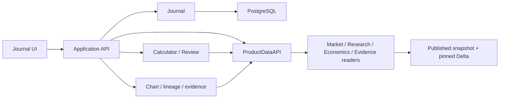

# План интеграции Journal с данными TA3000

Актуализация документа: 2026-11-04. Change surface: `product-plane`.
Статус: принятая target-интеграция; main baseline `92160367` не содержит Workspace.
Точные локальные source refs и границы реализации находятся в
[статусе доставки](docs/architecture/product-plane/trade-workspace/delivery-and-validation.md).

## Основание и исторические наблюдения

Аудит 2026-10-14 проверял конкретный published snapshot и ограниченное окно
GOLD/SILV 08–13 октября. Он показал подходящие классы inputs: свечи,
EMA50/EMA100/ATR14, economics, dated contract metadata и publication manifests.
Он не устанавливает нынешние roots, row counts, freshness или состояние сервисов.
Данные и сервисы при доставке этого документа не проверялись и не изменялись.

Оригинальные machine-readable отчёты сохранены вне этой документальной поставки
в локальном `artifacts/journal-integration-audit-20261014/`:
`delta-inventory.json`, `delta-samples.json`, `postgres-inventory.json`,
`code-inventory.json`, `http-probes.json`, `contract-families.json`.
Их пути, hashes, числа строк и HTTP probes — датированные свидетельства,
а не зависимость чтения этого пакета или разрешение повторить старые команды.

| Наблюдение 2026-10-14 | Ограничение для будущей интеграции |
| --- | --- |
| CF `pit_active_front` имел EMA50/EMA100/ATR14; native subset не имел соответствующих indicator rows | Не соединять CF и native только по инструменту/timestamp; проверить фактический factor profile |
| Bars и economics использовали разные формы contract ID (`GDZ6@MOEX` / `GDZ6`) | Resolver нормализует зарегистрированную identity с venue, не угадывает её |
| Расчётное ГО было model estimate, official margin отсутствовала | Сохранять model/buffer/source versions и различать estimate и broker truth |
| Economics effective interval мог начинаться после даты source row | Проверять requested_as_of, effective и availability отдельно |
| Journal spot-карточки XAUUSD/XAGUSD не были MOEX-контрактами | Не переименовывать их автоматически; новая MOEX-карточка требует явного выбора |
| В аналитических значениях использовался double | Adapter фиксирует исходное значение и утверждённое Decimal/tick преобразование |

Актуальный root разрешается через selected runtime instance, environment/mount
binding и принятые manifests. Текущее чтение должно следовать
[публикации Data/Research](docs/runbooks/app/data-research-snapshot-publication.md),
[refresh admission](docs/architecture/product-plane/research-refresh-admission.md)
и [семантическому контракту](docs/architecture/product-plane/semantic-compute-contract.md).
Неизвестная ancestry или missing factor не разрешают скрытый rebuild.

## Локальные кандидаты и граница main

Есть отдельные manual Journal, ProductData/chart и Intake source-линии;
подробности и immutable refs закреплены в статусе доставки. Старое утверждение
о недоставленном baseline не означает отсутствия любого кода; поздний dirty
native Intake нельзя объявлять частью старого HEAD. API из этого плана остаются
target-контрактом, пока соответствующий slice не доставлен и не принят.

PostgreSQL `journal.*` владеет пользовательскими записями, revisions и receipts.
Существующие `signal.*` принадлежат Runtime. Расчётные пакеты и Review требуют
своих versioned schemas/migrations; проект таблиц в
[storage-and-data.md](docs/architecture/product-plane/trade-workspace/storage-and-data.md)
не считается выполненным DDL. Journal facts не зависят от успешного Delta/LLM read.

## Общий интерфейс данных ProductDataAPI

Уточнение пользователя от 2026-10-14: все потребители получают рыночные и
справочные данные через один общий интерфейс. `ProductDataAPI` — технический
фасад существующих Market/Research data products внутри модульного backend.
Приложение передаёт этот интерфейс потребителям; модули зависят от его
типизированного контракта, а не от реализации и физических таблиц.

Catalog UI, Calculator, Review, chart и lineage используют один фасад.
Внутри него могут быть отдельные readers по владельцам/источникам — Market,
Research, Economics, Evidence. Эти реализации общие для потребителей:
economics reader не дублируется для формы, Calculator и Review.
В первой версии отдельный сетевой сервис для фасада не требуется.

| Операция общего интерфейса | Результат | Потребители |
| --- | --- | --- |
| list_families | Стабильные family IDs, коды, названия, aliases | Формы и каталог |
| list_contracts(family_id, as_of) | Контрактные варианты, active default и его источник/дата | Формы, Intake, Calculator |
| get_contract_context(contract_id, as_of, snapshot_ref) | Identity + экономика, effective/availability, units и evidence | Контрактный блок, Calculator, Review |
| get_analysis_context(series_ref, factor_request, as_of, snapshot_ref) | Свечи/факторы согласованного bounded среза | Calculator, Review |
| get_chart_context(series_ref, window, overlays, snapshot_ref) | Ограниченные bars/overlays и ссылки на контекст | График |
| get_evidence / get_lineage | Зарегистрированные источники и зависимости значения | Происхождение результата |
| get_publication_status | Опубликованные версии, cutoff и качество | Статус приложения |

HTTP endpoints — адаптеры над этим интерфейсом. Контрактные методы возвращают
typed DTO/DataContext с version, value/unit/currency, status/reason, snapshot refs
и evidence. Lineage также получает сохранённые result roots через публичные
Journal/Review API; ProductDataAPI владеет рыночной частью этого пути.

Общий слой централизует разрешение root/publication, закрепление таблиц, bounded
predicates/projection, нормализацию IDs, соединения по ключам и as-of, единицы,
quality/availability и источники. Calculator владеет money/scenario formulas;
Review — методикой отчёта. Пропавший фактор возвращается как missing, а не
запускает скрытый пересчёт или обновление Delta.

При изменении storage layout, названий полей или source join правится
соответствующий внутренний reader/mapping. Контракты потребителей защищены
DTO/fixtures и contract tests. Изменение публичного смысла требует версии API.
Cache identity включает manifest hash и параметры запроса, поэтому разные
контексты не смешиваются между потребителями.

Journal продолжает хранить карточки/факты/результаты в PostgreSQL. Прикладной
слой получает данные через ProductDataAPI и передаёт сохраняемый пакет Journal;
сам Journal к Delta не подключается.

Первой реализуется часть общего фасада families → contracts → economics.
Analysis/chart/evidence операции добавляются в тот же контракт по следующим
этапам. Отдельные data adapters на каждую кнопку или предметный модуль не вводятся.

## Первый участок интеграции: семейство и экономика контракта

Уточнение пользователя от 2026-10-14: сначала выбирать семейство BR/MX/Gold и
конкретный контракт внутри него. При новом выборе семейства по умолчанию предлагается
активный контракт; пользователь может выбрать другой срок. Экономика относится к
выбранному контракту. Этот участок позволяет начать расчёт по вручную введённым
native ценам и количеству до подключения технических факторов и Review.

### Граница первого frontend slice

Локальный ProductData-кандидат содержит ручные позиции, charts и фактические
execution markers. Это не готовый money/scenario workflow. Новый блок планового
расчёта использует обычный Journal write path; сохранение плана не создаёт
execution entry. Полный CalculationBundle и его сохранение принимаются отдельно.

### Семейства и контрактный каталог

Стабильные семейства уже заданы как `internal_id` в
[universe](configs/moex_foundation/universe/moex-futures-priority.v1.yaml).
В историческом published срезе 2026-10-14 наблюдались 13 семейств: FUT_BR, FUT_NG, FUT_GOLD, FUT_SILV, FUT_PLD,
FUT_PLT, FUT_WHEAT, FUT_RTS, FUT_MIX, FUT_MXI, FUT_NASD, FUT_SPYF, FUT_RGBI.
`family_id` использует эту существующую идентичность; display code и название
становятся полями публичного справочника, общими для UI и других потребителей.

| family_id | Display code | Название | MOEX assetcode |
| --- | --- | --- | --- |
| FUT_BR | BR | Brent | BR |
| FUT_MIX | MX | Индекс МосБиржи | MIX |
| FUT_GOLD | GOLD | Золото | GOLD |
| FUT_SILV | SILV | Серебро | SILV |

Список сроков формируется по prepared securities + canonical economics с датой
и source refs. Research instrument tree помогает проверить family/contract membership,
но его исторический список active_contract_ids не определяет текущий default.
`secid`/`is_active` из апрельских seed-конфигов также не являются текущим default.

Историческая иллюстрация `canonical_roll_map` на 2026-10-13, не текущий default: BR → BRX6@MOEX,
MX → MXZ6@MOEX, GOLD → GDZ6@MOEX, SILV → SVZ6@MOEX.
Примеры других available contracts: BRZ6/BRF7, MXH7/MXM7, GDH7/GDM7, SVH7/SVM7.
UI получает дату и правило выбора из фактически закреплённого контекста.
Исторический перечень не заменяет актуальный catalogue/publication read.

Правила выбора:

- Default применяется при создании нового плана либо явной смене семейства.
  Сохранённый контракт и зарегистрированное исполнение не меняются при новом ролле.
- Исторический факт выбирает контракт на дату исполнения, не сегодняшнюю замену.
- Ручной выбор другого срока сохраняется явно; экономика и расчёт обновляются для
  него. Старый расчёт получает признак устаревшего и не подставляется к новой идентичности.
- Если active selection отсутствует, устарела или конфликтует с dated catalogue,
  provider возвращает причину и доступные варианты, без выбора случайного контракта.
- У одной карточки исполнения остаётся один эпизод/контракт по Journal v1.
  Расчёт и выбор планового контракта не меняют фактическую позицию.

### Минимальные API и результат расчёта

Предлагаемые read endpoints под `/api/trade-workspace/v1`, вызывающие общий ProductDataAPI:

| API | Ответ |
| --- | --- |
| GET /families | family_id, display_code, name, asset_group, aliases |
| GET /families/{family_id}/contracts?as_of=... | Dated варианты, active/default ID, причина и дата default, contract identities, expiry, availability, snapshot refs |
| GET /contracts/{contract_id}/economics?as_of=... | min_step, lot_volume, валюты, step_price_rub, оценка ГО, effective/availability, model/buffer/source refs |

Calculator получает выбранный контракт, native цены входа/стопа/целей, целое
количество и явные costs. Backend считает стоимость шага позиции, риск/результат
по уровням и оценку ГО всего объёма. Frontend отображает result/status/evidence.
Недоступные входы имеют null + reason; процентный риск требует отдельного account snapshot.
Интерпретация spot-уровней как native цены выбранного фьючерса не выполняется.

В Journal plan сохраняются family_id, выбранные contract identities, причина
выбора, economics context/version, входы и calculation bundle. API facts остаётся
для уже совершённых исполнений. Приёмка первого участка: BR/MX/GOLD/SILV,
default + ручная смена срока, historical selection, смена контракта после расчёта,
missing economics, источник и дата каждого денежного входа, отсутствие скрытого execution.

## Карта DataContext

| Контракт | Основание для проверки в выбранном срезе | Работа adapter |
| --- | --- | --- |
| context_id | Manifest hash + query/profile inputs | Версионированный ID/hash полного запроса |
| contract_id/instrument_id/venue | Registered MOEX IDs, prepared metadata, economics | Разрешить identities и отделить analysis от execution |
| requested_as_of/observed_as_of | Ввод + ts/bar_end_ts/session rules | Выбрать допустимый закрытый бар; показать фактический cutoff каждого фактора |
| source_available_at/effective interval | Raw fetched_at, economics intervals/source flags, source manifests | Проверять availability отдельно от даты факта; неизвестную историю обозначать явно |
| timeframe/series_mode/price_space | Research columns + roll/adjustment recipe | Запрет несовместимого price-space; перевод только по доказуемой версии recipe |
| dataset/table identity/version | Published manifests | Закрепить все использованные refs из одного coherent bundle |
| value/unit/currency/status/reason | Scalars и economics currencies; QC | Добавить явные единицы и available/missing/stale/incompatible states |
| factor/method/profile versions | Indicator/profile hashes, manifests, economics versions | Реестр требуемых факторов и versioned method/report profile |
| keys/window/warmup/evidence | Provenance windows, source hashes, warmup metadata | Сохранить точные dependencies каждого выданного значения |

## Последовательность интеграции

| Этап | Конкретный результат | Приёмка |
| --- | --- | --- |
| 0. Доставка Journal | Согласовать existing contracts/backend/UI с актуальным main; reviewable PRs; явный локальный запуск | Миграции, restart/restore, retries/conflicts, две исходные карточки и hashes сохранены |
| 1. Контракты источников | Единый ProductDataAPI: Family/ContractResolution/ContractEconomicsContext сначала; затем SeriesReference и factor DataContext; решения по as_of, units, price-space и availability | Fixtures: default/manual/historical contract choice, spot unresolved, missing economics/factor, unavailable version |
| 2. Общий data facade | Families → dated contracts → pinned economics через ProductDataAPI; dropdowns + economics panel в «Контрактах». Затем bounded factor reads и publication status | BR/MX/GOLD/SILV, source/date default, ручной срок; latest advance не меняет сохранённый выбор; future economics исключены; consumers не читают Delta напрямую |
| 3. Calculator и сохранение | Сначала fixed-quantity по вручную введённым native уровням; затем EMA50/EMA100/ATR14 scenarios. Versioned rounding/costs; POST/GET calculations; Journal attach bundle | Независимые money cases; missing costs/margin; смена контракта; incompatible space; input_hash/revision conflict; атомарность snapshot+bundle+receipt |
| 4. График и происхождение | GET chart-context/lineage/evidence; выбранное число раскрывает formula, user inputs, factor, dataset slice, canonical/raw | Путь одного реального числа; сохранённый результат переживает обновление рынка; evidence_expired при удалённой версии |
| 5. Review и AI Intake | Fixed report profile, Review request/report/attempt migrations; durable request lifecycle; LM Studio adapter; submissions/reviews/requests | Явная Journal revision; numeric facts immutable; missing/unsupported AI выводы отклоняются; recovery/timeout; local corpus eval |

Этапы 1–2 можно делать до выбора модели. Определение method profile завершается
до этапа 3. Для fixed_risk_budget дополнительно нужен account snapshot с капиталом,
валютой, временем и источником; первый fixed-quantity slice его не подменяет.
EMA13/EMA21/EMA500 добавляются owning research pipeline только после выбора
нужного analysis source/profile; frontend их не рассчитывает.

### Первый проверяемый пользовательский сценарий

Новая тестовая MOEX-карточка → выбрать семейство → получить active default и
возможность другого срока → загрузить pinned economics выбранного контракта →
ввести native уровни/количество → рассчитать один сценарий по утверждённой методике →
сохранить bundle в новой Journal revision → открыть источник экономики → повторить
расчёт на сохранённых scalar inputs. Подключение CF-факторов — следующий шаг;
при отсутствии доказуемого adjusted/native mapping такой сценарий incompatible.

Полные рыночные ряды остаются в Delta. PostgreSQL хранит использованные scalar
inputs, методику, результаты и evidence refs. Retention входов и Delta history
должен покрывать обещанный срок replay; expiry не уничтожает сохранённый результат.
Journal не читает Delta и не запускает Review автоматически.

## Проверка перед реализацией

Новая приёмка фиксирует selected instance и manifests, immutable code refs,
нужные columns/windows и native predicate/projection read. Она отдельно проверяет
identity, business keys, availability, price-space и source evidence. При
неизвестной ancestry применяется существующий admission/recovery контракт.

Октябрьские скрипты и SELECT readback не запускаются этой документацией.
Наличие старого audit output не закрывает нынешние data, HTTP, PostgreSQL,
restart/restore или AI acceptance. Полная последовательность проверок принадлежит
[плану поставки](docs/architecture/product-plane/trade-workspace/delivery-and-validation.md).
