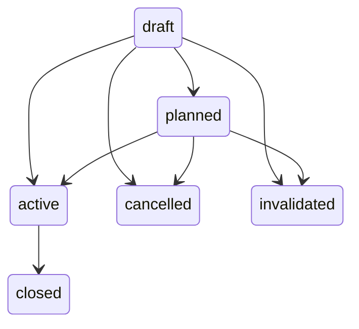

# Journal v1: карточка и ручной ввод

Дата: 2026-10-12. Change surface: `product-plane`. Solution Intent: `staged`.
Область: Journal + ручной Intake + PostgreSQL/API. Calculator, Review, LM Studio,
автоматический справочник контрактов и frontend остаются следующим этапом.

## Solution Intent

- Solution Class: staged
- Critical Contour: runtime-publication-closure
- Forbidden Shortcuts: implicit execution from plan, mutable history, automatic Review
- Closure Evidence: contract tests and isolated PostgreSQL/API integration tests, restart and restore readback
- Shortcut Waiver: none

Native Runtime Choice: PostgreSQL transactions/constraints own durability;
psycopg manages short connection transactions; Pydantic validates manual input;
FastAPI owns HTTP. Journal has no RuntimeStack/Delta/model dependency. This closes
manual journal persistence only, not runtime publication or broker execution.

## Поля

| Блок | Поля и смысл |
|---|---|
| Идентичность | trade_id, schema_version=1, revision, created_at, updated_at, is_test |
| Анализ | symbol, asset, market_type, price_unit, timeframe/data_provider с null+reason |
| План | title, introduction, direction, entry, invalidation, targets с собственными основаниями |
| Обоснование | technical_items: pattern/indicator/zone/fibonacci/correlation/other; название, текст, timeframe, зона/уровень |
| Общая гипотеза | shared_thesis: ID, заголовок, текст, source; закреплённая копия каждой версии |
| Связь сделок | related_trade_id + relation=reentry/roll; ссылка на существующую закрытую карточку |
| Происхождение | source_type=manual/import, original_text, reference; версия источника хранится в snapshot |
| Факт | execution entry: MOEX contract_code, account с null+reason, increase/reduce, целое положительное количество, цена/комиссия с null+reason, currency |
| Дневник | note/execution, entry_id, event_at, recorded_at, revision, source, supersedes_entry_id |
| Проекция | positions по конкретным contract_code; включает только действующие факты, планы исключены |

Цена — строка Decimal, максимум 20 целых и 10 дробных цифр; NUMERIC(30,10) для
исполнений. Единица уровней задана анализируемым рядом; валюта исполнения задана
отдельно. XAUUSD/XAGUSD не переводятся автоматически в цену/результат фьючерса.
Пустые поля серебра остаются null+reason. Технические наблюдения автора не
объявляются проверенными рынком. original_text сохраняет исходный ввод.

## Статусы и grain

draft/черновик, planned/план, active/открыта, closed/закрыта,
cancelled/отменена, invalidated/гипотеза опровергнута. Полнота полей независима
от статуса: ручной план допускает явно неизвестные уровни. active требует
положительного фактического объёма; остальные статусы требуют нулевого открытого
объёма. closed требует хотя бы одного действующего факта исполнения.

Одной карточке соответствует эпизод позиции по одному контракту. Доборы и
частичные выходы — новые факты той же карточки. Закрытие/переоткрытие после
полного выхода и ролл — новая карточка с related_trade_id. Второй контракт в
одном эпизоде отклоняется. Это реализационное решение первого этапа на основе
требования «одна сделка — одна карточка», а не ранее утверждённая политика ролла.

Статус меняется явно; запись исполнения и смена статуса могут быть одной
командой. Закрытый эпизод не переоткрывается. Исправление ошибочного статуса
возможно только отдельной операцией correct_status с причиной, без добавления
нового увеличения позиции в той же команде. Коррекция существующего increase
через supersedes допустима вместе с correct_status: это исправление старого
факта, а не новое открытие. Отрицательная позиция/избыточное
сокращение отклоняются; факты проверяются по event_at, затем recorded sequence.

## Изменения и атомарность

POST /trades создаёт draft/planned. POST /trades/{id}/changes содержит 1–20
типизированных операций replace_card/add_entry/set_status/correct_status.
Граница Q-BATCH — одна карточка и её операции, одна транзакция, одна revision.
replace_card заменяет весь план явно, но не меняет факты. Коррекция факта/заметки
добавляет запись с supersedes_entry_id; ссылка только на действующую запись того
же вида в этой карточке, не на будущую/чужую/уже исправленную. Записи не удаляются.
Поздний факт хранит своё event_at отдельно от recorded_at. Заметки допустимы
во всех статусах. Изменения требуют причины и source.

command_id + canonical normalized hash дедуплицируются глобально внутри Journal;
та же команда возвращает прежнюю receipt, другой payload/route даёт 409.
expected_revision обязателен для правок; устаревшая версия даёт 409. Факт,
snapshot, revision pointer и receipt фиксируются атомарно. Старые snapshots
никогда не пересобираются из изменяемого состояния.

## API и пределы

Префикс /api/trade-workspace/v1. POST /trades, POST /trades/{id}/changes,
GET /commands/{command_id}, GET /trades, GET /trades/{id}?revision=N,
GET /trades/{id}/timeline. Список и лента: limit=1..100, cursor привязан к
фильтрам/карточке. Additive read options: список принимает status; лента order=asc/desc
(default asc сохраняется), desc показывает последнее сначала. Смена status/order
отклоняет чужой cursor; desc сохраняет pin revision при дозагрузке.
Лента закрепляет верхнюю revision. max 5000 entries/card,
20 операций/команду, 100 technical_items/targets, original_text до 64 KiB.
current включает draft/planned/active; archive — terminal statuses.
Чтение не вызывает вычислений, модели, migrations или mutation.

Миграции выполняются явной CLI-командой; API не изменяет DDL при старте.
API слушает localhost по runbook, DSN приходит из environment. SQL identifiers
фиксированы, параметры передаются отдельно. Ошибка БД — 503 без вывода DSN/SQL;
422 — ввод, 404 — объект, 409 — ревизия/повтор/предметный конфликт.

JSON Schema v1 создаются из DTO и фиксируются рядом с fixtures; тест сравнивает
их с runtime DTO, проверяет невалидные значения и реальные записи PostgreSQL.
Новые schemas не добавляются автоматически в release-blocking inventory.

### Исправления контракта и readiness, 2026-10-18

DTO остаются источником генерации JSON Schema. Пара `related_trade_id`/`relation`
либо задана целиком, либо отсутствует/null. `execution` обязателен и не-null
только для kind=execution; для note допустимы отсутствие/null. Эти правила
попадают и во вложенные запросы, и в сохраняемый Entry. Исправление schema v1
не меняет множество запросов, принимаемых HTTP/DTO: ранее ошибочно разрешённые
только JSON Schema комбинации сервер уже отвергал. Миграция записей не нужна.

GET /ready вызывает публичную `PostgresJournal.check_ready()`. Journal в
read-only транзакции проверяет полный набор packaged SQL versions и SHA-256,
используя ту же проверку, что явная migration CLI. Отсутствующая таблица/версия,
неизвестная версия или неверный checksum дают 503; HTTP не читает private SQL.
Ни readiness, ни запуск API не исправляют схему автоматически. Более новая БД
требует соответствующей версии приложения, а не ослабления проверки.

## First main delivery, 2026-11-11

The first staged slice ports the compatible Stage1 v1 DTOs, generated schema,
PostgreSQL writer and API onto current main. Manual requests use `/docs`; React
forms follow separately. The API root redirects to `/docs`. One separately
created database and loopback-only ports are used for local verification.
SQL 001 is copied unchanged; the API never migrates storage on startup.
The compact JSON export is generated from readable DTOs and checked for exact
semantic parity. It is not a second hand-maintained validation authority.
Existing Journal, Intake, market/research, model and production services are
outside this delivery. No deployment or full Workspace acceptance is claimed.
