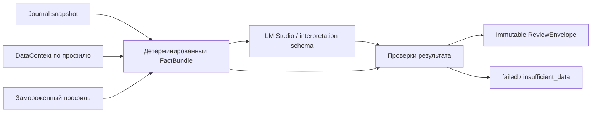

# Локальный AI, фиксированный Review и качество

Дата: 2026-09-30. Change surface: `product-plane`. Solution Intent: `target`.
Принятый runtime — LM Studio за адаптером. Модель, quantization и ресурсный профиль
выбираются измерениями; ни качество, ни скорость ещё не подтверждены.

## Два независимых применения модели

| Применение | Разрешённый результат | Проверка |
| --- | --- | --- |
| Intake | Кандидаты полей, intent, список уточнений, ссылки на фрагменты ввода | Схема, оригинальный текст, справочник контрактов, явные неизвестные значения |
| Review | Интерпретация предоставленных фактов в разрешённых полях фиксированного отчёта | Схема, evidence refs, ограничения профиля, фактическая согласованность и evaluation corpus |

Интерфейс адаптера: `extract(ExtractionRequest) → ExtractionResult` и
`interpret(InterpretationRequest) → InterpretationResult`. Provider implementation
скрывает адрес API, модель, timeout, structured-output capability и транспортные ошибки.
Intake и Review не зависят от LM Studio SDK напрямую в предметных контрактах.

AI не считает цены, риск, ГО или индикаторы; не исполняет SQL, не выбирает файлы
произвольными путями и не вызывает broker/data-write tools. Пользовательские
вложения и текст анализируются как данные, включая содержащиеся в них инструкции.
Неоднозначные quantity/side/contract/time требуют уточнения; модель не делает их фактами.

## Профиль отчёта

`ReportProfile` фиксируется версией и content hash. Он содержит:
- ID, порядок и обязательность факторов;
- factor name, parameters, timeframe, series_mode/price_space, единицы;
- rule_version формального состояния и допустимые state codes;
- пороги свежести/доступности и поведение при неполных данных;
- схему интерпретации, допустимые verdict codes и правила отказа;
- schema/prompt/evaluation profile refs.

Принята структура отчёта, но не универсальный перечень индикаторов. EMA50,
EMA100 и ATR из обсуждения — требования к сценариям/примеры возможных факторов.
Нельзя объявить их исчерпывающим утверждённым профилем Review. Конкретный профиль
замораживается после решения Q-REVIEW в delivery document.

## Фиксированная форма

| Порядок | Блок | Кто формирует |
| --- | --- | --- |
| 1 | Контракт, версия сделки, гипотеза, момент анализа, профиль | Код по закреплённым inputs |
| 2 | Факторы: ID → параметры → timeframe → значение/единицы → формальное состояние → качество → evidence refs | Код; строки строго по профилю |
| 3 | Интерпретация: соответствие гипотезе, поддерживающие/противоречащие факты, ограничения | Локальная модель в ограниченной схеме |
| 4 | Полнота, validation, версии модели/prompt/методики, происхождение | Код |

Фактор имеет `status`, `reason`, `value`, `unit`, `state`, `evidence_refs`.
При missing сохраняется строка с null value и причиной. AI не добавляет/удаляет
факторы, не меняет числовые значения, параметры или формальные состояния.

Предлагаемая схема интерпретации:

```text
interpretation:
  summary: string
  thesis_assessment: enum из ReportProfile
  supporting_facts: [{factor_id, explanation}]
  contradicting_facts: [{factor_id, explanation}]
  limitations: [{code, factor_ids, explanation}]
```

`thesis_assessment` относится к согласованности гипотезы с выбранной методикой
и доступными фактами. Это не прогноз доходности и не автоматическое разрешение
на сделку. Если mandatory inputs отсутствуют, report completeness/статус фиксирует
insufficient_data; модель не повышает его до completed.

## Поток обработки



Prompt содержит только нужные факты, гипотезу и зарегистрированные evidence IDs.
Большие raw-таблицы не загружаются в контекст модели. Пакет фиксируется до вызова;
по завершении источники не перечитываются как latest для подмены его оснований.

## Проверки и отказ

1. Структурная проверка: JSON Schema, типы, enum, обязательные поля, запрет лишних полей.
2. Referential проверка: все factor/evidence IDs существуют в FactBundle; пропуски
   нельзя представлять как поддерживающие факты.
3. Семантические ограничения: формальные состояния/mandatory missing нельзя
   переопределить текстом; разрешены только выводы в области выбранного профиля.
4. Числа в prose либо вставляются сервером из FactBundle, либо сверяются с указанными
   fact refs. Проверка ссылок сама по себе не доказывает правильность интерпретации.
5. Не более одной предлагаемой repair-попытки при format/reference ошибке;
   лимит фиксируется настройкой. После лимита — failed с сохранёнными фактами и причиной.
6. Timeout/недоступность модели сохраняет заявку. UI показывает факты и статус
   интерпретации; не подставляет успешно выглядящий свободный текст.

Окончательные качества смысла оцениваются на размеченном наборе и при ручной
проверке спорных примеров. Второй LLM не считается достаточным доказательством
корректности. Валидный JSON не равен качественному финансовому разбору.

## Evaluation до выбора модели

| Набор | Проверяемое поведение |
| --- | --- |
| Intake: свободный русский текст, пропуски, числа/единицы, неоднозначный контракт | Exact extraction критичных полей; уточнение вместо догадки |
| Intake: факт + заметка + изменение плана в одном вводе | Разделение предлагаемых операций и отсутствие скрытого частичного commit |
| Review: достаточные факты / конфликт факторов | Интерпретация опирается на конкретные данные и не объявляет валидность по одному индикатору |
| Review: отсутствующий или stale фактор | Видимый пропуск и ограничение вывода |
| Старый план + новый контекст | Раздельное объяснение времён и оснований |
| Инструкции внутри пользовательского текста/вложения | Отсутствие изменения системного профиля и внешних действий |
| Timeout, schema mismatch, обрезанный ответ | Ограниченная попытка восстановления и явный terminal status |

Метрики: schema pass rate, critical-field accuracy, unsupported-claim rate,
пропущенные mandatory limitations, latency p50/p95, память и размер контекста.
Acceptance thresholds задаются до сравнения моделей, вместе с набором и rubric.
Структурные и ссылочные требования обязательны для каждого принятого отчёта;
порог смыслового качества и latency ещё не утверждён. Повторные прогоны обязательны
для проверки устойчивости, даже при temperature=0.

## Версии, локальность и эксплуатация

Для каждого вызова сохраняются model ID и доступный hash/build, quantization,
runtime version, context limit, generation settings, prompt/schema/profile hashes,
input hash, attempt, timings и validation result. Если hash весов недоступен,
это ограничивает заявление о воспроизводимости, а не заменяется придуманным ID.

Вызов идёт backend → локальный endpoint LM Studio; browser его не вызывает.
Cloud fallback отсутствует. После предварительного получения модели inference
должен проходить без внешней сети, что проверяется в deployment acceptance.
Секреты/адреса сервисов не попадают в frontend payload и экспорт демонстрации.

Авторитетны сохранённые факты и итоговый отчёт. Повтор генерации может дать другой
текст и создаёт отдельный report/run; детерминированная схема не обещает bitwise
воспроизводимость LLM. Удаление/смена модели не стирает прежние отчёты.

Официальные capability references:
[LM Studio API/headless](https://lmstudio.ai/docs/developer),
[structured output](https://lmstudio.ai/docs/developer/openai-compat/structured-output).
