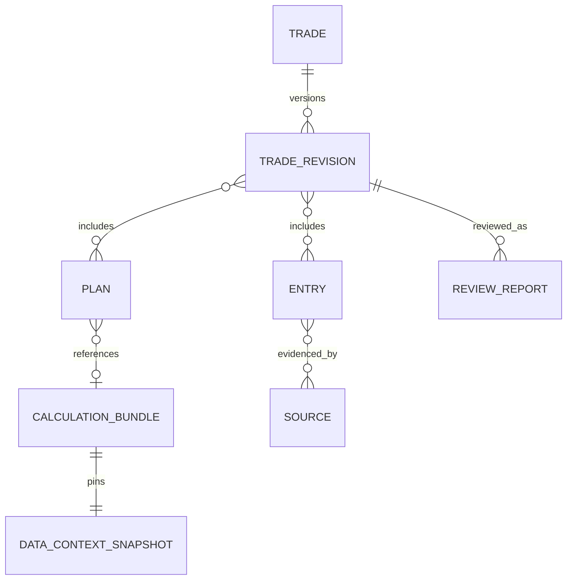

# Хранение, срезы и связь с Delta

Дата: 2026-09-30. Change surface: `product-plane`. Solution Intent: `target`.
PostgreSQL-схема ниже — полный логический target, не выполненный этим пакетом DDL.
Отдельный локальный Journal v1 уже ограничивает факт одним episode/contract/account;
его расширение, executions/roll/account детали требуют решения и версий до миграций.

## Владение записями

| Предлагаемая таблица PostgreSQL | Владелец / содержание |
| --- | --- |
| intake.submissions | Intake: исходный материал, intent, revision, уточнения, нормализованные поля и provenance |
| intake.requests | Прикладной слой: request ID/hash, статус, attempt, связь с Dagster run, result_ref, ошибка |
| intake.working_calculations | Прикладной слой: расчёты до commit, input_revision, bundle и срок хранения |
| journal.trades | Journal: ID карточки, account/contract refs, current_revision, состояние |
| journal.trade_revisions | Journal: immutable снимки состава карточки, причина/автор/время изменения |
| journal.entries | Journal: факты исполнения, заметки, гипотезы; исправления с supersedes_ref |
| journal.plans | Journal: сохранённые планы, выбранный сценарий либо явное отсутствие выбора |
| journal.calculation_bundles | Journal: неизменяемые входы, результаты, DataContext, методика и lineage вычисления |
| journal.command_receipts | Journal: command_id, payload_hash, CommitReceipt; атомарно с бизнес-изменением |
| journal.sources | Journal: долговечные исходные свидетельства и ссылки на вложения сохранённых записей |
| review.requests | Review: revision сделки, профиль/время, статус и ссылка на прикладной запрос |
| review.reports | Review: неизменяемый после завершения отчёт, факты, источники, происхождение и validation |
| review.attempts | Review: попытки AI, model/config refs, duration, результат проверок и ошибка |

Intake и Review получают общий request lifecycle через прикладной публичный
интерфейс; не правят чужие таблицы. Одинаковый физический PostgreSQL не отменяет
модульное владение. Существующие `signal.*` таблицы Runtime не используются как Journal.
Справочник счетов, единицы учёта и общий каталог вложений требуют уточнения DDL;
account_id уже обязателен в тех операциях, где от него зависит смысл факта/риска.

Диаграмма логическая. Связи revision → entries/plans материализуются через
версионированный snapshot или membership tables при DDL. Исторический снимок
не собирается по изменяемому current-state JOIN. Связь Review → Journal — ссылка
на публичный snapshot с закреплённым содержимым, без каскадной записи в Journal.

## Типы и ограничения

- Типизированные колонки: IDs, revision, timestamps, intent/state, account,
  contract, direction, quantity, цены/суммы. JSONB — composite snapshots фиксированной
  schema_version: contexts, scenario results, report factors, provenance.
- Деньги/цены — NUMERIC с утверждёнными precision/scale; количество контрактов
  целое в поддерживаемом futures scope. Единицы и валюта хранятся явно.
- Уникальны command_id и request_id в своём scope; receipt хранит payload_hash.
  Уникальна пара trade_id/revision. Current revision обновляется с optimistic lock.
- История не исправляется UPDATE предыдущего факта: новая запись supersedes старую.
  Проекции открытого объёма/средней цены исключают superseded данные и не включают планы.
- Индексы: карточки по account/state/contract; история по trade_id/time/id;
  requests по status/update time; reports по trade_id/revision/created_at.
  Индексы JSONB добавляются только под реальные запросы, не на весь документ по умолчанию.
- Вне зависимости от физической модели, список/карточка/история должны возвращать
  согласованную revision. Приложение не выдаёт смесь плана новой версии и фактов старой.

## DataContext: контракт согласованного среза

Каждый используемый вход имеет value, unit/currency, status/reason, source_ref,
effective/availability time и методику. Весь контекст фиксирует:

| Группа | Обязательные сведения |
| --- | --- |
| Идентичность | context_id, contract_id, instrument_id, venue |
| Выбор контракта | family_id, execution contract identities, selection reason/as_of; сохранённый выбор не следует за новым default |
| Ряд анализа | Отдельный analysis_reference/series_ref: dataset/contour/series identity; явная связь с execution contract, если она применима |
| Время | requested_as_of, observed_as_of, source_available_at, время закрытия свечи |
| Ряд | timeframe, series_mode, price_space, связь adjusted/native price при необходимости |
| Наборы | Логический dataset ID, physical table identity у провайдера, Delta version, manifest ID/hash |
| Выборка | Ключи/границы использованных строк, имена колонок, требуемое окно и прогрев |
| Методика | factor parameters/profile, formula/library versions, economics/buffer policy versions |
| Качество | published role, missing/stale/unavailable/incompatible, проверки и ограничения |

Delta version имеет смысл только вместе с идентичностью таблицы. Разные таблицы
не обязаны иметь одинаковый номер версии; provider возвращает согласованный
манифест. Если такого набора нет, он возвращает несовместимость, а не соединяет
последние строки из произвольных запусков.

Все Workspace consumers получают эти контексты через один ProductDataAPI facade
над публичными Market/Research продуктами. Shared readers принадлежат этим
владельцам; facade не вводит вторую storage truth. Подробности —
[план интеграции](docs/architecture/product-plane/trade-workspace/journal-integration-plan.md).
ContractEconomicsContext закрепляет экономику выбранного execution contract;
analysis context закрепляет отдельный ряд и факторы. Для ручного fixed-quantity
расчёта native уровней analysis context необязателен. Spot/continuous-front цены
не становятся native фьючерсными уровнями без явного доказуемого mapping.

## Карта источников

Эти имена взяты из текущих архитектурных документов; наличие/покрытие/актуальность
конкретных опубликованных таблиц данным пакетом не подтверждается.

| Требуемые данные | Источники Delta / артефакты | Потребитель через публичный API |
| --- | --- | --- |
| Исходные свечи MOEX | raw_moex_history | Evidence provider для демонстрации источника |
| Нормализованные свечи | canonical_bars | Market Data API; chart и research preparation |
| Источник свечи | canonical_bar_provenance | Evidence provider |
| Календарь и смена контрактов | canonical_session_calendar, canonical_roll_map | DataContext resolver |
| Ряды анализа | research_datasets, research_bar_views | Calculator/Review/chart через Research Data API |
| Базовые факторы | research_indicator_frames | EMA/ATR и прочие объявленные profile inputs |
| Производные состояния | research_derived_indicator_frames | Подготовленные отношения/состояния по версии профиля |
| Экономика контракта | canonical_contract_economics | Calculator; canonical model/estimate, не broker ledger |
| FX и риск-параметры | canonical_fx_rates, canonical_asset_risk_parameters | Economics provider и объяснение inputs |
| Первичная экономика | raw_moex_contract_securities, raw_moex_indicative_fx_rates, raw_moex_rms_limits, raw_moex_rms_staticparams | Economics lineage |
| Опубликованные версии | baseline-manifest.json, route/canonical reports, materialization.lock.json и data-prep manifests | Data API и доказательства публикации/материализации |
| Continuous-front proof | cf_indicator_input_frame, indicator_roll_rules, continuous_front_indicator_frames, continuous_front_derived_indicator_frames | Детализация конкретного continuous-front контекста |
| Continuous-front качество/запуск | continuous_front_indicator_qc_observations, continuous_front_indicator_run_manifest, continuous_front_indicator_acceptance_report | Lineage/system read API |

Consumer-facing research tables сохраняют интерфейс; sidecar proof не становится
параллельным незаявленным источником значений. Источник справочника контрактов
требует отдельной проверки: resolve_contract нельзя строить как неограниченный
поиск тикера по свечам или как угадывание текущего контракта моделью.

Физические roots разрешает data provider по принятому registry/publication
контракту. Frontend не передаёт файловые пути/SQL. Candidate, verification и
published current остаются разными ролями; совпадение имени таблицы их не объединяет.

## Соединения и точность времени

1. Свечи/факторы соединяются по идентичности ряда, контракту, timeframe, времени
   и совместимым версиям; одиночного timestamp или тикера недостаточно.
2. Для MTF доступны только закрытые свечи: ts_close не позже analysis_as_of.
   Время `ts` не считается временем доступности без определения контракта ряда.
3. Экономика присоединяется as-of по контракту и effective interval, без размножения
   строк. Effective time и source_available_at проверяются отдельно.
4. Уровни adjusted continuous series нельзя непосредственно использовать как
   стоп native contract. Нужен доказуемый перевод ценового пространства;
   без него scenario incompatible/unavailable, а не численно правдоподобный стоп.
5. При неизвестной исторической availability нельзя заявлять строгий point-in-time
   replay. Контекст обозначает ограничение и не выдаёт его за доказанную историческую доступность.
6. Missing EMA100 не заменяется EMA50. История прогрева, formula version и параметры
   входят в свидетельство фактора; одинаковое имя колонки не гарантирует одинаковую методику.

## Money math boundary

Calculator использует действующую модель экономики и сохраняет её версии,
source flags, min_step/стоимость шага, FX, оценку ГО, buffer policy и допущения
fees/slippage. Полный economics source — canonical_contract_economics;
research `execution_*` — производная проекция, не универсальный источник истины.

Фиксированный объём и фиксированный риск-бюджет — разные режимы. Источник капитала
и время его значения обязательны для процентного бюджета. Способ округления,
направление стопа, costs и ограничения ГО утверждаются как версия методики.
Отсутствующие обязательные inputs не становятся нулевыми расходами/ГО.
Оценка ГО не представляется как подтверждённое брокером требование.

## Снимки, файлы и восстановление

Journal/Review сохраняют фактически использованные scalar values, parameters,
версии и evidence refs. Этого достаточно показать прежний результат и повторить
ограниченный сценарный расчёт при наличии его методики. Повторная материализация
EMA/ATR требует сохранённой истории, прогрева и зависимостей реализации.

Delta time travel зависит от retention/VACUUM: версия сама по себе не гарантирует
будущий доступ. До приёмки выбирается срок сохранения входных snapshots или
закреплённых data-plane артефактов. После истечения evidence retention результат
остаётся читаемым, но lineage/replay честно сообщает evidence_expired.

Вложения — вне больших JSONB: content hash, media type, size, storage ID, provenance
и references в БД. Принятые Journal/Review источники имеют срок жизни независимо
от очистки Intake. До commit необходима долговечная ссылка/резервация файла;
GC не удаляет артефакт с действующей ссылкой. Правила общих metadata tables
и reconciliation резервов фиксируются при DDL, без cross-module private writes.

Backup охватывает PostgreSQL, управляемые файлы, профили/методики и необходимые
закреплённые данные. Restore проверяет hashes и отсутствие broken refs.
Общей транзакции PostgreSQL/Delta/файлов/LLM нет; локальная атомарная граница —
Journal business package + revision + command receipt.

Источники: [baseline layout](docs/runbooks/app/moex-baseline-storage-runbook.md),
[research](docs/architecture/product-plane/research-plane-platform.md),
[continuous-front](docs/architecture/product-plane/continuous-front-indicator-storage.md),
[money math](docs/runbooks/app/moex-money-math-runbook.md).
