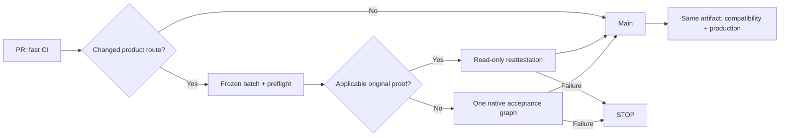

# Guarded staging acceptance

Change surface: mixed. Contract: [staging acceptance](docs/architecture/product-plane/staging-acceptance.md).



## Prepare once

Use a clean protected verifier checkout, frozen candidate checkout, immutable image
digest, independent staging data and persistent Dagster HOME. Initialize the
dedicated quota database with `scripts/bootstrap_staging_quota.py`; its runtime
role has SELECT/INSERT and sequence USAGE only. Keep its owner credentials and
Ed25519 private key outside every container mount. Never print connection secrets.

The host runtime needs the image-compatible Dagster/Postgres packages and
`staging-control` dependencies. Windows host quota access explicitly maps the
configured `host.docker.internal` transport to loopback; the database, role and
protected plan stay identical.

Seed with `scripts/seed_staging_snapshot.py` from an accepted Research snapshot
and its exact Data parent. It copies retained native Delta versions and registered
support files independently. Missing files block preparation. Keep the seed
receipt; do not refill/rebuild automatically. A protected prior CURRENT observation
can freeze a checkpoint when production advances during preparation.

## Freeze a candidate and plan

`scripts/build_staging_candidate.py` composes branch heads against current main.
Retain its candidate document and executable manifest. Run
`scripts/prepare_staging_plan.py` against the actual candidate in the native Linux
image with read-only data. It captures the real schedule RunConfig and producer
defaults without invoking the producer. Select an elapsed genuine cron instant
or propose the next genuine future cron as metadata; admission still requires its
actual persisted successful tick and run link. Select accepted source, explicit
nonempty consumer columns, input-byte cap, deadline and
execution window. No guessed parameters or Windows translation of Linux paths.

Place `plan.json`, `execution-manifest.json`, `root-marker.json` and public
`operator-keyring.json` in a host-owned control directory mounted read-only.
The marker contains `schema_version: staging_root.v1`,
`plan_path: /staging-control/plan.json`, and the canonical plan digest.
Prepare a literal env file using the `TA3000_STAGING_*` allowlist in
`scripts/run_staging_control.py`. Declare independent data/control/quota/code/host
state paths, exact image and dataset, port, CPU/RAM/scratch/growth/free-space caps.
Set `TA3000_ACCEPTANCE_MEMORY_LIMIT` within actual Docker VM capacity.

## Ordinary integration: one command

After the one-time environment setup, the protected host runs:

```text
python scripts/run_staging_control.py --candidate candidate.json --repo <candidate-repo> --base-ref origin/main --env-file staging.env --plan <control>/plan.json --execution-manifest <control>/execution-manifest.json --private-key <host-only-key> --key-id <issuer> --output <new-receipt.json>
```

Provide `--original-receipt <control>/original-receipt.json` to reuse retained
proof. Reuse keeps the original plan and manifest; the candidate document supplies
the new Git binding. Changed computation uses its new candidate-bound plan.
The command verifies original evidence, selects once, and calls the existing
read-only observer or supervisor. An observer failure stops; no compute fallback.
`--prepare-only` checks preparation without launching or signing evidence.
Ordinary non-product PRs use fast CI; native branch perf is optional. Do not
manually repeat this ladder for every branch or for a SHA-only change.

## Optional branch perf and native acceptance

Run the protected host supervisor with `--stage branch|acceptance`, `--env-file`,
`--plan` and `--execution-manifest`. `--prepare-only` checks configuration; its
output explicitly does not claim signer or native-consumer proof.

Branch uses the native direct coordinator without a daemon. After host preflight,
launch through `scripts/launch_moex_baseline_staging_run.py` and the registered
guarded branch instance. The launcher uses the captured native RunConfig. For
baseline/candidate perf comparisons, use separate roots restored from identical
accepted pins; a second run on mutated data is not a comparable measurement.

Acceptance adds host-only `--private-key`, `--key-id` and a new `--output` receipt
path. It runs the ordinary schedule, baseline job, catch-up sensor, Research job,
QC, publication and fresh candidate consumer. Optional `--initialize-catch-up`
initializes a fresh isolated schedule checkpoint once under the host lock; the
daemon creates the actual preceding cron tick and runs. Label this native catch-up
separately from future wall-clock daily operation. Never inject fake ticks/runs.

New-plan defaults per stable task: zero small attempts, one acceptance graph, zero
rebuilds. Optional branch perf requires explicit `--small-attempts 1|2` at initial
plan preparation. Existing plans and spent attempts are retained unchanged.
Reservation occurs before actual launch; failure/cancellation spends the attempt.
New SHA/PR/HOME/day never resets it. Stop after failure, diagnose using retained
metadata, and obtain an explicit new budget authorization before another attempt.
Do not replace the protected host supervisor with direct Compose startup.

Production stays active. A short-lived host permit and shared staging lock gate
dequeue; the supervisor stops staging if production unexpectedly starts. Production
does not share that lock, so the monitoring interval can contain resource overlap.
Keep caps safe for that interval. One idle production poll is insufficient.

## Admit and promote

Attach the signed receipt to the PR delivery contract. The canonical
`scripts/merge_staging_candidate.py` verifies the exact protected workflow/run,
fresh base/head, artifact and receipt before SHA-bound merge. Required status names
alone do not establish workflow identity; UI/admin bypass remains an adoption gap
until remote rules enforce the same authority. Never describe this as all-path
enforcement while that gap exists.

To close it on a personal repository, install a private controller App on this
repository only: Contents write, Actions read, webhook disabled. Add a separate
active `main` update restriction with only that App's Integration ID as a
`pull_request` bypass. Keep the original strict PR/`pr-lane` rules without bypass.
Use `scripts/merge_with_staging_app.py` with the protected current-main checkout
and host-only App configuration/key; it limits and revokes its temporary token.
Verify actual rules and refusal through another identity before marking enforcement
accepted. Policy settings remain editable by the owner.

Inert foundations use ordinary PR/CI; activate the compute gate after its native
pilot. An identical artifact may receive protected read-only
reattestation through `scripts/reattest_staging_acceptance.py`; retain immutable
`compute_origin`, original plan and quota spend. Any executable/config/input/output
change needs new evidence rather than this reuse path.

Before deployment run `scripts/validate_staging_promotion.py` in host mode with
receipt, source/output manifests, exact image and retained production code ref.
It checks the actual current production checkpoint in one capped read-only native
container. Unknown ancestry/schema/layout blocks promotion. Deploy the admitted
code/image through the existing production procedure; retain prior code/image and
checkpoint for rollback. Never copy acceptance output into production.

Reference mode requires the exact accepted merged main and host authorization.
It reuses the ordinary daily schedule with one bounded graph per real tick,
records fresh consumer readback, and halts on the first failed/cancelled/BLOCKED
cycle. Signed accepted checkpoints can seed the next candidate. Failed candidate
outputs cannot. A proven reference NOOP is normal operational evidence and does
not establish changed candidate computation. Merge alone is not deployment proof.
