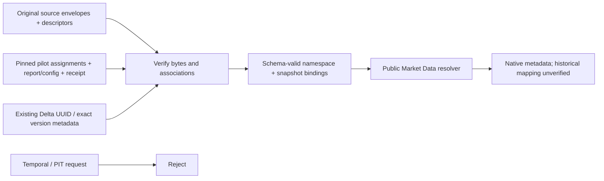

# Native identity admission for a pinned verification snapshot

Change surface: product-plane. Solution Intent: staged.
Scope: the user's minimum next step, SBER / IMOEX / SRZ6 native metadata admission.
Full bars/L0/L1/L2 adapters, caches, PIT and production admission remain pending.
The [owning decision](../../architecture/product-plane/market-identity.md#native-snapshot-identity-admission)
records the explicit contract amendment, alternatives and rollback.

## Boundary



Source verification:
`product_plane.data_plane.moex.snapshot_identity.admit_native_snapshot`.
Public consumer:
`product_plane.data_plane.identity.resolve_snapshot_identity`, with
`SnapshotIdentitySelector.from_payload`. Schemas and relational meaning remain
in Contracts; the typed envelope does not restate their fields.

The pure consumer accepts trusted admitted inputs. It verifies schemas, namespace
fingerprint and exact selector/pin equality; it does not re-read source files.
Use the source-backed constructor before treating bindings as admitted evidence.
Historical bars may later be read retrospectively from the selected snapshot;
this does not establish historical mapping availability or PIT.

| Request | Existing source evidence | Snapshot match | Result |
| --- | --- | --- | --- |
| SBER native | moex_iss / MOEX / stock / shares / TQBR; common_share, ISIN RU0009029540, issuer 484 | Exact source/report/config/assignment/namespace and table pins | Existing pilot instrument assignment; base equity |
| IMOEX native | moex_iss / MOEX / stock / index / SNDX; stock_index, currency RUB | Same complete pin boundary | Base reference index; execution false, economics not_applicable |
| SRZ6 native | moex_iss / MOEX / futures / forts / RFUD; ASSETCODE SBRF, issuer 484, LOTSIZE 100 | Same complete pin boundary; distinct instrument | Derivative on the reviewed ordinary-share underlying; UTC expiry/complete specification unknown |
| Historical/PIT or CF | Insufficient temporal/scope facts | No compatible selector | Fail closed; no fallback or reconstruction |

The metadata constructor has no bar predicate or projection yet. These will
belong to the later bounded Market/Research readers, after Q/recipes are sourced.
No canonical series/family/product ID is introduced. Legacy source descriptors
and contract IDs occur only inside the explicit compatibility evidence boundary.

## Real input pins

Original root (read only):
`D:/CodexHome/worktrees/moex-multi-asset-pilot/trading advisor 3000/.tmp/moex-multi-asset-pilot/full`.
Namespace adoption: `ta3000:pilot:identity-v2-r7-20261031`. Existing pilot IDs are
adopted explicitly; no IDs or CF scopes are generated or copied wholesale.

| Input | Original relative path | SHA256 |
| --- | --- | --- |
| Source manifest | alltf-20261027/source/manifest.json | 71edcd73adfed97592b7263b2ae6b1dc39b13d4f2708c7b205fb2f19809b191a |
| Descriptors | alltf-20261027/source/series.jsonl | 03625b065a337f9d4c785a1de67619aadf616dfb228a4ab75b6021d34f763217 |
| Assignments | identity-v2-r7-20261031/proofs/identity-registry.json | 7bc9dca533e94d78a5c4778027e8adca4ceb5f3f2db1dd740626e15ca1e18507 |
| Accepted verification report | identity-v2-r7-20261031/proofs/identity-v2-inventory.json | aa1646114f254e4b990086d92cfbbb30133e84faefed968ba777b6728027ac4e |
| Invocation/root binding | identity-v2-r7-20261031/proofs/native-invocation-20261031-identity-v2-r7.json | 841be4045291543f63143e1522a6a885f1af7444565d821bed922dc2578c693c |

Assignment version: `economic-instrument-mapping.v2`. Selected source config ID:
`CTX:cb0457852c3021eaaa249d67953476d19e76e7c5a2a4ec95a623dee124feb7d3`.
Configuration SHA hashes exact original context_json UTF-8 bytes, no newline.
Namespace fingerprint hashes sorted compact UTF-8 JSON. Source file hashes cover
original bytes. Raw payload hash uses the acquisition producer's sorted JSON,
default separators, ensure_ascii=False, allow_nan=False and trailing newline.

Original report table ref remains
`/workspace/.tmp/moex-multi-asset-pilot/full/alltf-20261027/data/analytical_bars.delta`,
version `0`. The pinned invocation maps it to the r7 host output root;
physical table UUID: `942752c1-9c76-4a46-b8f8-fe06132bbaf8`.
No path, UUID, Delta version, manifest or pointer is rewritten.

The three metadata request paths are manifest-relative and explicitly supplied,
not discovered by guessing ticker prefixes:

| Instrument | Pilot instrument_id | Metadata request basename under raw_requests/ |
| --- | --- | --- |
| SBER | INSTR:34d0559d-eed2-5050-ad8a-e820f9918654 | cafe852f7d4cfdb042602174ff8606f595a0d03f1c88ce7cdf10cbf75ce9869a.json |
| IMOEX | INSTR:51de05e1-382a-5394-8be6-d26117dee10b | 3e6583558e17fb2cd995e5a620ef7bf1c8b136c688e13f8892e9d1aab9630cb0.json |
| SRZ6 | INSTR:8cd2387b-888a-5bbf-ba44-3f17f1a1b952 | ea71c3c11428c539137f64e0e398de3cc7ce509671b2a043fb34749ecda0d93f.json |

## Evidence and limits

Task evidence directory:
`D:/CodexHome/visualizations/2026/10/31/01a19403-e9da-7011-bc5b-51fbe3ea3be9`.
`native-snapshot-admission.json` is the source-backed metadata package;
`snapshot-admission-roundtrip.py` and `.json` preserve the repeatable actual
constructor -> public consumer check and rejected-request evidence.
They write proof artifacts only; no market/research outputs are produced.

Focused checks:

```text
python -B -m pytest tests/product-plane/contracts/test_market_identity_v3.py tests/product-plane/contracts/test_snapshot_identity_admission.py -q
```

The old temporal resolver and legacy JSON fixtures remain compatible. Synthetic
tests prove specified rejection and metadata invariants; the real proof verifies
source associations and physical metadata pins. Neither proves bar value/type/
NULL preservation, row grain, joins, caches or a real old-reader snapshot roundtrip.
Those remain the separate stage-2 read-slice work. No writer migration, ingestion,
compute, execution or production readiness follows from metadata admission.

Rollback: remove this opt-in admission route/use previous consumer. No data repair.
