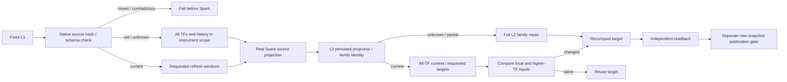

# MTF source projection delivery

Change surface: product-plane. Spark owns the L0/L1 join and source-frame
projection/write; Delta and Arrow own physical readback and native distinct.
Python derives declared dependencies and orchestrates invalidation. L1 indicator
calculation and the other 94 core L2 output definitions stay unchanged.

The core derived profile declares 24 MTF outputs. Its source projection omitted
`adx_14`, although the MTF builder requires all four carried columns. An executed
source snapshot could therefore omit ADX and silently produce NULL MTF values.
The dependency helper now includes every source column named by declared MTF
outputs, including ADX. Source projection hashing uses the resulting column set.

Before Spark starts or refresh windows apply, inspect native distinct projection
hashes across the originally declared dataset/contour/indicator-set/instruments,
including all timeframes and historical rows. Empty declared instrument scope means
the entire dataset; refresh-window instruments cannot narrow this contract check.
A mixed hash set, including a known hash plus NULL, fails closed. One old/unknown hash or an empty legacy scope requires full
source refresh for those instruments across all timeframes. Date windows and
requested timeframe restrictions cannot retain the old projection. A source with
the expected hash but a missing declared value column also fails closed. A fresh
source build and a matching hash retain the existing requested scope behavior.

The L2 owner persists two nullable, reserved metadata strings:
`source_indicator_columns_hash` identifies the projected columns;
`mtf_source_family_hash` identifies each target's consumed higher-TF inputs.
Old/unknown projection identity, unknown family identity or mixed identities
inside one L2 partition require full repair across the original instrument scope
and all timeframes. Different valid hashes between target partitions are normal.
Also compare observed physical partition keys/counts against all-TF source
coverage before selecting target TFs. Stored `row_count` is not physical proof:
a failed append can advertise a full partition while writing only half of it.
Requested series mode remains isolated when contract and continuous-front rows
coexist. Missing/incomplete coverage forces full family repair.
This survives a source commit followed by an L2 failure: narrow retry repairs all
L2 families even though the source already has the current projection.

Keep all source timeframes as context; filter requested target timeframes only
when selecting outputs. The family fingerprint uses native pandas hashing of
loaded source-close times, numeric carried values and effective per-column usage
eligibility. It follows actual daily session-close semantics and ignores global
commit/creation metadata. A higher-TF-only input revision therefore invalidates
its dependent lower target even with unchanged lower L1. A missing source TF,
empty dependency and present warmup NULL have stable, distinct identities.
Reuse and column-only extension require both local and family inputs to match.

All existing L1 values are inputs; L1 is neither recalculated nor zero-filled.
NULL warmup values, short history and absent higher-timeframe series retain their
normal meaning. Compatible daily source refreshes retain requested windows;
ordinary L2 target scope remains explicit. Projection recovery expands L2 scope.

## Staged execution order

1. Review and merge this dependency correction independently of storage-layout,
   snapshot-reader/publication and OOM writer groups.
2. Keep the prior research snapshot, its manifest and Delta versions immutable.
   Record the old MTF omission as a known defect; its previous PASS is not a
   correction or primary-promotion proof.
3. On the composed candidate runtime, refresh source frames and affected L2
   families from the already accepted L1. The changed projection hash forces the
   historical correction before tail-window optimization. Do not recalculate L1
   without another independently established reason.
4. Independently verify source ADX against L1 by business key, all 39 applicable
   target series, causal source-close/asof behavior, unchanged other 94 L2 outputs,
   L1 pins, physical partition layout and new provenance.
5. Publish a new research snapshot only through the separately delivered pinned
   manifest/publication route. Full fresh composed native validation and primary
   promotion remain separate gates.

## Validation contract

`tests/product-plane/unit/test_mtf_source_projection_contract.py` characterizes
three failures on unchanged merged main `25b84256`: ADX absent from declared
source dependencies, mixed old/new hashes, and old/NULL hashes starting Spark.
Native Delta/Arrow fixtures additionally cover old/empty/NULL projection hashes,
scoped predicates, a current-hash/schema contradiction, missing L1 declared
columns, short warmup, and an absent higher timeframe. Recovery contract tests
were written before implementation (eight failures). They cover legacy nullable
metadata, partially mixed identities, valid partition-specific identities, native
metadata scope, source-close/eligibility sensitivity and reserved row roundtrip.

`tests/product-plane/integration/test_mtf_source_projection_native.py` runs the
real source Spark job and the actual L2 owner. Its bounded L1 input is fixed: 128
rows per instrument over four timeframes (256 total), including eight legitimate
ADX warmup NULLs. Both instruments are declared; only A appears in the narrow
window, so historical instrument B must also be corrected. Only the
legacy dependency helper is substituted to reproduce the old defect. Restoring
the helper must correct all history despite a narrow 15m tail request, preserve
all 94 other outputs exactly, match source ADX to L1, preserve L1 ID/version/active
file bytes, and obey 1h/4h source-close and daily session-close boundaries. A
subsequent compatible refresh must stay narrow. Three focused followups prove:
source success followed by a failure after the first actual committed 16-row L2
append (advertised partition count32) then narrow retry repairs all eight target
partitions; a compatible local 15m ADX revision forces
actual recalculation while preserving full MTF context; a higher 1h ADX revision
changes lower causal MTF values, preserves other 94 outputs and reuses the other
instrument family. Fixture-only upstream edits happen before the owning job;
L1 ID/version/file bytes must stay fixed relative to each supplied input.
These fixtures prove code behavior; they cannot establish full-size OOM closure
or promote real data.

Native Spark execution uses the installed Spark/Delta runtime, local filesystem
fixture tables, and offline installed jars. The test may configure that actual
session factory for offline execution; it never replaces the source join,
projection, writer, reader, or L2 materializer. Serialize heavy Spark proof with
other promotion groups. Store actual run evidence outside tracked runtime code.

## Solution Intent

- Solution Class: staged
- Critical Contour: data-integration-closure
- Forbidden Shortcuts: old-projection reuse; silent missing declared column; synthetic upstream closure; whole frozen runtime copy
- Closure Evidence: focused native source-to-L2 regression and repository delivery gates; real corrected snapshot and full composed route remain pending
- Shortcut Waiver: none

## Self-review

Changed contract: a declared MTF output requires its projected source column;
projection identity must be uniform before window selection, and L2 records its
projection and consumed family identity. Forbidden behavior: reuse/partial repair
of an old source projection; accepting a contradictory current hash/schema;
narrow retry leaving legacy L2 after source success; lower MTF reuse after higher
inputs change; recomputation with lost higher-TF context. The unit and real
Spark/Delta regressions above catch those paths. Numerical L1 semantics and other L2 output definitions are unchanged.
Residual limits: fresh source construction with an explicit narrow TF scope
materializes only that source scope. Primary bootstrap must first create the
full declared source TF family; this patch does not change Dagster bootstrap
scope/defaults. Accepted source already has the full family; recovery tests start
from that full/old source. The existing source writer still deletes then appends;
atomic affected-range writes belong to the separate writer group. This delivery
has not written or promoted the accepted research dataset and does not close
full-size memory, default partition or pinned-publication acceptance.
