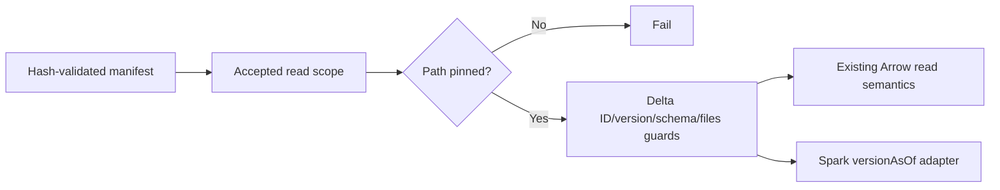

# Snapshot foundation delivery

Change surface: mixed. Product-plane snapshot/read behavior plus mandatory
Solution Intent metadata. This is a staged foundation; the primary dataset has
not been promoted by this delivery.

Delta owns table identity, exact versions, schema and active add actions. Arrow
owns existing projections, typed predicates, NULL/DNF and scanning. Python owns
canonical JSON hashes, local registry bookkeeping and accepted read scopes.

## Manifest and publication contract

`data_snapshot.v1` retains its original snapshot ID and canonical manifest hash
when loaded. Existing references without `active_files_sha256` remain supported
for reads with reduced evidence; they are never silently recaptured. New
`capture_table` references always include this optional v1 evidence: SHA-256 of
the sorted active Delta path/size pairs. It is not a Parquet content checksum.

Every read checks the declared table ID, exact Delta version and schema hash,
file presence and byte sizes. Declared partition columns, layout identity,
file count and active-set hash must match. Declared row count is checked when
all selected add actions provide native record counts; absent statistics do not
trigger a broad row scan during open. Capture can use native Arrow count when
record statistics are incomplete. Hash validity does not establish source QC.

`save_snapshot` creates an immutable registry entry; an identical retry is
idempotent, while different contents under the same ID fail. `publish_snapshot`
requires a saved manifest, nonempty PASS/PASS-NOOP QC, a local exclusive lock
and the caller's expected current snapshot ID. It checks pinned files under the
lock before atomic pointer replacement. An invalid pointer fails without a
fallback. The caller supplies the QC; owning-layer acceptance is a later stage.
No automatic stale-lock recovery is provided.

The saved manifest is reloaded and hash-validated under the owned lock before
CAS; a change from the pre-lock accepted hash fails. Cleanup affects only files
successfully acquired by this operation. If unlink also fails, the original
CAS/evidence/I/O exception keeps its identity and gains a cleanup note. Without
a primary error, cleanup failure propagates. A cleanup error after successful
pointer replacement means failed completion with a possibly advanced pointer;
read the registry before retrying. It does not promise the old pointer survived.

## Accepted reads

`snapshot_read_scope(manifest)` snapshots references into immutable private
state, restores the previous scope after nested exceptions and uses ContextVar
isolation. Explicitly propagate context when moving accepted reads to another
thread; a fresh thread has no accepted scope. Unscoped reads preserve existing
latest/factory behavior. Inside an accepted scope every requested path must be
registered, the factory is ignored, and capture/latest/writable escapes fail.
Existing writers are outside this read-only API; callers must not mutate tables
while using an accepted reader scope. Producer discovery requires a separate
explicit mutable boundary in a later delivery.



The eight existing Delta readers use this scope: `delta_table_version`,
`delta_table_columns`, `delta_table_column_value_counts`,
`count_delta_table_rows`, `iter_delta_table_row_batches`,
`read_delta_table_arrow`, `read_delta_table_rows` and `read_delta_table_frame`.
Limited rows retain their original bound. `read_spark_delta` validates the
reference and loads its absolute path with `versionAsOf`. Native Spark/Delta
fixture proof passed: owning append retained v0/v1 history, ID/schema and exact
old Spark/Arrow reads despite different Python/Hadoop working directories.

## Proof and readiness boundary

Run the native Delta/Arrow fixtures and existing PR180/runtime regressions:

```powershell
python -m pytest -q tests/product-plane/unit/test_data_snapshots.py tests/product-plane/unit/test_delta_missing_statistics.py tests/product-plane/unit/test_delta_runtime.py
```

They prove an old version after in-place append and schema evolution, all six
PR180 read modes, typed/NULL/DNF/no-statistics filters, metadata pins, replaced
or missing evidence rejection, legacy v1 hash/ID preservation, nested isolation,
immutable manifests and CAS failures. The Spark adapter recording test proves
API arguments only. A separate offline native Spark proof writes v0, appends v1,
reads latest two rows and scoped v0 one row through Spark/Arrow. Its measured
JVM maxMemory is 4 GiB; cgroup peak 891.2 MiB, OOM events zero. This is fixture
append history proof; real source history/VACUUM ownership remains deferred.

Deferred: real source/accepted snapshot verification, history retention and
VACUUM ownership, Windows/Linux competing-publisher proof, filesystem crash
durability, table transfers/content integrity, owning Data/research publication,
producer capture, decorators/loaders, layouts/overwrite hooks and composed
fresh-data promotion. `runtime_provenance` awaits its actual producer importer.

## Self-review

Changed contract: accepted reads select exactly declared native Delta versions;
new captures bind active path/size metadata. Forbidden behavior: latest fallback
inside an accepted scope, reference mutation, silent legacy recapture, pointer
ID aliases and replacement after CAS/evidence failure. These failures are caught
by `tests/product-plane/unit/test_data_snapshots.py`. Fixture PASS supports this
foundation only; full route, owning writers and primary readiness remain open.
